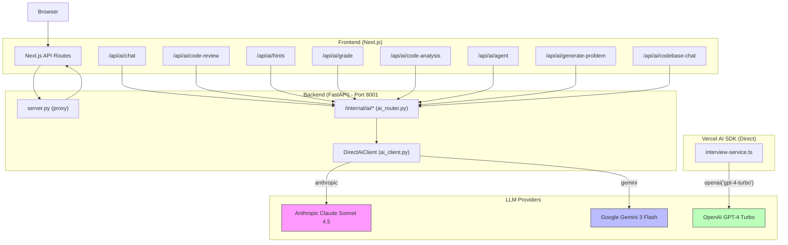

# AI Architecture

> **Auto-update:** This file is maintained by automated audit. When the AI system architecture changes, update this document to match.

## Overview

CodeSpectra uses a **dual-backend AI architecture** with four LLM providers routed through two independent AI subsystems that have **no coordination** between them.

---

## LLM Providers

| Provider | Model | Role | Access Method |
|----------|-------|------|--------------|
| Anthropic | Claude Sonnet 4.5 (`claude-sonnet-4-5-20250929`) | Reasoning | Anthropic API (direct) |
| Google | Gemini 3 Flash (`gemini-3-flash-preview`) | Fast / Vision | Google Generative AI API (direct) |
| OpenAI | GPT-4 Turbo (`gpt-4-turbo`) | Interview | Vercel AI SDK (direct) |
| Provider Keys | `ANTHROPIC_API_KEY` / `GEMINI_API_KEY` | Env or `x-{provider}-api-key` header | Routing key resolution |

---

## Model Registry

Defined in `backend/ai_router.py:37-41`:

```python
MODEL_REGISTRY: dict[str, tuple[str, str]] = {
    "reasoning": ("anthropic", "claude-sonnet-4-5-20250929"),
    "fast":       ("gemini",    "gemini-3-flash-preview"),
    "vision":     ("gemini",    "gemini-3-flash-preview"),
}
```

Three logical roles map to (provider, model) tuples. The `_build_chat()` function (`ai_router.py:65-120`) instantiates a `DirectAiClient` with the resolved provider and model, passing the provider key resolved from env or `x-{provider}-api-key` header.

---

## Architecture Flow



---

## Dual-Backend Architecture (Key Finding)

There are **two separate AI backends** with no coordination:

### 1. FastAPI DirectLLM Backend (`backend/ai_router.py` + `backend/ai_client.py`)

- Serviced by the FastAPI server on port 8001
- Exposes ten endpoints under `/internal/ai/*`
- Uses the `DirectAiClient` class which speaks directly to Anthropic and Gemini APIs via HTTP
- Authenticated by the proxy (only reachable in-cluster at `localhost:8001`)
- All calls resolve provider keys from `ANTHROPIC_API_KEY` / `GEMINI_API_KEY` env vars or matching request headers
- Source: `backend/ai_client.py:23-164`

### 2. Vercel AI SDK Backend (`frontend/lib/interview-service.ts`)

- Runs inside Next.js server-side (no FastAPI proxy)
- Uses `@ai-sdk/openai` and the `ai` package (`ai` v6.x, `@ai-sdk/openai` v3.x)
- Calls **OpenAI GPT-4 Turbo directly** — not through the Emergent gateway
- Handles interview question generation, answer analysis, and feedback
- Uses Zod schemas for structured output via `generateObject()`
- Source: `frontend/lib/interview-service.ts:1-253`

### Implications

- **No unified cost tracking**: The FastAPI path has no token accounting; the Vercel path has none either
- **No unified rate limiting**: Neither subsystem implements request throttling
- **Different API key management**: FastAPI uses one gateway key; Vercel SDK likely uses `OPENAI_API_KEY`
- **Different streaming protocols**: FastAPI emits SSE; Vercel AI SDK uses its own streaming abstraction

---

## Route Map: Frontend → Backend

| Frontend Route | Backend Endpoint | Model Role | Source File |
|---------------|-----------------|-----------|-------------|
| `POST /api/ai/chat` | `POST /internal/ai/chat` | `reasoning` | `frontend/app/api/ai/chat/route.ts` |
| `POST /api/ai/agent` | `POST /internal/ai/agent` | `reasoning` | `frontend/app/api/ai/agent/route.ts` |
| `POST /api/ai/hints` | `POST /internal/ai/hints` | `fast` | `frontend/app/api/ai/hints/route.ts` |
| `POST /api/ai/code-review` | `POST /internal/ai/code-review` | `reasoning` | `frontend/app/api/ai/code-review/route.ts` |
| `POST /api/ai/code-analysis` | `POST /internal/ai/code-analysis` | `fast` | `frontend/app/api/ai/code-analysis/route.ts` |
| `POST /api/ai/grade` | `POST /internal/ai/grade` | `reasoning` | `frontend/app/api/ai/grade/route.ts` |
| `POST /api/ai/generate-problem` | `POST /internal/ai/generate-problem` | `reasoning` | `frontend/app/api/ai/generate-problem/route.ts` |
| `POST /api/ai/codebase-chat` | `POST /internal/ai/complete` | `reasoning` | `frontend/app/api/ai/codebase-chat/route.ts` |
| (Direct SDK) | — | `gpt-4-turbo` | `frontend/lib/interview-service.ts` |

---

## Key Findings

1. **Two disjoint AI backends** with no shared state, rate limiting, or cost tracking.
2. **No rate limiting on any AI endpoint** — every request fires directly to the LLM provider.
3. **Model strings are hardcoded** in `MODEL_REGISTRY` — changing a model requires a full redeployment.
4. **Vision support is brittle** — `identity-verify` has a fallback path when `ImageContent` import fails.
5. **Agent loop is naive** — a simple `for` loop with no tool-use, memory, or state graph.
6. **Emergent LLM key is a single point of failure** — all FastAPI AI calls share one API key; if it's missing, every endpoint returns 500.

---

## References

- `backend/ai_router.py` — Internal AI router (10 endpoints)
- `backend/ai_client.py` — Direct LLM client (Anthropic + Gemini)
- `frontend/lib/ai/backend.ts` — TypeScript client wrapper for FastAPI
- `frontend/lib/interview-service.ts` — Vercel AI SDK interview service
- `frontend/package.json` — Dependencies: `ai@^6.0.162`, `@ai-sdk/openai@^3.0.53`
- `backend/requirements.txt` — Dependencies: `fastapi`, `httpx`, `pydantic`
- `backend/server.py` — FastAPI proxy + AI router mount
