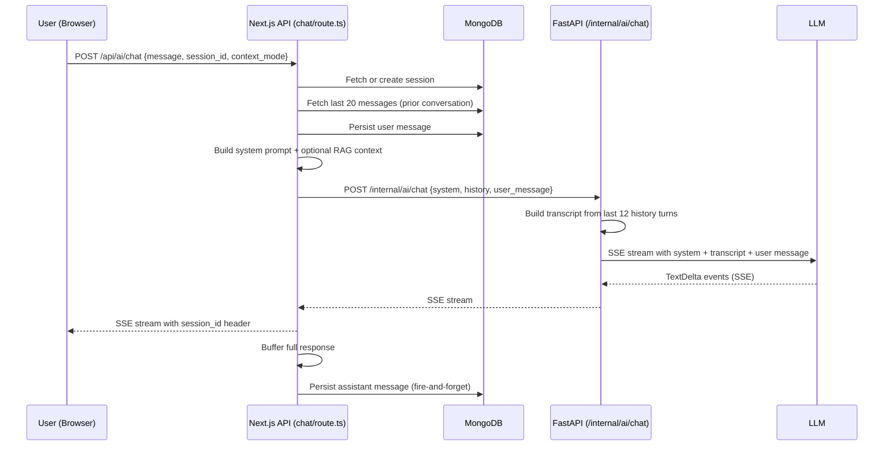
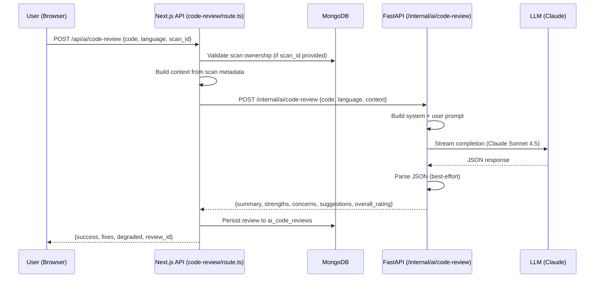
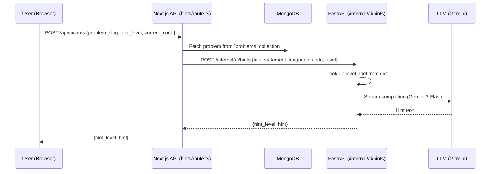
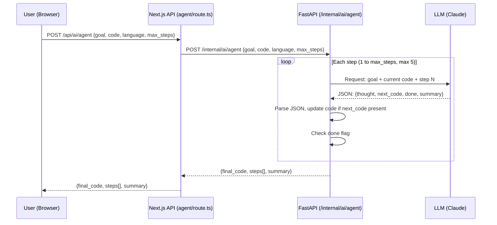
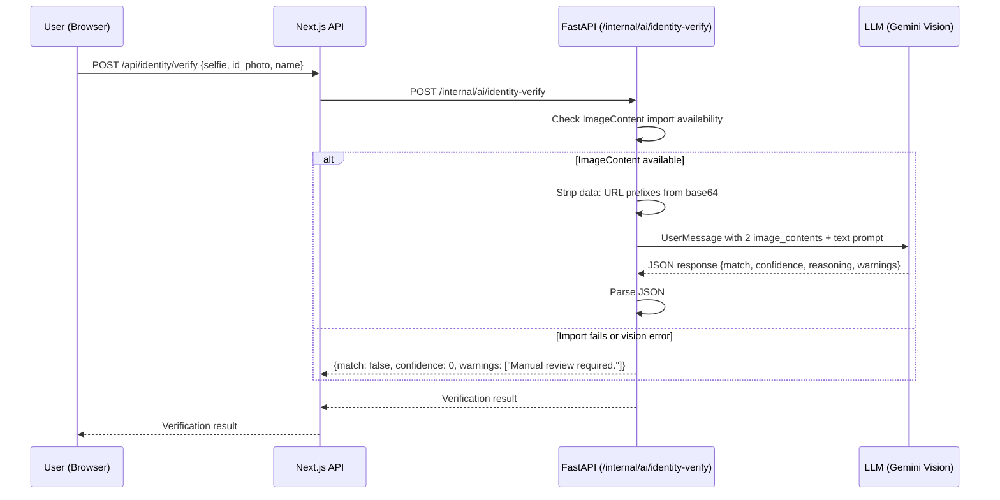

# Prompt Pipeline

> **Auto-update:** This file is maintained by automated audit. When prompt templates change, update this document to match.

All prompts are constructed server-side — either in the Next.js API route handler or in the FastAPI `ai_router.py`. The frontend never constructs prompts directly.

---

## 1. Chat Pipeline

**Source:** `frontend/app/api/ai/chat/route.ts:83-98` → `backend/ai_router.py:86-122`



### System Prompt

```
You are 'Ask CodeSpectra', an expert AI coding assistant embedded in the
CodeSpectra platform. You help developers with: code reviews, debugging,
explaining algorithms, suggesting refactors, and walking through their
scans and submissions. Be concise, practical, and ALWAYS use fenced code
blocks for code. When context about the user's scans, submissions or the
problem they are viewing is provided in the system message, ground your
answer in that context.
```

### RAG Context (when `context_mode='rag'`)

Appended to system prompt as:

```
USER'S RECENT CODE SCANS (most recent first):
Scan #1 (<scan_type>, <language>, <created_at>):
<code_snippet[:1200]>
---
Scan #2 ...
```

Pulled from `code_scans` collection, limited to 5 most recent scans per user (`chat/route.ts:187-205`).

### Current Scan Context (when `context_mode='current_scan'`)

```
USER IS CURRENTLY VIEWING THIS SCAN:
Language: <language>
Code:
```<language>
<code_snippet[:4000]>
```
```

### Prior Conversation Injection

Up to 12 turns (last 12 history entries) are serialized into the system message as:

```
Prior conversation transcript:
USER: <content>
ASSISTANT: <content>
...
```

Source: `ai_router.py:96-100`

---

## 2. Code Review Pipeline

**Source:** `frontend/app/api/ai/code-review/route.ts:41-49` → `backend/ai_router.py:231-254`



### System Prompt

```
You are a senior staff engineer doing a strict but constructive code review.
Return JSON ONLY with keys: summary (string), strengths (string[]),
concerns (array of {severity:'critical'|'major'|'minor', title, detail,
line?:number}), suggestions (string[]), overall_rating (1-10).
```

### User Prompt Template

```
Language: <language>
Context: <scan context or 'n/a'>

Code:
```<language>
<code[:12000]>
```

Return ONLY a single JSON object — no prose, no markdown fences.
```

---

## 3. Hints Pipeline

**Source:** `frontend/app/api/ai/hints/route.ts:32-41` → `backend/ai_router.py:193-220`



### System Prompt

```
You are a coding interview coach. Produce progressive hints for a coding
problem WITHOUT spoiling the solution before the requested hint level.
```

### Hint Level Briefs

| Level | Description |
|-------|-------------|
| 1 | A SHORT non-spoiler nudge focused on the right data structure or insight — no algorithm name, no code, max 2 sentences. |
| 2 | The high-level APPROACH — what algorithm/pattern fits, time/space complexity. No code yet. |
| 3 | PSEUDO-CODE only. No real implementation. ~10 lines. |
| 4 | A complete working solution in the requested language with brief inline comments. |

### User Prompt Template

```
Problem title: <title>

Problem statement:
<statement>

Language: <language>
Candidate's current code:
```
<current_code[:4000]>
```

Return ONLY: <level_brief>
```

---

## 4. Agent Pipeline

**Source:** `frontend/app/api/ai/agent/route.ts:27-33` → `backend/ai_router.py:489-526`



### System Prompt

```
You are an autonomous code-fixing agent. You will be called multiple times
in a loop. Each call: 1) READ the goal + current code 2) IDENTIFY the single
highest-impact change 3) APPLY it and return JSON ONLY: { thought: string,
next_code: string, done: boolean, summary: string }. When you are satisfied
set done:true.
```

### User Prompt Template

```
GOAL: <goal>

LANGUAGE: <language>

CURRENT CODE:
```
<code[:8000]>
```

Step <N>/<max_steps>. Return ONLY one JSON object.
```

### Agent Loop Characteristics

- Max steps: `max(1, min(req.max_steps, 5))` — clamped to [1, 5]
- No tool-use — the agent only rewrites code
- No persistent memory between calls besides the code itself
- 50ms sleep between iterations (`asyncio.sleep(0.05)`)
- If `next_code` is empty strings, the previous code is retained

---

## 5. Identity Verification Pipeline

**Source:** `backend/ai_router.py:416-470`



### System Prompt

```
You are an identity verification assistant. Compare the SELFIE and ID PHOTO
and respond with JSON ONLY: { match: boolean, confidence: number(0-100),
reasoning: string, warnings: string[] }. Be conservative: only return
match=true with confidence>=70.
```

### Image Handling

- Accepts `data:image/png;base64,...` data URLs
- Strips the `data:` prefix via `_strip_data_url()` (`ai_router.py:473-477`)
- Sends as `inlineData` (Gemini) or `image` content block (Anthropic)
- Fallback path exists if `ImageContent` cannot be imported

---

## 6. Other Pipelines

### Code Analysis (`/internal/ai/code-analysis`)

**System:** "You are an automated code analyzer..."
**Output keys:** `time_complexity`, `space_complexity`, `efficiency_score` (0-100), `edge_cases_covered[]`, `missing_edge_cases[]`, `readability_score` (0-100), `summary`
**Model:** `fast` (Gemini 3 Flash)

### Grading (`/internal/ai/grade`)

**System:** "You are an automated technical grader..."
**Output keys:** `scores{}`, `feedback{}`, `total`, `max`, `letter_grade` (A-F), `overall_feedback`
**Model:** `reasoning` (Claude Sonnet 4.5)
**Default rubric:** correctness:40, efficiency:20, readability:15, edge_cases:15, style:10

### Generate Problem (`/internal/ai/generate-problem`)

**System:** "You create production-quality coding interview problems..."
**Output keys:** `slug`, `title`, `difficulty`, `topics[]`, `statement_md`, `input_format`, `output_format`, `constraints`, `example_explanation`, `time_limit_ms`, `starter_code{}`, `test_cases[]`
**Model:** `reasoning` (Claude Sonnet 4.5)

### Skill Insights (`/internal/ai/skill-insights`)

**System:** "You are a skills coach..."
**Output keys:** `strengths[]`, `weak_topics[]`, `recommended_problems[]`, `speed_assessment`, `accuracy_assessment`, `growth_plan[]`
**Model:** `fast` (Gemini 3 Flash)

---

## JSON Parsing Strategy

All endpoints that request JSON use `_parse_json_response()` (`ai_router.py:155-180`):

1. Strip markdown code fences (```` ```json ````)
2. Find the first `{` or `[` character
3. Attempt `json.loads()` from that position
4. If that fails, progressively trim trailing characters
5. Return `None` if all parsing attempts fail

This is **best-effort only** — there is no Pydantic/Zod schema validation on LLM output. Malformed JSON results in empty objects `{}` at the call site.

---

## References

- `backend/ai_router.py` — All prompt templates
- `frontend/app/api/ai/chat/route.ts` — Chat with RAG context
- `frontend/app/api/ai/hints/route.ts` — Hint proxy
- `frontend/app/api/ai/code-review/route.ts` — Code review proxy
- `frontend/app/api/ai/agent/route.ts` — Agent proxy
- `frontend/app/api/ai/grade/route.ts` — Grade proxy with default rubric
- `frontend/app/api/ai/codebase-chat/route.ts` — Codebase chat with scan context
