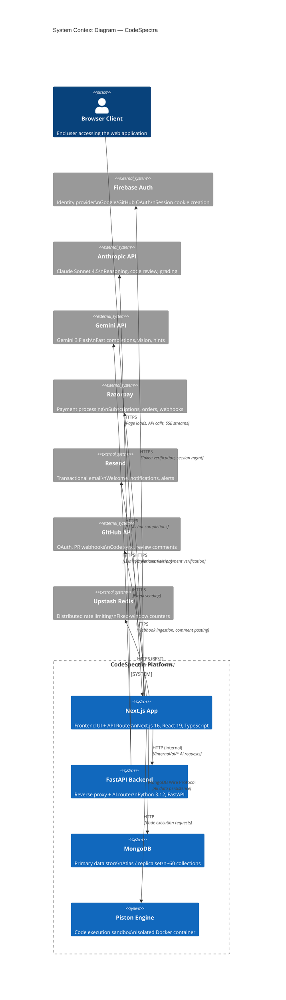

# High-Level Architecture

## System Context Diagram

## Component Descriptions

### Browser Client
The end user accesses CodeSpectra through a modern web browser. The application is a single-page application (SPA) built with Next.js 16 and React 19, featuring server-side rendering (SSR) for initial page loads and client-side navigation thereafter. The Monaco Editor (the same engine powering VS Code) is embedded for code editing. Communication with the server occurs via standard HTTPS for pages, JSON API calls, and Server-Sent Events (SSE) for streaming AI responses.

### Next.js App (Frontend + API Routes)
The core of the platform, serving three roles:

- **Pages Layer**: 50+ page components under `app/` covering the public marketing site, authentication flows, and the full dashboard (admin panels, coding arena, scanner, learning paths, leaderboard, billing, etc.). All pages use React Server Components (RSC) by default with client-side interactivity where needed.

- **API Routes Layer**: 55+ route handlers under `app/api/` implementing RESTful endpoints for every feature — authentication (`/api/auth/*`), AI services (`/api/ai/*`), billing (`/api/billing/*`), GitHub integration (`/api/github/*`), code execution (`/api/runtimes`, sub-route submissions), admin operations, and more. These run server-side in Node.js and directly access MongoDB, external APIs, and the FastAPI backend.

- **Server Library Layer**: Shared logic in `lib/` providing MongoDB connection management (`lib/mongodb.ts`), authentication helpers (`lib/route-auth.ts`), RBAC enforcement (`lib/rbac.ts`), AI backend client (`lib/ai/backend.ts`), code execution client (`lib/piston.ts`), rate limiting (`lib/upstash-rate-limit.ts`), and all repository functions (`lib/db/`).

### FastAPI Python Backend
A thin Python service running FastAPI on port 8001 with two primary responsibilities:

1. **Reverse Proxy**: Forwards all `/api/*` requests from external ingress to the Next.js app running on port 3000. This allows the deployment topology to route external traffic through a single public-facing service while keeping the Next.js internal server unexposed. The proxy strips hop-by-hop headers and manages `x-forwarded-host` for correct origin handling.

2. **AI Router**: Exposes `/internal/ai/*` endpoints (not accessible from outside the Docker network) that Next.js API routes call for LLM operations. These include chat streaming (`/internal/ai/chat`), completions (`/internal/ai/complete`), code review (`/internal/ai/code-review`), code analysis (`/internal/ai/code-analysis`), grading (`/internal/ai/grade`), smart hints (`/internal/ai/hints`), problem generation (`/internal/ai/generate-problem`), skill insights (`/internal/ai/skill-insights`), identity verification (`/internal/ai/identity-verify`), and the agentic fix loop (`/internal/ai/agent`).

### MongoDB
The primary and only data store, running on MongoDB Atlas (with a local fallback). The database `codespectra` contains approximately 60 collections organized by domain area:

- **User & Auth**: `user`, `session`, `account`, `verification`, `organization`, `member`, `invitation`
- **AI Features**: `ai_chat_sessions`, `ai_chat_messages`, `ai_code_reviews`, `ai_grades`, `ai_generated_problems`, `proctor_events`, `identity_verifications`, `skill_insights_cache`, `agent_runs`
- **Content**: `problems`, `submissions`, `challenges`, `tracks`, `exams`, `codeathons`, `certifications`
- **Scanner**: `code_scans`, `code_metrics`, `code_issues`, `suggested_fixes`, `quality_gates`, `scan_activities`
- **Billing**: `billing_orders`, `billing_payments`, `pricing_tiers`, `pricing_features`, `user_subscriptions`
- **Admin**: `platform_settings`, `roles`, `permissions`, `feature_flags`, `admin_audit_logs`, `workflows`
- **Other**: `notifications`, `notification_preferences`, `support_tickets`, `web_vitals_events`, `leaderboard`, `xp_events`, `integrations`, `github_tokens`, `github_scan_queue`, `resumes`, `jobs`, `job_applications`, `qr_events`

MongoDB is accessed via the official `mongodb` Node.js driver (v7) with connection pooling (max 20), automatic primary/fallback URI support, and a global cached client singleton to survive serverless cold starts.

### Piston Code Execution Sandbox
An open-source code execution engine (ghcr.io/engineer-man/piston) running as a separate Docker container. It supports 40+ programming languages and executes user-submitted code in isolated containers with resource limits. CodeSpectra interacts with Piston via its REST API (`/api/v2/execute`, `/api/v2/runtimes`). If Piston is unreachable or misconfigured, the system falls back to a local subprocess executor for Python, JavaScript, TypeScript, and Bash.

### External Services

- **Firebase Auth**: Provides client-side identity verification. Users authenticate via email/password, Google OAuth, or GitHub OAuth through the Firebase SDK. The resulting ID token is exchanged server-side for a session cookie via `firebase-admin`.

- **Anthropic API**: Powers the "reasoning" model role using Claude Sonnet 4.5 for chatbot conversations, code review, grading, problem generation, and the agent loop. Accessed through the FastAPI AI router.

- **Gemini API**: Powers the "fast" model role using Gemini 3 Flash for quick completions, smart hints, code analysis, skill insights, and the "vision" role for identity verification (face comparison). Accessed through the FastAPI AI router.

- **Razorpay**: Primary payment processor for subscriptions and one-time orders. Orders are created server-side, payments are verified via HMAC-SHA256 signature, and webhooks handle `payment.captured`, `payment.failed`, and `refund.created` events.

- **Resend**: Transactional email service for welcome emails, password resets, notifications, and alerts. Credentials are configurable via platform settings in MongoDB or environment variables.

- **GitHub API**: Supports OAuth-based integration for syncing user repositories, receiving push/PR webhooks, posting AI review comments on pull requests, and scanning code from GitHub repositories. Webhook events are queued in `github_scan_queue` and processed by a background worker.

- **Upstash Redis**: Provides distributed rate limiting via HTTP REST API. Fixed-window counters are stored with keys like `codespectra:rl:generate-fixes:{key}:{bucket}`. Falls back to in-memory sliding window when Upstash is not configured or unavailable.
