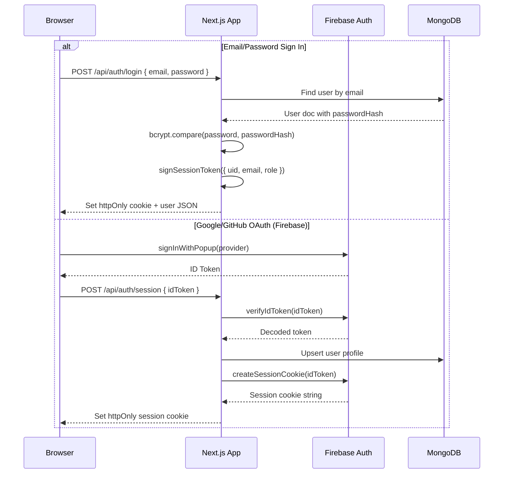

# System Architecture

> **Auto-Generated**: Internal Engineering documentation.

## Container Diagram

```mermaid
C4Container
  title Container Diagram — CodeSpectra

  Person(browser, "Browser", "End user")

  System_Boundary(nextjs, "Next.js 16 Application") {
    Container(pages, "Pages", "React 19, TypeScript", "Public pages, auth flows,\ndashboard (50+ routes)")
    Container(api_routes, "API Routes", "Next.js Route Handlers", "55+ REST endpoints\nServer-side execution")
    Container(lib, "Server Library", "TypeScript", "MongoDB repos, auth helpers,\nRBAC, rate limiting, AI client")
  }

  System_Boundary(fastapi, "FastAPI Backend") {
    Container(proxy, "Reverse Proxy", "Python 3.12, FastAPI", "Forwards /api/* to Next.js\nStrips hop-by-hop headers")
    Container(ai_router, "AI Router", "Python, FastAPI", "/internal/ai/* endpoints\nChat, review, grade, hints, agent")
    Container(ai_client, "AI Client", "Python, httpx", "Streaming LLM calls to\nAnthropic & Gemini APIs")
  }

  System_Boundary(mongo, "MongoDB Atlas") {
    ContainerDb(users_col, "user", "Collection")
    ContainerDb(sessions_col, "session", "Collection")
    ContainerDb(problems_col, "problems", "Collection")
    ContainerDb(submissions_col, "submissions", "Collection")
    ContainerDb(scans_col, "code_scans", "Collection")
    ContainerDb(chat_col, "ai_chat_sessions", "Collection")
    ContainerDb(billing_col, "billing_orders", "Collection")
    ContainerDb(roles_col, "roles/permissions", "Collection")
    ContainerDb(other_cols, "50+ more collections", "")
  }

  ContainerDb(piston_engine, "Piston", "Docker Container", "Isolated code execution\n40+ languages")

  Rel(browser, pages, "HTTPS", "Page loads, navigation")
  Rel(browser, api_routes, "HTTPS", "JSON API, SSE streams")
  Rel(api_routes, lib, "Imports", "Shared utilities")
  Rel(api_routes, proxy, "HTTP", "/api/* forwarded")
  Rel(proxy, api_routes, "HTTP", "Proxied to :3000")
  Rel(api_routes, ai_router, "HTTP (internal)", "/internal/ai/*")
  Rel(ai_router, ai_client, "Calls", "Streaming requests")
  Rel(ai_client, anthropic, "HTTPS", "Claude API")
  Rel(ai_client, gemini, "HTTPS", "Gemini API")
  Rel(api_routes, mongo, "MongoDB Wire Protocol", "CRUD operations")
  Rel(api_routes, piston_engine, "HTTP", "/api/v2/execute")
```

## Request Flow

### External Traffic Path

```
Internet
   │
   ▼
┌──────────────┐
│  FastAPI      │  Port 8001 (public ingress)
│  Reverse Proxy│
└──────┬───────┘
       │  proxies /api/* → localhost:3000
       ▼
┌──────────────┐
│  Next.js App  │  Port 3000 (internal only)
│  API Routes   │
└──────┬───────┘
       │
       ▼
┌──────────────┐
│  MongoDB      │
│  collections  │
└──────────────┘
```

The Kubernetes/Cloudflare ingress forwards `/api/*` to the FastAPI backend on port 8001. FastAPI receives the request and proxies it to the Next.js app running on port 3000. This two-tier architecture ensures the Next.js app is never directly exposed to external traffic; all requests flow through the FastAPI proxy.

### Internal AI Request Path

```
Next.js API Route
       │
       │  POST http://localhost:8001/internal/ai/chat
       ▼
┌──────────────┐
│  FastAPI      │
│  AI Router    │
└──────┬───────┘
       │
       ▼
┌──────────────┐
│  AI Client    │
│  (httpx)      │
└──────┬───────┘
       │
       ├──→ Anthropic API (Claude Sonnet 4.5)
       └──→ Gemini API (Gemini 3 Flash)
```

Next.js API routes call the FastAPI AI router over the internal Docker network. The AI router builds the appropriate LLM client based on the `model_role` parameter (`reasoning` → Anthropic/Claude, `fast` → Gemini) and streams the response back as Server-Sent Events.

## Authentication Flow



## File Structure

```
codespectra/
├── frontend/                          # Next.js 16 application
│   ├── app/                           # App Router directory
│   │   ├── page.tsx                   # Landing page
│   │   ├── layout.tsx                 # Root layout
│   │   ├── globals.css                # Global styles
│   │   ├── auth/                      # Auth pages (login, signup)
│   │   ├── dashboard/                 # Main dashboard (30+ routes)
│   │   │   ├── admin/                 # Superadmin area (20+ routes)
│   │   │   ├── arena/                 # Coding challenges
│   │   │   ├── scanner/               # Code scanner
│   │   │   ├── problems/              # Problem-solving UI
│   │   │   ├── agent/                 # AI agent view
│   │   │   ├── learning/              # Learning paths
│   │   │   ├── skill-analytics/       # Developer skill insights
│   │   │   ├── identity-verify/       # ID verification
│   │   │   ├── billing/               # Subscriptions & payments
│   │   │   └── ...                    # 20+ more dashboards
│   │   ├── api/                       # API route handlers (55+)
│   │   │   ├── ai/                    # AI endpoints (9 sub-routes)
│   │   │   ├── auth/                  # Auth endpoints (5 sub-routes)
│   │   │   ├── billing/               # Billing endpoints (10 sub-routes)
│   │   │   ├── github/                # GitHub integration
│   │   │   ├── admin/                 # Admin operations
│   │   │   └── ...                    # 40+ more API routes
│   │   ├── setup/                     # Demo setup flow
│   │   └── ...                        # Public pages (pricing, docs, etc.)
│   │
│   ├── components/                    # React components
│   │   ├── ui/                        # shadcn/ui primitives (50+)
│   │   ├── ai/                        # AI widgets (chat, review, hints)
│   │   ├── auth/                      # Auth components
│   │   ├── dashboard/                 # Dashboard components
│   │   ├── scanner/                   # Scanner components
│   │   ├── workflows/                 # Workflow builder
│   │   ├── providers.tsx              # Client providers
│   │   └── theme-provider.tsx         # Theme system
│   │
│   ├── lib/                           # Server & shared utilities
│   │   ├── db/                        # MongoDB repositories (11 files)
│   │   │   ├── admin.ts               # User, roles, notifications
│   │   │   ├── ai.ts                  # Chat sessions, reviews, grades
│   │   │   ├── scans.ts               # Code scans & issues
│   │   │   ├── problems.ts            # Problems & submissions
│   │   │   ├── content.ts             # Codeathons, exams, jobs
│   │   │   └── misc.ts               # Quality gates, billing, flags
│   │   ├── ai/                        # AI backend client
│   │   ├── session.ts                 # JWT session management
│   │   ├── route-auth.ts              # API auth helpers
│   │   ├── rbac.ts                    # RBAC definitions
│   │   ├── page-permissions.ts        # Route→role mapping
│   │   ├── piston.ts                  # Piston code execution
│   │   ├── mongodb.ts                 # MongoDB connection
│   │   ├── upstash-rate-limit.ts      # Distributed rate limiting
│   │   ├── firebase.ts                # Firebase client config
│   │   ├── firebase-admin.ts          # Firebase admin SDK
│   │   ├── razorpay-server.ts         # Razorpay integration
│   │   ├── transactional-mail.ts      # Email (Resend + SendGrid)
│   │   └── ...                        # 40+ more modules
│   │
│   ├── hooks/                         # React hooks
│   ├── tests/                         # Test suites
│   ├── Dockerfile                     # Production container
│   ├── next.config.mjs                # Next.js configuration
│   ├── package.json                   # Dependencies
│   └── tsconfig.json                  # TypeScript configuration
│
├── backend/                           # FastAPI Python service
│   ├── server.py                      # Reverse proxy (FastAPI app)
│   ├── ai_router.py                   # AI endpoint definitions
│   ├── ai_client.py                   # LLM client (Anthropic + Gemini)
│   ├── requirements.txt               # Python dependencies
│   ├── Dockerfile                     # Production container
│   └── tests/                         # Python test suites
│
├── docs/                              # Documentation
│   ├── Architecture/                  # Architecture docs
│   ├── API/                           # API reference
│   ├── Database/                      # DB setup guides
│   └── ...
│
├── scripts/                           # Utility scripts
├── docker-compose.yml                 # Docker Compose topology
├── .env.docker                        # Docker environment template
└── AGENTS.md                          # Development conventions
```

## MongoDB Collections Index

The `codespectra` database contains approximately 60 collections organized by domain:

| Domain | Collections |
|--------|-------------|
| **Authentication** | `user`, `session`, `account`, `verification` |
| **Organization** | `organization`, `member`, `invitation` |
| **RBAC** | `roles`, `permissions`, `user_roles`, `organization_invitations` |
| **AI Chat** | `ai_chat_sessions`, `ai_chat_messages` |
| **AI Analysis** | `ai_code_reviews`, `ai_grades`, `ai_generated_problems`, `skill_insights_cache`, `agent_runs` |
| **Proctoring** | `proctor_events`, `identity_verifications` |
| **Content** | `problems`, `submissions`, `problem_languages`, `challenges`, `tracks`, `exams`, `codeathons` |
| **Scanner** | `code_scans`, `code_metrics`, `code_issues`, `suggested_fixes`, `quality_gates`, `scan_activities` |
| **Billing** | `billing_orders`, `billing_payments`, `pricing_tiers`, `pricing_features`, `user_subscriptions` |
| **Integrations** | `integrations`, `github_tokens`, `github_scan_queue`, `github_webhook_events` |
| **Platform** | `platform_settings`, `feature_flags`, `admin_audit_logs`, `web_vitals_events`, `workflows` |
| **Content (Phase 5)** | `codeathons`, `codeathon_registrations`, `exams`, `jobs`, `job_applications`, `resumes` |
| **Other** | `notifications`, `notification_preferences`, `support_tickets`, `leaderboard`, `xp_events`, `qr_events`, `code_review_comments`, `scan_comments`, `certifications`, `quality_ratings` |
