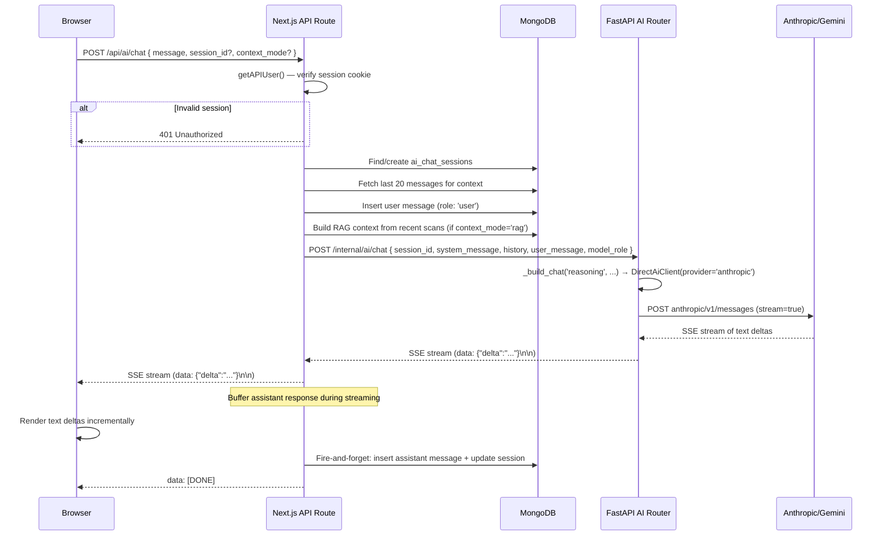
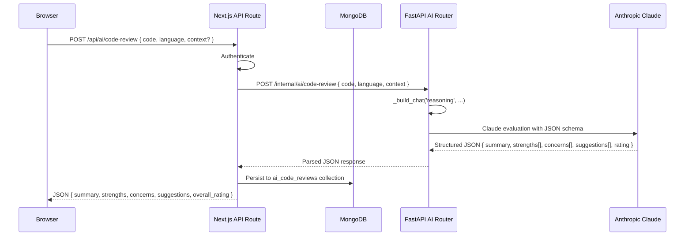
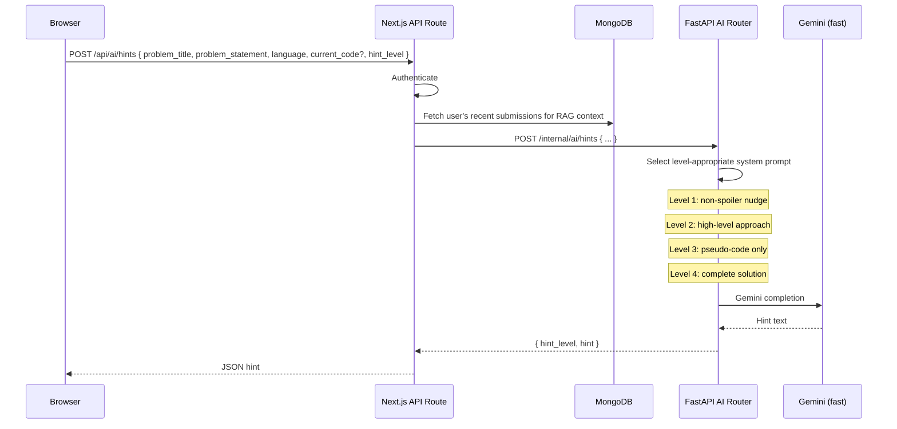

# AI Service Architecture

## LLM Provider Overview

CodeSpectra integrates four LLM providers through two access paths:

| Provider | Model | Role | Access Path | Use Cases |
|----------|-------|------|-------------|-----------|
| **Anthropic** | Claude Sonnet 4.5 (`claude-sonnet-4-5-20250929`) | `reasoning` | FastAPI → Anthropic API | Chat, code review, grading, problem generation, agent loop |
| **Gemini** | Gemini 3 Flash (`gemini-3-flash-preview`) | `fast` | FastAPI → Gemini API | Hints, code analysis, skill insights, quick completions |
| **Gemini** | Gemini 3 Flash | `vision` | FastAPI → Gemini API | Identity verification (selfie vs. ID photo comparison) |
| **OpenAI** | GPT-4o-mini | (chat) | Vercel AI SDK (`@ai-sdk/openai`) | Secondary chat completions via Vercel AI SDK |

Providers authenticate through `ANTHROPIC_API_KEY` / `GEMINI_API_KEY` env vars or matching `x-{provider}-api-key` request headers.

## Model Registry

Defined in `backend/ai_router.py:37-41`:

```python
MODEL_REGISTRY = {
    "reasoning": ("anthropic", "claude-sonnet-4-5-20250929"),
    "fast": ("gemini", "gemini-3-flash-preview"),
    "vision": ("gemini", "gemini-3-flash-preview"),
}
```

## Chat / SSE Flow



### Key Points

- Authentication is verified by the Next.js API route before any LLM call is made.
- The Next.js API route calls the FastAPI AI router over the internal Docker network (`http://localhost:8001/internal/ai/chat`).
- The AI client in FastAPI streams directly from the LLM provider using `httpx.AsyncClient.stream()`.
- The Next.js route buffers the assistant response while forwarding SSE chunks to the browser, then persists the complete assistant message to MongoDB asynchronously.
- The `history` array (last 12 messages per default) is prepended to the system message as a transcript, ensuring context is preserved across stateless server instances.

## Code Review Pipeline



The code review prompt instructs the LLM to act as a senior staff engineer and return a strict JSON object with specific keys: `summary` (string), `strengths` (string[]), `concerns` (array of `{severity, title, detail, line?}`), `suggestions` (string[]), and `overall_rating` (1-10). The response is parsed with a `_parse_json_response` helper that handles JSON code fences and malformed output gracefully.

## AI Agent Loop

```mermaid
sequenceDiagram
    participant Browser
    participant NextJS as Next.js API Route
    participant FastAPI as FastAPI AI Router
    participant LLM as Anthropic Claude

    Browser->>NextJS: POST /api/ai/agent { goal, code, language, max_steps }
    NextJS->>FastAPI: POST /internal/ai/agent { ... }
    Note over FastAPI: max_steps clamped to 1..5

    loop For each step (1..max_steps)
        FastAPI->>LLM: Evaluate: goal + current_code + step N
        LLM-->>FastAPI: JSON { thought, next_code, done, summary }
        FastAPI->>FastAPI: Record step in steps[]
        alt next_code provided
            FastAPI->>FastAPI: Update current_code
        end
        alt done == true
            break
        end
        FastAPI->>FastAPI: await asyncio.sleep(0.05)
    end

    FastAPI-->>NextJS: { final_code, steps[], summary }
    NextJS-->>Browser: JSON result
```

The agent loop is a simple multi-step reasoning cycle. At each step, the LLM receives the original goal, the current state of the code, and its step number. It must return a JSON object containing its reasoning (`thought`), the updated code (`next_code`), a completion flag (`done`), and a summary. The loop terminates when `done=true` or when `max_steps` is reached (whichever comes first).

## Smart Hints Flow



The hints system has four progressive levels that map to the user's `hint_level` parameter (1-4). Each level has a distinct system prompt instructing the LLM on how much detail to reveal. Level 1 is a short nudge without spoiling the algorithm; level 4 is a full working solution. The `fast` model (Gemini 3 Flash) is used for hints due to its lower latency.

## Identity Verification Flow (Gemini Vision)

```mermaid
sequenceDiagram
    participant Browser
    participant NextJS as Next.js API Route
    participant MongoDB
    participant FastAPI as FastAPI AI Router
    participant Gemini as Gemini Vision

    Browser->>Browser: Capture selfie via camera
    Browser->>NextJS: POST /api/ai/identity-verify { selfie_data_url, id_photo_data_url, candidate_name? }
    NextJS->>NextJS: Authenticate
    NextJS->>FastAPI: POST /internal/ai/identity-verify { ... }
    FastAPI->>FastAPI: _build_chat('vision', ...) → DirectAiClient(provider='gemini')
    FastAPI->>FastAPI: Strip data:image/...;base64, headers
    FastAPI->>FastAPI: Build UserMessage with image_contents[]
    FastAPI->>Gemini: POST gemini/v1beta/models/gemini-3-flash-preview:streamGenerateContent
    Note over FastAPI: Sends both images as inlineData parts
    Gemini-->>FastAPI: JSON { match, confidence, reasoning, warnings }
    alt Vision fails
        FastAPI-->>NextJS: Fallback: { match: false, confidence: 0, reasoning: "...", warnings: [...] }
    end
    FastAPI-->>NextJS: Parsed verification result
    NextJS->>MongoDB: Persist to identity_verifications collection
    NextJS-->>Browser: { match, confidence, reasoning, warnings }
```

The identity verification endpoint uses Gemini's vision capabilities to compare a live selfie against a government ID photo. Both images are sent as base64-encoded `inlineData` parts in a single Gemini API call. The LLM is instructed to be conservative, only returning `match=true` when confidence is >= 70. If the vision comparison is unavailable (e.g., provider limitation), the system returns a fallback response requesting manual review.

## API Endpoint Summary

All AI endpoints are mounted at `/internal/ai/*` on the FastAPI backend and called from Next.js API routes:

| Endpoint | Method | Model Role | Response | Description |
|----------|--------|------------|----------|-------------|
| `/chat` | POST | `reasoning` | SSE stream | Multi-turn chat with context |
| `/complete` | POST | `fast` | JSON | Single-turn completion |
| `/code-review` | POST | `reasoning` | JSON | Structured code review |
| `/code-analysis` | POST | `fast` | JSON | Auto-analysis on submission |
| `/grade` | POST | `reasoning` | JSON | Rubric-based grading |
| `/hints` | POST | `fast` | JSON | Progressive smart hints |
| `/generate-problem` | POST | `reasoning` | JSON | AI problem generation |
| `/skill-insights` | POST | `fast` | JSON | Developer skill analysis |
| `/identity-verify` | POST | `vision` | JSON | Selfie vs. ID comparison |
| `/agent` | POST | `reasoning` | JSON | Multi-step code fix agent |

## AI Client Architecture

The `ai_client.py` module implements the `DirectAiClient` class with two streaming implementations:

- **`_stream_anthropic`**: Calls the Anthropic Messages API (`/v1/messages`) with `stream: true`. Parses SSE `data:` lines looking for `content_block_delta` events with `text_delta` type. Supports image content via the `image` content block type.

- **`_stream_gemini`**: Calls the Gemini API (`/v1beta/models/{model}:streamGenerateContent`). Parses the streaming JSON response, extracting `text` from `candidates[0].content.parts[]`. Supports images via `inlineData` parts.

Both streams yield `TextDelta` events for content chunks and a final `StreamDone` event, providing a uniform interface for the AI router.
