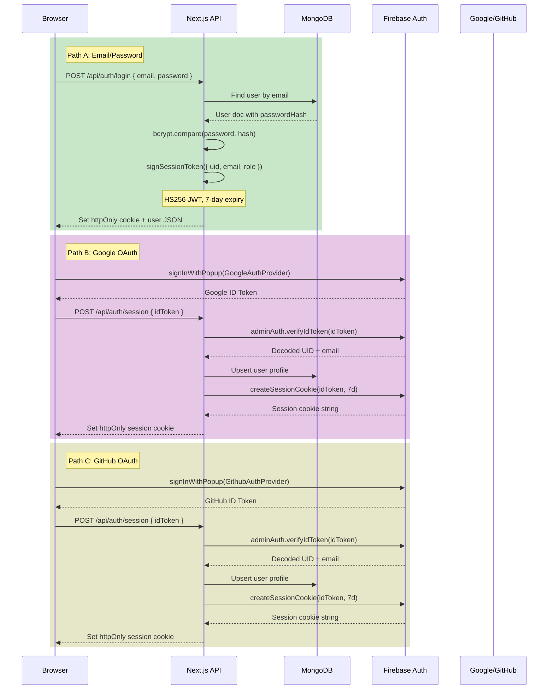
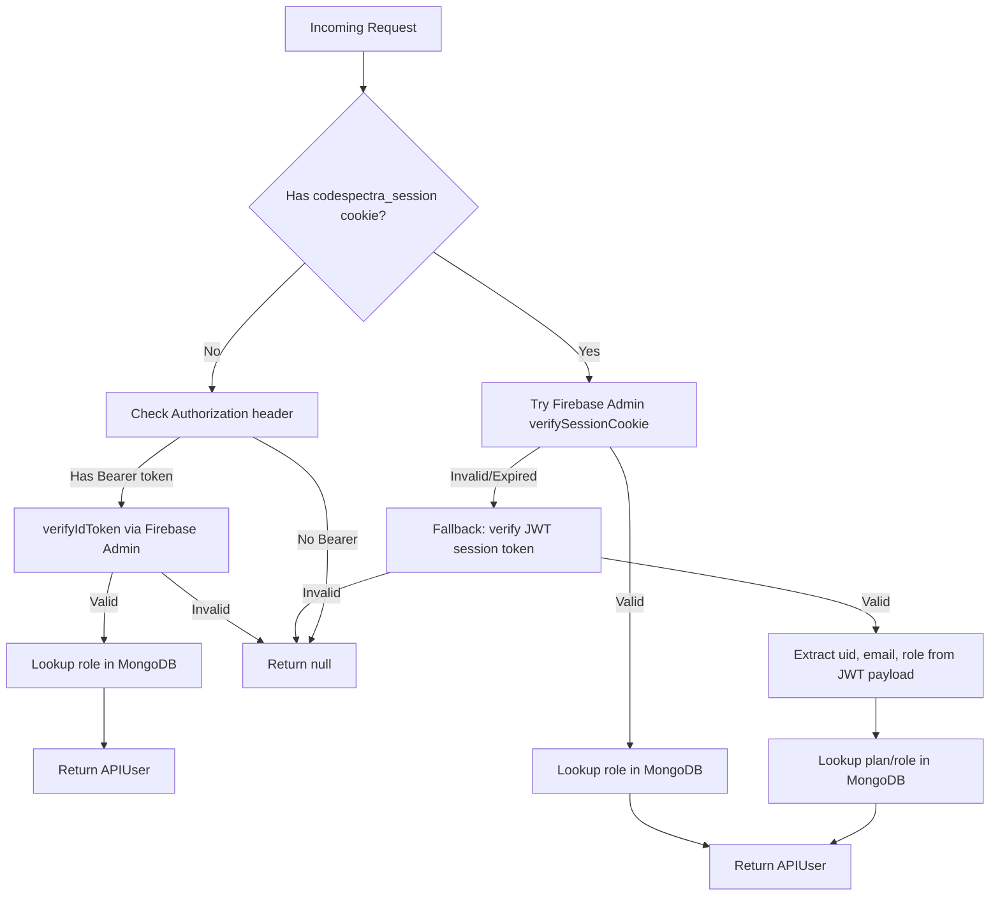
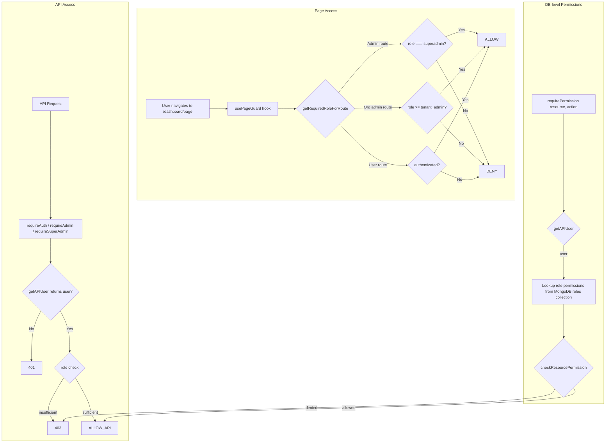
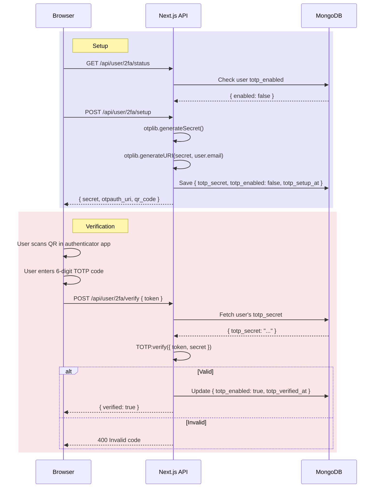

# Security Architecture

> **Auto-Generated**: Internal Engineering documentation.

## Authentication Flow

CodeSpectra supports three authentication paths, with session persistence managed via httpOnly cookies.



### Session Cookie Properties

| Property | Value |
|----------|-------|
| Name | `codespectra_session` |
| httpOnly | `true` (inaccessible to JavaScript) |
| secure | `true` in production |
| sameSite | `lax` (CSRF protection) |
| path | `/` |
| maxAge | 7 days (604,800 seconds) |
| Signing | Firebase session cookie OR HS256 JWT |

## Session Cookie Validation Chain



The `getAPIUser()` function in `lib/route-auth.ts` implements a three-tier validation strategy:

1. **Firebase session cookie** (primary): Uses `firebase-admin`'s `verifySessionCookie()` with `checkRevoked=true` for instant revocation support. If valid, returns user with role looked up from MongoDB.

2. **JWT session token** (fallback): If Firebase validation fails (e.g., Firebase is not configured), falls back to a manually signed HS256 JWT using the `jose` library. This supports email/password auth when Firebase is unavailable.

3. **Authorization header** (API fallback): If no cookie is present, checks for a `Bearer` token and verifies it as a Firebase ID token. This supports non-browser API clients.

## RBAC Authorization Flow



### Role Hierarchy

```
superadmin  →  tenant_admin  →  user
    ↑                ↑              ↑
 Platform        Organization    Individual
 Operator        Administrator   End User
```

- **superadmin**: Full access to all platform features, including user management, role configuration, platform settings, billing management, and system administration. 20+ admin routes.
- **tenant_admin**: Organization-level administrator for enterprise customers. Can manage team members and organization settings. Inherits all `user` access.
- **user**: Individual end user with access to problems, arena, scanner, learning, profile, billing, and other self-service features. 25+ user routes.

### Route → Role Mapping

Defined in `lib/page-permissions.ts` as three arrays:

| Array | Required Role | Example Routes |
|-------|---------------|----------------|
| `ADMIN_ONLY_ROUTES` | `superadmin` | `/dashboard/admin/*` (20 routes) |
| `TENANT_ADMIN_ROUTES` | `tenant_admin` | `/dashboard/admin/team`, `/dashboard/interviews/feedback` |
| `ALL_USER_ROUTES` | `user` | `/dashboard/arena`, `/dashboard/problems`, `/dashboard/scanner` |

### Multi-Layer Enforcement

RBAC is enforced at three independent layers:

1. **Client-side page guard** (`usePageGuard` hook): Checks the session cookie and compares the user's role against the required role for the route. Shows a loading spinner until the session resolves, then either renders the page or redirects.

2. **Server-side API guard** (`requireAuth`, `requireAdmin`, `requireSuperAdmin`): Every protected API route calls one of these functions, which validates the session cookie and checks the role before executing the handler. Returns 401 (unauthorized) or 403 (forbidden) on failure.

3. **Database permission check** (`requirePermission`): For granular resource-level access control, checks the user's role permissions from the MongoDB `roles` collection. Supports actions: `read`, `create`, `update`, `delete`, `manage`.

## Rate Limiting Architecture

```mermaid
flowchart LR
    subgraph "Request Flow"
        REQ[API Request] --> KEY[Generate rate limit key]
        KEY --> DECIDE{Upstash configured?}
    end

    subgraph "Upstash Path"
        DECIDE -->|Yes| UP[Upstash HTTP REST API]
        UP --> INCR[INCR codespectra:rl:{key}:{bucket}]
        INCR --> EXPIRE[EXPIRE key TTL]
        EXPIRE --> COUNT{Count > maxHits?}
        COUNT -->|No| OK
        COUNT -->|Yes| RETRY[Retry-After response]
    end

    subgraph "In-Memory Fallback"
        DECIDE -->|No| MEM[In-memory sliding window]
        MEM --> BUCKET[Prune expired timestamps]
        BUCKET --> CHECK{len(hits) >= max?}
        CHECK -->|No| PUSH[Push timestamp]
        PUSH --> OK
        CHECK -->|Yes| RETRY
    end
```

The rate limiting system uses a two-tier strategy:

1. **Upstash Redis (primary)**: When `UPSTASH_REDIS_REST_URL` and `UPSTASH_REDIS_REST_TOKEN` are configured, rate limit counters are stored in Upstash Redis via HTTP REST API. Keys follow the pattern `codespectra:rl:{feature}:{key}:{bucket}` where `bucket` is a wall-clock-aligned time window. Uses `INCR` + `EXPIRE` pipeline for atomicity.

2. **In-memory sliding window (fallback)**: When Upstash is not configured, falls back to an in-memory sliding window algorithm using a `Map<string, number[]>`. Timestamps older than the window are pruned on each check. This provides best-effort rate limiting per server instance.

The `clientLimiterKeyFromRequest` helper generates the rate limit key:
- For authenticated users: `u:{userId}`
- For anonymous requests: `ip:{client_ip}` (derived from `x-forwarded-for` or `x-real-ip` headers)

### Rate Limit Configuration

| Feature | Window | Auth Limit | Anon Limit |
|---------|--------|------------|------------|
| `generate-fixes` | 10 minutes | 24 requests | 10 requests |

## 2FA TOTP Flow



Two-factor authentication is implemented using the `otplib` library with TOTP (Time-based One-Time Password) algorithm. The setup flow generates a secret and an `otpauth://` URI that can be encoded as a QR code for scanning by authenticator apps. Verification uses `TOTP.verify()` with the stored secret. The TOTP secret is stored in the user's MongoDB document as `totp_secret`, with `totp_enabled` and `totp_verified_at` tracking the state. Disabling 2FA unsets these fields.

## Cookie Security

### Firebase Session Cookie

Created by `firebase-admin`'s `createSessionCookie()` with a 7-day expiry. Verified with `verifySessionCookie(cookie, checkRevoked=true)` for instant revocation support. Used as the primary session mechanism for OAuth-authenticated users.

### JWT Session Token (Fallback)

For email/password authentication (when Firebase is not the primary provider), a manually signed JWT is used:

```typescript
signSessionToken({ uid, email, role })
// HS256 algorithm, 7-day expiry, signed with SESSION_SECRET
```

Secret: loaded from `SESSION_SECRET` environment variable with a dev-only fallback string. The secret is encoded as `Uint8Array` for the `jose` library.

### Cookie Clearing

On logout, the session cookie is cleared by setting it to an empty string with `maxAge: 0`. Both the JWT fallback path and the Firebase session cookie path use the same cookie name (`codespectra_session`), ensuring mutual exclusivity.
