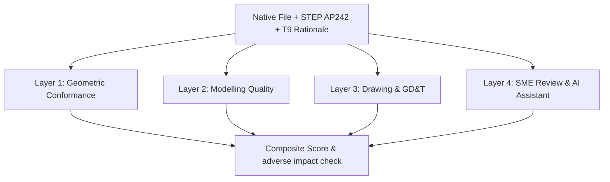

# Architecture Document 05: CAD & Engineering Assessment Module

**Author**: AXISS Group (Araxis Systems Inc. / AVKS AI) & CodeSpectra Core Architecture Team  
**Companion To**: Implementation Agenda and Requirements  
**Scope**: Requirements FR-41 through FR-92, Tasks T1–T9, Delivery Modes A–D, 4-Layer Scoring Engine, Add-ons A–J, and Integrity Controls.

---

## 1. Assessment Modalities (Tasks T1 – T9)

| Task Type | Competency Tested | Time | Automation | Deliverable | Target Experience |
| :--- | :--- | :--- | :--- | :--- | :--- |
| **T1. Part Modelling Task** | Feature-based modelling, parametric design intent | 30–60 min | High (Objective Geometry) | Native CAD + STEP AP242 | All Bands (0–6+ yrs) |
| **T2. Assembly & Mate Task** | Constraint logic, DOF, interference awareness | 30–45 min | High (Compute Mates/Clash) | Assembly File + Mate Tree | 2+ yrs Experience |
| **T3. GD&T & Drawing Task** | Manufacturing callouts, tolerancing (ISO/ASME) | 20–40 min | High (Parse PMI/Datums) | 2D Drawing (Native + PDF) | All Bands |
| **T4. DFM Critique** | Manufacturing defect detection, cost awareness | 15–25 min | High (Match Seeded Defects) | Annotated Defect Findings | All Bands |
| **T5. Model Repair & Edit** | Legacy CAD repair, editing existing feature trees | 20–40 min | High (Target Geometry) | Repaired Solid Model | 2+ yrs Experience |
| **T6. Engineering Change Order (ECO)** | Change discipline, downstream drawing updates | 25–40 min | Med-High | Revised Model + Drawing + Note | 3+ yrs Experience |
| **T7. Calculation & Sizing** | First-principles engineering (shafts, bolts, gears) | 20–30 min | High (Tolerance Bands) | Worked Math + Final Values | All Bands |
| **T8. Simulation & FEA Interpretation** | Analysis literacy, mesh artefact detection | 15–25 min | High (Objective QA) | Interpretation Responses | 2+ yrs Experience |
| **T9. Design Rationale / Viva** | Design intent communication, anti-cheat anchor | 10–15 min | Med (AI + SME Rubric) | Recorded / Written Rationale | **Mandatory Companion** |

---

## 2. Delivery Modes (A – D)

- **Mode A (Cloud CAD)**: Browser-based CAD (Onshape API). Zero install, full edit history.
- **Mode B (Candidate's Licensed CAD)**: Timed file upload (SolidWorks `.sldprt`, Inventor `.ipt`, Creo `.prt`, STEP AP242).
- **Mode C (Virtual Desktop VDI)**: Streamed workspace with pre-installed CAD software.
- **Mode D (Hybrid - Recommended)**: CAD-free pre-screens (T3, T4, T7, T8) $\rightarrow$ Mode B/C modelling for finalists.

---

## 3. Four-Layer Scoring Architecture

1. **Layer 1: Geometric Conformance** (Automated Objective):
   - Mass properties (volume, mass, COM, moments of inertia).
   - Bounding box, principal dimensions, Hausdorff distance shape heat map.
   - Hole positions, depths, thread callouts, minimum wall thickness.
2. **Layer 2: Modelling Quality** (Automated Feature Tree Analysis):
   - Sketch constraint ratio (% fully defined vs. under/over-defined).
   - Rebuild errors/warnings, rebuild time, dangling external references.
   - Parametric relations, patterns/mirrors vs. copy-paste geometry.
3. **Layer 3: Drawing & GD&T Conformance** (Automated PMI Parsing):
   - View completeness, datum schemes, feature control frames (ISO 1101 vs. ASME Y14.5).
   - Tolerance appropriateness vs. process capability.
4. **Layer 4: Engineering Judgement** (SME Review + AI Draft Assistant):
   - Side-by-side 3D viewer with deviation heat maps.
   - Feature tree diff and pre-populated Layer 1–3 scoring flags.

---

## 4. Integrity Controls

1. **Mandatory T9 Rationale**: Viva explanation of feature order and design intent.
2. **Parametric Brief Variation (Add-on A)**: Unique dimensions/load cases per candidate.
3. **File Metadata Forensics**: Author field, creation/modification timestamps, total edit time.
4. **Build History Verification**: Ensures submission is not an imported dumb STEP solid.
5. **Cross-Candidate Similarity**: Detects geometric and feature tree plagiarism.
6. **Human-in-the-Loop Review**: No candidate is rejected automatically without human review.

---

## 5. Module Requirements Traceability (FR-41 to FR-92)

- **FR-41 to FR-50**: Delivery & Environment (Modes A–D, 250MB limit, STEP AP242 paired export).
- **FR-51 to FR-59**: Brief & Reference Management (Seeded defects, starter files, ISO 1101 / ASME Y14.5).
- **FR-60 to FR-66**: Layer 1 Geometric Scoring (Hausdorff distance, COM, tolerance bands).
- **FR-67 to FR-75**: Layer 2 Modelling Quality Scoring (Sketch constraints %, rebuild time).
- **FR-76 to FR-83**: Layer 3 Drawing & GD&T Scoring (Feature control frames, semantic PMI).
- **FR-84 to FR-92**: Layer 4 SME Review Workflow (3D heat map viewer, feature tree diff, blind review).
