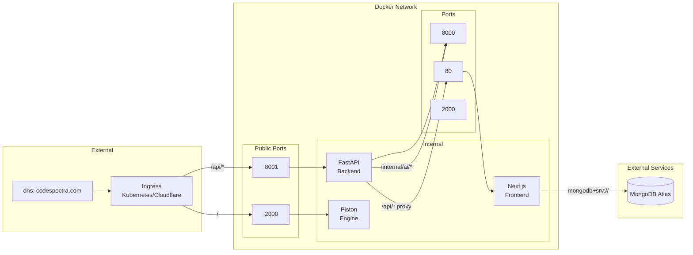
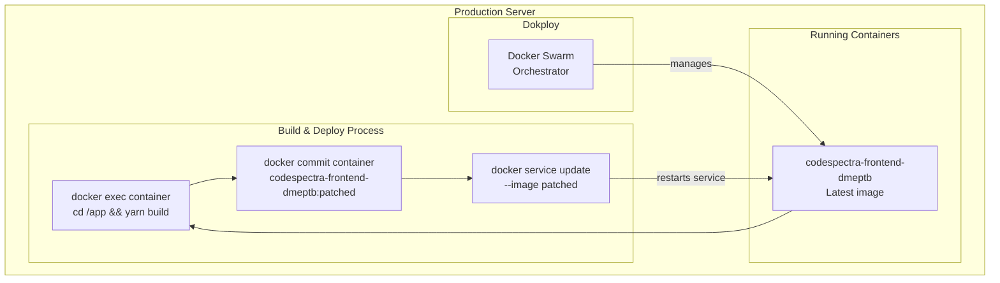
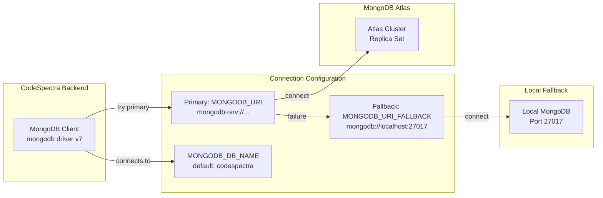

# Deployment Architecture

## Docker Compose Topology

```mermaid
graph TB
    subgraph "Docker Compose Network"
        subgraph "Service: frontend"
            FE[Next.js 16<br/>Port 80]
            FE_ENV[Environment:<br/>PISTON_URL=http://piston:2000/api/v2<br/>INTERNAL_BACKEND_URL=http://backend:8000<br/>NEXT_PUBLIC_FIREBASE_*]
        end

        subgraph "Service: backend"
            BE[FastAPI Python 3.12<br/>Port 8000]
            BE_ENV[Environment:<br/>NEXTJS_INTERNAL_URL=http://frontend:80<br/>ANTHROPIC_API_KEY<br/>GEMINI_API_KEY<br/>MONGODB_URI]
        end

        subgraph "Service: piston"
            PI[Piston Engine<br/>Port 2000<br/>privileged: true]
            PI_VOL[Volume: piston-data → /piston]
        end

        subgraph "External Services"
            MONGO[MongoDB Atlas<br/>mongodb+srv://...]
            ANTH[Anthropic API]
            GEM[Gemini API]
            RZ[Razorpay]
            RS[Resend]
            GH[GitHub API]
            UP[Upstash Redis]
        end
    end

    FE -->|HTTP /api/v2/execute| PI
    FE -->|HTTP /internal/ai/*| BE
    FE -->|MongoDB Wire Protocol| MONGO
    FE -->|HTTPS| RZ
    FE -->|HTTPS| RS
    FE -->|HTTPS| GH
    FE -->|HTTPS (REST)| UP
    BE -->|HTTPS| ANTH
    BE -->|HTTPS| GEM
    BE -->|HTTP proxy /api/* → :80| FE
```

### Docker Compose Configuration

Defined in `docker-compose.yml` with three services:

| Service | Image | Port | Dependencies | Health Check |
|---------|-------|------|--------------|--------------|
| `piston` | `ghcr.io/engineer-man/piston:latest` | `2000:2000` | None | `curl -f http://localhost:2000/api/v2/runtimes` (30s interval, 60s start period) |
| `frontend` | Custom Dockerfile (`./frontend/Dockerfile`) | `3000:80` | piston (condition: service_healthy) | None |
| `backend` | Custom Dockerfile (`./backend/Dockerfile`) | `8001:8000` | frontend | None |

### Container Configurations

#### Frontend Container (codespectra-frontend)
- Base image: `node:22-alpine`
- Build args: Firebase configuration (`NEXT_PUBLIC_FIREBASE_*`) — must be provided at build time
- Environment: `PISTON_URL`, `INTERNAL_BACKEND_URL` (runtime-configurable)
- Additional packages: `docker-cli` (for cache management operations during hot reloads)
- Exposes port 80 (not 3000); runs `next start -p 80`
- Builds the application inside the container (`yarn build` in Dockerfile)

#### Backend Container (codespectra-backend)
- Base image: `python:3.12-slim`
- Environment: `NEXTJS_INTERNAL_URL=http://frontend:80`, plus secrets from `./backend/.env`
- Exposes port 8000 (mapped to 8001 externally)
- Runs `uvicorn server:app --host 0.0.0.0 --port 8000`
- Has no health check configured

#### Piston Container (codespectra-piston)
- Image: `ghcr.io/engineer-man/piston:latest`
- Runs in privileged mode (required for container-in-container code isolation)
- Persistent volume: `piston-data:/piston` for cached runtimes and packages
- Exposes port 2000
- Has a health check that verifies the `/api/v2/runtimes` endpoint

## Network Flow



### Request Routing

1. **External traffic** arrives at the ingress (Kubernetes ingress or Cloudflare tunnel).
2. **`/api/*` requests** are forwarded to port 8001 (FastAPI backend).
3. **Non-API requests** (pages, static assets) are forwarded to port 3000 (Next.js frontend) — or in the Docker Compose configuration, directly to the frontend's port 80.
4. **FastAPI proxy** receives `/api/*` requests and forwards them to the Next.js server on `http://frontend:80/api/*`, preserving method, headers, and query parameters.
5. **Next.js API routes** can reach the FastAPI AI router on `http://backend:8000/internal/ai/*` for LLM operations.
6. **Code execution** requests go directly from Next.js to Piston on `http://piston:2000/api/v2/execute`.

### Dual Proxy Path Handling

The FastAPI proxy in `server.py` handles two ingress configurations:

- **Path-preserving ingress**: `/api/users` → backend → `/api/users` → frontend
- **Path-stripping ingress**: `/users` → backend → `/api/users` → frontend (re-adds `/api/` prefix)

This is controlled by two catch-all route registrations in FastAPI.

## Docker Swarm / Dokploy Deployment

As documented in `AGENTS.md`, production deployment uses Docker Swarm managed by Dokploy:



### Dokploy Deployment Steps

1. **Build inside the running container** (hot reload without full rebuild):
   ```bash
   docker exec <container> sh -c "cd /app && yarn build"
   ```

2. **Commit the modified container** to a new image:
   ```bash
   docker commit <container> codespectra-frontend-dmeptb:patched
   ```

3. **Update the service** to use the new image:
   ```bash
   docker service update --image codespectra-frontend-dmeptb:patched --force codespectra-frontend-dmeptb
   ```

This approach allows code changes to be deployed without pulling from a Docker registry or rebuilding from scratch. It is suited for environments where the container already has the source code and only the production build output needs to be refreshed.

## MongoDB Atlas Connection



### Connection Configuration

The MongoDB connection in `lib/mongodb.ts` implements:

- **Primary URI**: `MONGODB_URI` (expected to be an Atlas SRV connection string like `mongodb+srv://...`)
- **Fallback URI**: `MONGODB_URI_FALLBACK` (optional; used when primary fails, e.g., IP allowlist issues)
- **Database name**: `MONGODB_DB_NAME` (defaults to `codespectra`)
- **Connection pool**: 20 max connections, 6s server selection timeout, 30s socket timeout, retry writes enabled
- **Global singleton**: Client is cached globally to survive hot reloads and avoid connection storms on serverless cold starts
- **Ping verification**: Each connection is verified with a `ping` command before being returned

### Environment Variables

| Variable | Purpose | Source |
|----------|---------|--------|
| `MONGODB_URI` | Primary Atlas connection string | `.env.local` |
| `MONGODB_URI_FALLBACK` | Local fallback connection string | `.env.local` |
| `MONGODB_DB_NAME` | Database name (default: `codespectra`) | `.env.local` |
| `SESSION_SECRET` | JWT signing key for session cookies | `.env.local` |
| `NEXT_PUBLIC_FIREBASE_*` | Firebase web app configuration | Docker build args / `.env.local` |
| `FIREBASE_PROJECT_ID` | Firebase Admin SDK service account | `.env.local` |
| `FIREBASE_CLIENT_EMAIL` | Firebase Admin SDK service account | `.env.local` |
| `FIREBASE_PRIVATE_KEY` | Firebase Admin SDK private key | `.env.local` |
| `ANTHROPIC_API_KEY` | Claude (Anthropic) API key | `backend/.env` |
| `GEMINI_API_KEY` | Gemini (Google) API key | `backend/.env` |
| `UPSTASH_REDIS_REST_URL` | Upstash Redis REST endpoint | `.env.local` |
| `UPSTASH_REDIS_REST_TOKEN` | Upstash Redis REST auth token | `.env.local` |
| `RAZORPAY_KEY_ID` / `RAZORPAY_KEY_SECRET` | Razorpay payment processing | `.env.local` / MongoDB platform_settings |
| `RESEND_API_KEY` / `RESEND_FROM_EMAIL` | Transactional email | `.env.local` / MongoDB platform_settings |
| `PISTON_URL` | Piston code execution endpoint | `.env.local` / MongoDB platform_settings |
