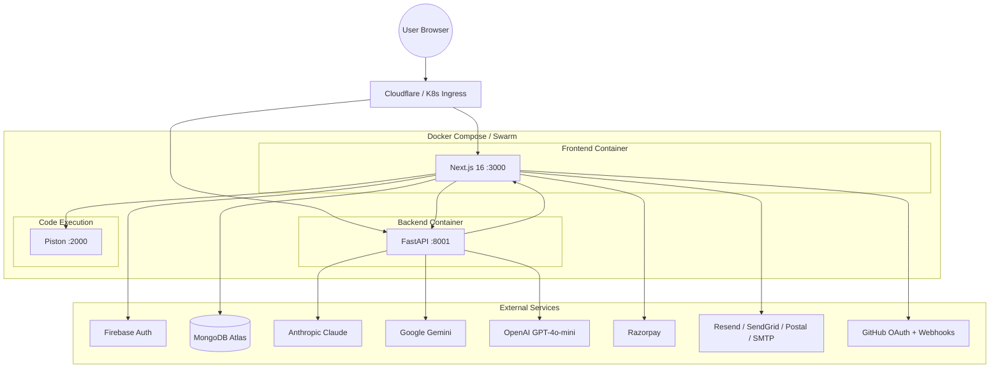

# CodeSpectra Technology Stack

> **Auto-Generated**: Internal Engineering documentation.

> **Auto-generated:** Verified from package.json, requirements.txt, docker-compose.yml, and codebase audit. Last updated: 2026-07-08.

---

## Frontend

| Technology | Version | File | Purpose |
|-----------|---------|------|---------|
| **Next.js** | 16.2.4 | `package.json:62` | React framework with App Router, SSR, API routes |
| **React** | 19.2.7 (resolved) | `package.json:68,100` | UI component library |
| **TypeScript** | 5.7.3 | `package.json:97` | Type-safe JavaScript |
| **Tailwind CSS** | 4.2.0 | `package.json:95` | Utility-first CSS framework |
| **@tailwindcss/postcss** | 4.2.0 | `package.json:89` | PostCSS plugin for Tailwind v4 |
| **shadcn/ui** (Radix primitives) | Various | `package.json:17-43` | Accessible UI components |
| **Lucide React** | 0.564.0 | `package.json:59` | Icon library |
| **Zod** | 3.24.1 | `package.json:81` | Schema validation |
| **React Hook Form** | 7.54.1 | `package.json:71` | Form management |
| **SWR** | 2.4.1 | `package.json:77` | Data fetching & caching |
| **Monaco Editor** | 4.7.0 | `package.json:16` | Code editor |
| **@xyflow/react** (React Flow) | 12.11.1 | `package.json:47` | Workflow graph builder |
| **Recharts** | 2.15.0 | `package.json:73` | Charts & analytics |
| **date-fns** | 4.1.0 | `package.json:54` | Date formatting |
| **class-variance-authority** | 0.7.1 | `package.json:50` | Component variants |
| **Sonner** | 1.7.1 | `package.json:75` | Toast notifications |
| **Vaul** | 1.1.2 | `package.json:79` | Drawer component |
| **React Three Fiber** | 9.6.0 (+ Three.js 0.184.0) | `package.json:44-45,78` | 3D visualizations |
| **cmdk** | 1.1.1 | `package.json:53` | Command palette |
| **Embla Carousel** | 8.6.0 | `package.json:55` | Carousel component |

## Authentication

| Technology | Version | File | Purpose |
|-----------|---------|------|---------|
| **Firebase Auth (Client)** | 11.6.0 | `package.json:56` | Client-side auth + OAuth |
| **Firebase Admin** | 13.2.0 | `package.json:57` | Server-side token verification |
| **jose** | 6.2.3 | `package.json:59` | JWT signing/verification |
| **bcryptjs** | 3.0.3 | `package.json:50` | Password hashing |
| **otplib** | 13.4.1 | `package.json:65` | TOTP/2FA (if enabled) |
| **input-otp** | 1.4.2 | `package.json:58` | OTP input UI |

## Backend

| Technology | Version | File | Purpose |
|-----------|---------|------|---------|
| **FastAPI** | 0.110.1 | `requirements.txt:1` | API proxy & AI router |
| **Python** | 3.12 | `backend/Dockerfile` | Runtime |
| **Uvicorn** | 0.25.0 | `requirements.txt:2` | ASGI server |
| **httpx** | 0.27.0 | `requirements.txt:27` | Async HTTP client (AI calls, proxying) |
| **PyMongo** | 4.6.3 | `requirements.txt:7` | MongoDB driver |
| **Motor** | 3.3.1 | `requirements.txt:14` | Async MongoDB driver |
| **Pydantic** | 2.6.4+ | `requirements.txt:8` | Request/response models |
| **PyJWT** | 2.10.1+ | `requirements.txt:10` | JWT handling |
| **bcrypt** | 4.1.3 | `requirements.txt:11` | Password hashing |
| **passlib** | 1.7.4+ | `requirements.txt:12` | Password library |
| **python-jose** | 3.3.0+ | `requirements.txt:20` | JOSE implementation |
| **cryptography** | 42.0.8+ | `requirements.txt:5` | Encryption primitives |
| **email-validator** | 2.2.0+ | `requirements.txt:9` | Email validation |
| **boto3** | 1.34.129+ | `requirements.txt:3` | AWS SDK (potential S3) |
| **pandas / numpy** | 2.2.0+ / 1.26.0+ | `requirements.txt:22-23` | Data analysis |

## Database

| Technology | Version | File | Purpose |
|-----------|---------|------|---------|
| **MongoDB** | 7.x (Atlas compatible) | `docker-compose.yml` | Primary database |
| **MongoDB Node Driver** | 7.3.0 | `package.json:61` | Database access from Next.js |
| **PyMongo** | 4.6.3 | `requirements.txt:7` | Python MongoDB driver |
| **Motor** | 3.3.1 | `requirements.txt:14` | Async Python MongoDB driver |

## AI & Machine Learning

| Technology | Purpose | Mode |
|-----------|---------|------|
| **Anthropic Claude Sonnet 4.5** | Reasoning — chat, code review, grading, agent | `ai_router.py:38` |
| **Google Gemini 3 Flash** | Fast — hints, code analysis, skill insights, vision | `ai_router.py:39-40` |
| **OpenAI GPT-4o-mini** | Fast chat (via Vercel AI SDK) | `lib/ai/backend.ts` |
| **Vercel AI SDK (@ai-sdk/openai)** | AI streaming SDK | `package.json:14` |
| **Vercel ai package** | 6.0.162 | `package.json:48` |

## Payments

| Technology | Version | File | Purpose |
|-----------|---------|------|---------|
| **Razorpay** | 2.9.6 | `package.json:67` | Payment processing |
| **Stripe** | 17.7.0 | `package.json:75` | Payment processing (incomplete) |

## Code Execution

| Technology | File | Purpose |
|-----------|------|---------|
| **Piston** (`ghcr.io/engineer-man/piston`) | `docker-compose.yml:5` | Sandboxed code execution (40+ languages) |
| **Local executor** (child_process.spawn) | `frontend/lib/local-executor.ts` | Fallback for Python/JS/TS/Bash |

## Email Delivery

| Technology | Purpose |
|-----------|---------|
| **Resend** | Primary email API |
| **SendGrid** | Alternative email API |
| **Postal** | Self-hosted email server |
| **SMTP** (nodemailer) | Direct SMTP fallback |

## Developer Tools

| Technology | Purpose |
|-----------|---------|
| **Docker** | Containerization |
| **Docker Compose** | Multi-service orchestration |
| **Vitest** 4.1.9 | Unit/integration testing |
| **ESLint** | Code linting |
| **TypeScript** 5.7.3 | Type checking |

## Runtime Configuration

| Container | Base Image | Port | Entrypoint |
|-----------|-----------|------|------------|
| **Frontend** | Node (Next.js standalone) | 3000 → 80 | `next start` |
| **Backend** | Python 3.12 | 8001 → 8000 | `uvicorn server:app` |
| **Piston** | `ghcr.io/engineer-man/piston` | 2000 | Piston API server |

---

## Architecture Diagram

