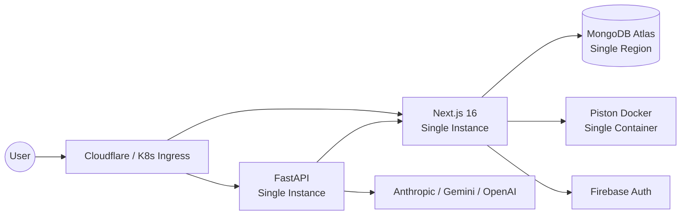

# CodeSpectra Scalability Strategy

> **Auto-generated:** Based on codebase audit. Last updated: 2026-07-08.

---

## Current Architecture



### Current Capacity Estimates

| Component | Current Config | Max Concurrency | Bottleneck |
|-----------|---------------|-----------------|------------|
| Next.js (Node) | Single instance | ~500 concurrent req | CPU-bound SSR |
| FastAPI (Uvicorn) | Single worker | ~100 concurrent req | Python GIL + AI calls |
| MongoDB | `maxPoolSize: 20` | 20 concurrent ops | Connection pool |
| Piston | Single container | Unlimited (no concurrency limit) | Memory/CPU per execution |
| AI Calls | Synchronous | 5-10 concurrent (no queue) | Provider rate limits |
| Rate Limiting | In-memory Map | Single-node only | Lost on restart |

---

## Bottlenecks Identified

### 1. No Connection Pooling Optimization

**Issue:** `mongodb.ts:31` — `maxPoolSize: 20` is hardcoded with no environment-based tuning.

**Impact:** Under load, the 20-connection pool saturates, causing request queuing.
**Fix:** Make pool size configurable. Increase to 50-100 for production. Use separate pools for read/write.

### 2. No Caching Layer

**Issue:** No Redis or in-memory cache for frequent reads (problem listings, user profiles, runtime lists).

**Impact:** Every page load hits MongoDB. Duplicate AI calls for identical prompts.
**Fix:** Add Redis for session state, rate limit counters, and query result caching. Add semantic caching for AI responses.

### 3. Synchronous AI Calls

**Issue:** AI endpoints (`/api/ai/*`, `/internal/ai/*`) block the request until the LLM responds (1-30s).

**Impact:** FastAPI workers block waiting for AI responses. Under load, all workers saturate.
**Fix:** Implement AI request queuing with background workers. Return pending status immediately, poll for result.

### 4. Monolithic Frontend Bundle

**Issue:** `dashboard/layout.tsx` (685 lines) and `scanner/page.tsx` (689 lines) load all components eagerly.

**Impact:** Large JavaScript bundle. Slow initial page load.
**Fix:** Code splitting with route-based lazy loading. Dynamic imports for scanner sub-components.

### 5. No Read Replicas

**Issue:** All queries hit the primary MongoDB instance.

**Impact:** Read-heavy pages (leaderboard, problem listing) compete with write operations.
**Fix:** Configure MongoDB read preference for secondary replicas. Route analytics/reporting queries to replicas.

### 6. In-Memory Rate Limiting

**Issue:** `in-memory-rate-limit.ts` uses a `Map<string, number[]>` in process memory.

**Impact:** Rate limits reset on server restart. Not shared across multiple instances.
**Fix:** Use Upstash/Redis for all rate limit counters. Make Upstash the default, not the fallback.

---

## Recommended Architecture (Target)

```mermaid
graph TB
    subgraph "CDN"
        CDN[Cloudflare CDN<br/>Static Assets]
    end
    
    subgraph "Load Balancer"
        LB[Cloudflare / AWS ALB]
    end
    
    subgraph "Frontend Cluster"
        NextJS1[Next.js Instance 1]
        NextJS2[Next.js Instance 2]
        NextJS3[Next.js Instance N]
    end
    
    subgraph "Backend Cluster"
        FastAPI1[FastAPI Worker 1]
        FastAPI2[FastAPI Worker 2]
        APIQueue[AI Request Queue<br/>Redis / SQS]
        AIPool[AI Worker Pool]
    end
    
    subgraph "Data Layer"
        MongoPrimary[(MongoDB Primary)]
        MongoReplica[(MongoDB Replica)]
        Redis[(Redis Cluster<br/>Cache + Rate Limit + Sessions)]
    end
    
    subgraph "Code Execution"
        PistonPool[Piston Pool<br/>Multiple Containers]
    end
    
    subgraph "External"
        AI[Anthropic / Gemini / OpenAI]
        Firebase[Firebase Auth]
        Razorpay[Razorpay]
    end
    
    User --> CDN
    User --> LB
    
    LB --> NextJS1
    LB --> NextJS2
    LB --> NextJS3
    
    NextJS1 --> Redis
    NextJS2 --> Redis
    NextJS3 --> Redis
    
    NextJS1 --> MongoPrimary
    NextJS2 --> MongoPrimary
    
    NextJS1 --> FastAPI1
    NextJS2 --> FastAPI2
    
    FastAPI1 --> APIQueue
    FastAPI2 --> APIQueue
    APIQueue --> AIPool
    AIPool --> AI
    
    NextJS1 --> PistonPool
    NextJS2 --> PistonPool
    NextJS3 --> PistonPool
    
    NextJS1 --> Firebase
    NextJS1 --> Razorpay
    
    MongoPrimary --> MongoReplica
    NextJS1 -.-> MongoReplica
```

---

## Implementation Phases

### Phase 1 — Quick Wins (Week 1-2)

| Improvement | Effort | Impact | Implementation |
|------------|--------|--------|----------------|
| Increase MongoDB pool size | 1h | Medium | Make `maxPoolSize` env-configurable, default 50 |
| Add response caching for runtimes | 2h | Low | Already has 5-min cache; extend to problem list |
| Configure Upstash as default limiter | 4h | High | Switch fallback order; apply to all auth endpoints |
| Add bundle analysis | 2h | Medium | Add `@next/bundle-analyzer` to find large deps |

### Phase 2 — Foundation (Week 3-6)

| Improvement | Effort | Impact | Implementation |
|------------|--------|--------|----------------|
| Deploy Redis cluster | 3d | High | ElastiCache / Upstash. Session state, rate limits, query cache |
| Configure MongoDB read replicas | 2d | High | Atlas replica set. Route reads to secondary |
| Code-split scanner page | 3d | High | Route-per-mode pattern (see file recommendations) |
| Code-split dashboard layout | 2d | Medium | Extract sidebar, nav, user menu into separate components |

### Phase 3 — AI Scalability (Week 7-12)

| Improvement | Effort | Impact | Implementation |
|------------|--------|--------|----------------|
| AI request queuing | 5d | High | Bull/BullMQ on Redis. Queue AI requests, process in background |
| Semantic caching | 4d | Medium | Cache semantically similar queries. Redis + embedding comparison |
| Model fallback chain | 2d | Medium | Primary → secondary → tertiary model on failure |
| Cost tracking + caps | 3d | High | Per-user monthly token budget, hard cap enforcement |

### Phase 4 — Enterprise Scale (Week 13-24)

| Improvement | Effort | Impact | Implementation |
|------------|--------|--------|----------------|
| Horizontal auto-scaling | 5d | High | K8s HPA based on CPU/memory/request count |
| CDN for static assets | 2d | High | Cloudflare Pages / AWS CloudFront for `_next/static` |
| Multi-region MongoDB | 5d | High | Atlas Global Clusters. Reads from nearest region |
| OpenTelemetry instrumentation | 5d | Medium | Traces, metrics, distributed logging |
| Database read/write splitting | 3d | Medium | ORM-level read replica routing |

---

## Key Metrics to Monitor

| Metric | Current Baseline | Target | How to Measure |
|--------|-----------------|--------|----------------|
| P95 API response time | ~500ms (no AI) | <200ms | OpenTelemetry traces |
| P95 AI response time | ~5s | <2s (with caching) | OpenTelemetry + custom metrics |
| MongoDB query time | ~50ms | <20ms | MongoDB Atlas profiler |
| Frontend bundle size | ~1.5 MB (estimated) | <500 KB | `@next/bundle-analyzer` |
| Concurrent users | Unknown | 10,000 | Load testing with k6 |
| Session token checks/req | 2-3 | 1 | Consolidate auth libs |
| Rate limit overhead | In-memory (<1ms) | <5ms (Upstash) | APM traces |
| AI token cost/user/month | Unknown | Tracked | Cost tracking dashboard |

---

## Scaling Decision Tree

```
Is the bottleneck CPU or I/O?
│
├── CPU (Next.js SSR / AI processing)
│   ├── Short-term: Increase instance size (vertical)
│   └── Long-term: Horizontal scaling + auto-scaling
│
├── I/O (MongoDB queries / API calls)
│   ├── Read-heavy → Add read replicas + cache layer
│   └── Write-heavy → Connection pooling + batch writes
│
├── AI calls timing out
│   ├── Add request queuing + background workers
│   ├── Implement semantic caching for repeat queries
│   └── Model fallback chain for provider outages
│
└── Rate limit saturation
    ├── Move from in-memory to Redis
    ├── Graduated limits (stricter for unauthenticated)
    └── Per-user + per-IP + per-endpoint tiers
```

---

## Cost Projections

| Component | Current (Dev) | Target (100K users) | Monthly Cost Est. |
|-----------|--------------|---------------------|-------------------|
| MongoDB Atlas (M0) | Free | M50 (3 replicas) | ~$1,500/mo |
| Next.js hosting | Single VPS | K8s cluster (10 pods) | ~$500/mo |
| FastAPI hosting | Single VPS | K8s cluster (5 pods) | ~$250/mo |
| Redis / Upstash | None | Paid tier | ~$50/mo |
| AI API costs | Variable | $5K-20K/mo (capped) | ~$10,000/mo |
| CDN | None | Cloudflare Pro | ~$20/mo |
| Piston hosting | Single Docker | 3 containers | ~$150/mo |
| **Total** | **~$50/mo** | | **~$12,500/mo** |

> AI costs dominate at scale. Implement aggressive caching, cost tracking, and per-user caps in Phase 3 before pursuing significant user growth.
