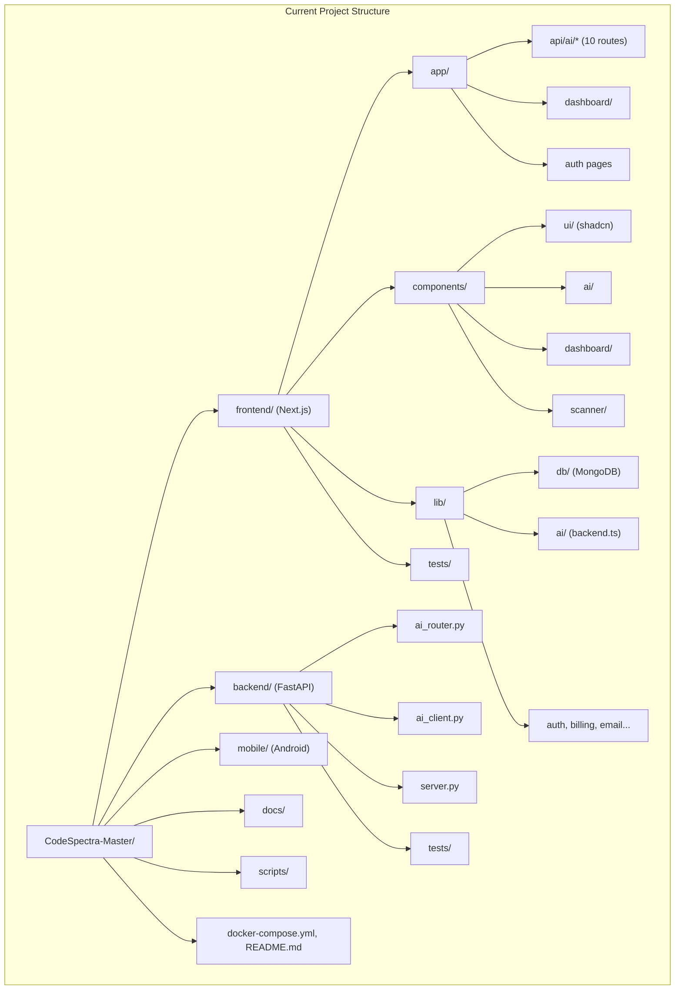
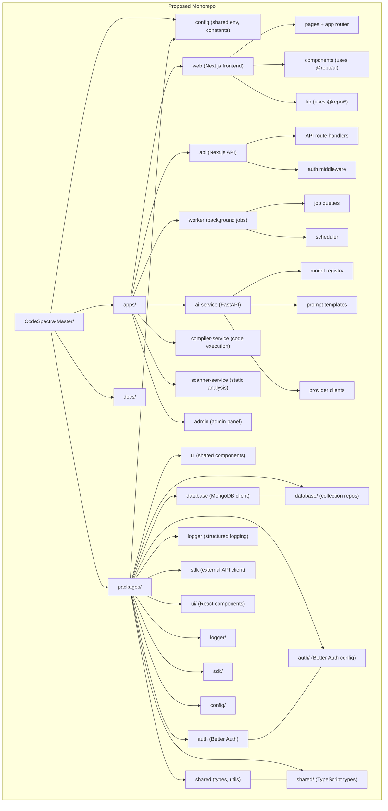

> **Auto-Generated**: Internal Engineering documentation.

---
title: Folder Structure
description: Current project structure and proposed monorepo migration plan
last_auto_updated: 2026-07-08
---

# Folder Structure

> **Auto-update:** This file is maintained by automated audit. When the folder structure changes, update this document to match.

---

## Current Structure (Flat)

```
CodeSpectra-Master/
├── frontend/                  # Next.js application (port 3000)
│   ├── app/
│   │   ├── api/               # API route handlers
│   │   │   ├── ai/            # AI features (chat, review, hints, etc.)
│   │   │   ├── auth/          # Better Auth routes
│   │   │   ├── billing/       # Razorpay billing
│   │   │   ├── admin/         # Admin API
│   │   │   └── mcp/           # MCP protocol server
│   │   ├── dashboard/         # Dashboard pages
│   │   └── (auth pages)       # Login, signup, etc.
│   ├── components/            # React components
│   │   ├── ui/                # shadcn/ui primitives
│   │   ├── dashboard/         # Dashboard widgets
│   │   ├── ai/                # AI feature components
│   │   ├── scanner/           # Code scanner UI
│   │   └── workflows/         # Workflow builder
│   ├── lib/                   # Shared utilities
│   │   ├── db/                # MongoDB collection repos
│   │   ├── ai/                # AI backend client
│   │   └── ...                # Auth, billing, email, etc.
│   ├── hooks/                 # React hooks
│   ├── tests/                 # Vitest tests
│   ├── public/                # Static assets
│   ├── package.json
│   ├── tsconfig.json
│   └── next.config.mjs
│
├── backend/                   # FastAPI proxy + AI router (port 8001)
│   ├── ai_router.py           # Internal AI router (10 endpoints)
│   ├── ai_client.py           # Direct LLM client
│   ├── server.py              # Proxy + router mount
│   ├── tests/                 # Pytest tests
│   ├── Dockerfile
│   └── requirements.txt
│
├── mobile/                    # Android native app
│   └── android/
│
├── docs/                      # Documentation
│   ├── AI/                    # AI architecture docs
│   ├── Standards/             # Standards docs
│   ├── Architecture/
│   ├── API/
│   ├── Database/
│   ├── Security/
│   └── ...
│
├── scripts/                   # Utility scripts
├── docker-compose.yml
└── README.md
```



---

## Proposed Monorepo Structure



### Proposed Directory Layout

```
CodeSpectra-Master/
├── apps/
│   ├── web/                    # Next.js frontend (pages + app router)
│   │   ├── app/
│   │   ├── components/
│   │   ├── public/
│   │   └── package.json
│   │
│   ├── api/                    # Next.js API-only service
│   │   ├── app/api/
│   │   └── package.json
│   │
│   ├── worker/                 # Background job processor
│   │   ├── src/
│   │   │   ├── queues/
│   │   │   └── jobs/
│   │   └── package.json
│   │
│   ├── ai-service/             # FastAPI LLM router (migrated from backend/)
│   │   ├── src/
│   │   │   ├── routers/
│   │   │   ├── clients/
│   │   │   └── prompts/
│   │   ├── tests/
│   │   ├── Dockerfile
│   │   └── requirements.txt
│   │
│   ├── compiler-service/       # Code execution (Piston-based)
│   │   ├── src/
│   │   └── Dockerfile
│   │
│   ├── scanner-service/        # Static code analysis
│   │   ├── src/
│   │   └── Dockerfile
│   │
│   └── admin/                  # Admin dashboard (standalone)
│       └── package.json
│
├── packages/
│   ├── ui/                     # Shared React components
│   │   └── src/
│   ├── database/               # MongoDB client + collection repos
│   │   └── src/
│   ├── auth/                   # Better Auth configuration
│   │   └── src/
│   ├── shared/                 # Shared types, constants, utilities
│   │   └── src/
│   ├── logger/                 # Structured logging
│   │   └── src/
│   ├── sdk/                    # External API client SDK
│   │   └── src/
│   └── config/                 # Shared configuration
│       └── src/
│
├── docs/                       # Documentation (remains unchanged)
├── scripts/                    # Utility scripts
├── turbo.json                  # Turborepo configuration
├── package.json                # Root workspace configuration
└── README.md
```

### Migration Benefits

| Concern | Current | Proposed |
|---------|---------|----------|
| Build times | Full rebuild on any change | Turborepo caching, incremental builds |
| Code sharing | Copy/paste or direct import | `@repo/*` packages |
| Service isolation | All in one Next.js process | Independent deployments |
| AI service ownership | Mixed in frontend/backend | Dedicated `ai-service` |
| Testing | Scattered | Co-located per package |
| Dependency management | Single `package.json` | Hoisted workspaces |

### Migration Phases

1. **Phase 1**: Create package structure, move `frontend/lib/db` → `packages/database`
2. **Phase 2**: Extract `frontend/lib/ai` → `packages/ai-client`, create `apps/ai-service` from `backend/`
3. **Phase 3**: Split `frontend/app/api` into `apps/api`, retain `apps/web` for pages
4. **Phase 4**: Extract `frontend/components/ui` → `packages/ui`
5. **Phase 5**: Add `apps/worker`, `apps/compiler-service`, `apps/scanner-service`

---

## References

- Current structure in project root
- `frontend/app/api/ai/` — All AI API routes
- `frontend/components/` — Component directory
- `frontend/lib/` — Library directory
- `backend/` — FastAPI backend
