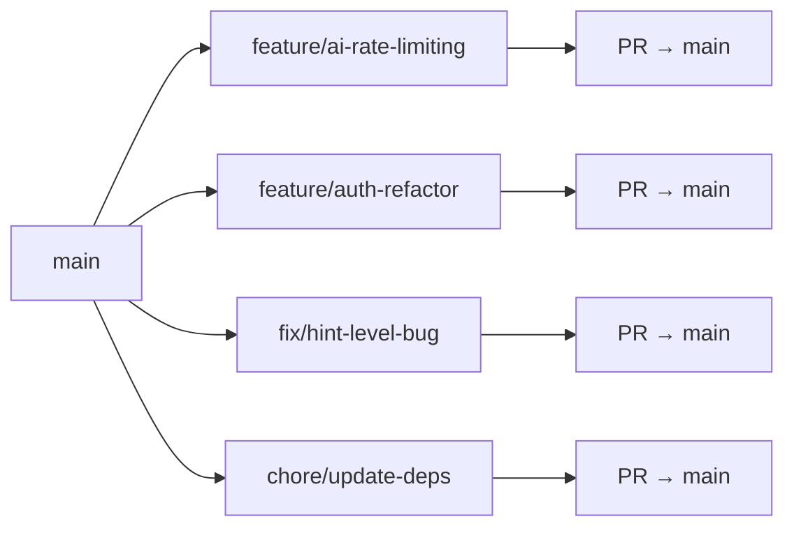
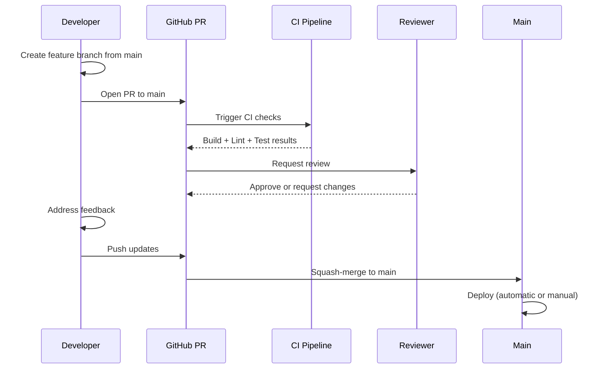

> **Auto-Generated**: Internal Engineering documentation.

---
title: Git Strategy
description: Branching model, commit conventions, and PR workflow for CodeSpectra
last_auto_updated: 2026-07-08
---

# Git Strategy

> **Auto-update:** This file is maintained by automated audit. When git conventions change, update this document to match.

---

## Branching Model

CodeSpectra uses a **feature-branch workflow** with `main` as the single long-lived branch.



### Branch Naming

| Prefix | Purpose | Example |
|--------|---------|---------|
| `feature/` | New features | `feature/ai-rate-limiting` |
| `fix/` | Bug fixes | `fix/hint-level-bug` |
| `chore/` | Maintenance, deps, config | `chore/update-deps` |
| `docs/` | Documentation-only changes | `docs/ai-architecture` |
| `refactor/` | Code restructuring | `refactor/ai-client` |
| `test/` | Test additions/fixes | `test/hints-coverage` |

### Branch Naming Rules

1. Use kebab-case: `feature/ai-rate-limiting`, not `feature/AI_Rate_Limiting`
2. Be descriptive but concise: `fix/hint-level-bug`, not `fix/bug`
3. No issue numbers in branch names (reference in PR description instead)
4. Short-lived branches: delete after merge

---

## Commit Message Format

Follow the [Conventional Commits](https://www.conventionalcommits.org/) specification:

```
<type>(<scope>): <description>

[optional body]
[optional footer(s)]
```

### Types

| Type | Usage |
|------|-------|
| `feat` | A new feature |
| `fix` | A bug fix |
| `chore` | Maintenance, build, deps |
| `docs` | Documentation only |
| `refactor` | Code change that neither fixes a bug nor adds a feature |
| `test` | Adding or fixing tests |
| `style` | Formatting, linting (no production change) |
| `perf` | Performance improvement |

### Scopes

| Scope | Area |
|-------|------|
| `ai` | AI features (chat, review, hints, agent, etc.) |
| `auth` | Authentication & authorization |
| `api` | API routes |
| `frontend` | UI components, pages |
| `backend` | FastAPI proxy, server |
| `db` | Database schema, migrations |
| `billing` | Payment processing |
| `admin` | Admin dashboard |
| `docs` | Documentation |
| `deps` | Dependency updates |

### Examples

```
feat(ai): add rate limiting to /internal/ai/chat

Implement token bucket rate limiting per user_id.
Threshold: 10 requests/minute for chat, 30 for completions.

Closes #123
```

```
fix(ai): handle empty hint_level in hints endpoint
```

```
chore(deps): upgrade next to 16.2.4
```

```
docs(ai): update model registry documentation
```

---

## PR Review Checklist

Every pull request must pass the following checklist before merging to `main`:

### Required

- [ ] Code compiles without errors (`yarn build`)
- [ ] Linter passes (`yarn lint`)
- [ ] Existing tests pass
- [ ] New tests added for new functionality
- [ ] No `console.log` or debugging code
- [ ] No secrets, API keys, or credentials committed
- [ ] Follows coding standards (see `docs/Standards/01-Coding-Standards.md`)

### AI-Specific

- [ ] Prompt injection risks considered for new AI endpoints
- [ ] Model role chosen intentionally (`reasoning` vs `fast`)
- [ ] Rate limiting applied (if applicable)
- [ ] Token usage is logged (if applicable)
- [ ] Output is validated against expected schema

### Documentation

- [ ] User-facing changes reflected in relevant docs
- [ ] API changes include route updates if needed
- [ ] Auto-update headers checked on modified docs

---

## Auto-Doc-Update Trigger Rules

Documentation auto-update headers (the `last_auto_updated` frontmatter field) are updated when:

1. **AI endpoints** change — model registry, prompt templates, new routes
2. **Safety measures** are added/modified — rate limiting, guardrails, validation
3. **Folder structure** changes — new apps or packages added
4. **Testing strategy** changes — new test frameworks or coverage targets
5. **Coding conventions** change — linter rules, naming patterns

### Files with Auto-Update Headers

| File | Trigger |
|------|---------|
| `docs/AI/01-AI-Architecture.md` | Model registry, provider list, architecture changes |
| `docs/AI/02-Prompt-Pipeline.md` | Prompt template changes, new endpoints |
| `docs/AI/03-Model-Selection.md` | Model assignment changes |
| `docs/AI/04-AI-Safety.md` | Safety measure additions/removals |
| `docs/Standards/01-Coding-Standards.md` | Linter rules, TS config changes |
| `docs/Standards/02-Folder-Structure.md` | Directory restructuring |
| `docs/Standards/03-Git-Strategy.md` | Branch/convention changes |
| `docs/Standards/04-Testing-Standards.md` | Coverage targets, framework changes |

---

## PR Process



---

## References

- `.git/` — Git repository config
- `AGENTS.md` — Project agent rules
- `docs/Standards/01-Coding-Standards.md` — Coding conventions
