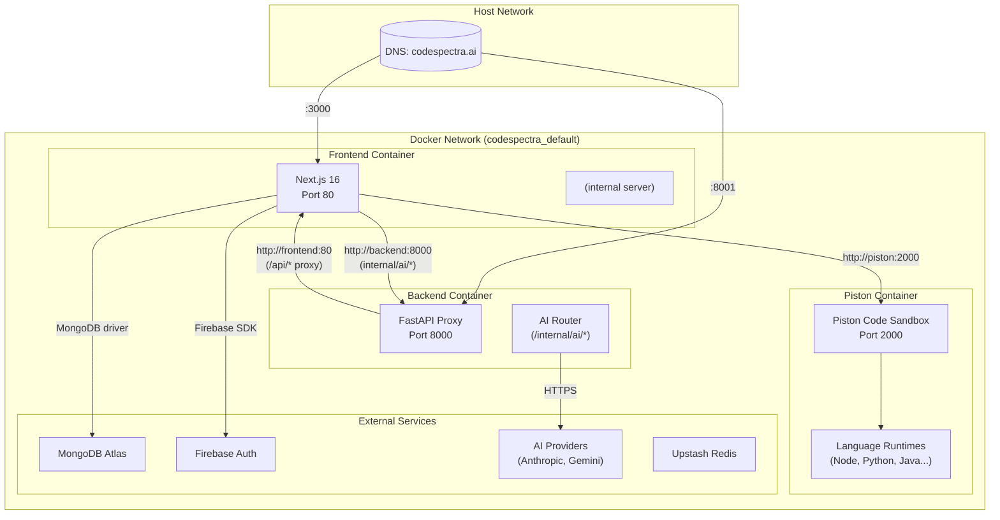
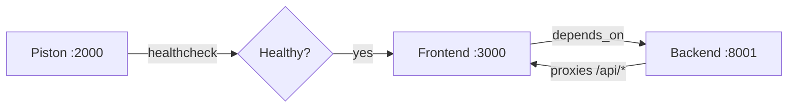

# Docker Architecture — CodeSpectra

> **Auto-Generated**: Internal Engineering documentation.

> **Last Updated:** 2026-07-08  
> **File:** `docker-compose.yml`  

---

## Container Topology



---

## Port Mappings

| Container | Internal Port | Host Port | Purpose |
|-----------|---------------|-----------|---------|
| **frontend** | 80 | 3000 | Next.js HTTP server |
| **backend** | 8000 | 8001 | FastAPI proxy + AI router |
| **piston** | 2000 | 2000 | Code execution sandbox API |

---

## Network Configuration

- **Network:** Default bridge network created by Docker Compose (`codespectra_default`)
- **Service discovery:** Container names used as hostnames (`piston`, `frontend`, `backend`)
- **CORS:** Frontend allows origins from `CORS_ORIGINS` env var
- **Cross-container traffic:**
  - Frontend → Piston: `http://piston:2000/api/v2`
  - Backend → Frontend: `http://frontend:80`
  - Frontend → Backend: `http://localhost:8001/internal/ai/*`

---

## Volume Mounts

| Volume | Container Path | Purpose |
|--------|---------------|---------|
| `piston-data` | `/piston` | Persist downloaded language runtimes and packages |

Volumes are declared at the bottom of `docker-compose.yml`:
```yaml
volumes:
  piston-data:
```

---

## Dependency Chain



1. **Piston** starts first (slowest — downloads language runtimes)
2. **Frontend** waits for Piston healthcheck to pass
3. **Backend** starts after Frontend (no healthcheck condition)

---

## Container Images

| Container | Base Image | Size Profile | Build Context |
|-----------|-----------|--------------|---------------|
| **frontend** | `node:22-alpine` | ~500MB (with node_modules) | `./frontend` |
| **backend** | `python:3.12-slim` | ~200MB | `./backend` |
| **piston** | `ghcr.io/engineer-man/piston:latest` | ~1.5GB (with runtimes) | Pre-built image |

---

## Dockerfile Structure

### Frontend Dockerfile (`frontend/Dockerfile`)

```dockerfile
FROM node:22-alpine
ARG NEXT_PUBLIC_APP_URL
ARG NEXT_PUBLIC_FIREBASE_API_KEY
# ... 6 more ARGs
ENV NEXT_PUBLIC_APP_URL=${NEXT_PUBLIC_APP_URL}
# ... corresponding ENVs
ENV PISTON_URL=http://piston:2000/api/v2
RUN apk add --no-cache docker-cli       # For cache management
WORKDIR /app
COPY package.json .
RUN yarn install --frozen-lockfile 2>/dev/null || yarn install
COPY . .
RUN yarn build
EXPOSE 80
CMD ["npx", "next", "start", "-p", "80"]
```

### Backend Dockerfile (`backend/Dockerfile`)

```dockerfile
FROM python:3.12-slim
WORKDIR /app
COPY requirements.txt .
RUN pip install --no-cache-dir -r requirements.txt
COPY . .
EXPOSE 8000
CMD ["uvicorn", "server:app", "--host", "0.0.0.0", "--port", "8000"]
```
