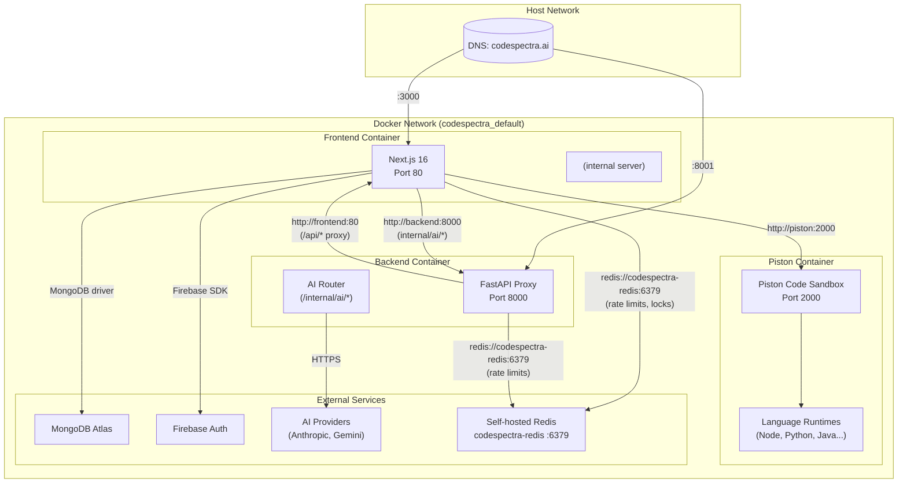
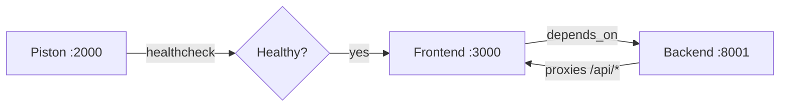

# Docker Architecture — CodeSpectra

> **Auto-Generated**: Internal Engineering documentation.

> **Last Updated:** 2026-07-08  
> **File:** `docker-compose.yml`  

---

## Container Topology



---

## Port Mappings

| Container | Internal Port | Host Port | Purpose |
|-----------|---------------|-----------|---------|
| **frontend** | 80 | 3000 | Next.js HTTP server |
| **backend** | 8000 | 8001 | FastAPI proxy + AI router |
| **piston** | 2000 | 2000 | Code execution sandbox API |
| **codespectra-redis** | 6379 | 6379 (internal only) | Self-hosted Redis 8 (rate limits, distributed locks) |

---

## Network Configuration

- **Network:** Default bridge network created by Docker Compose (`codespectra_default`)
- **Service discovery:** Container names used as hostnames (`piston`, `frontend`, `backend`)
- **CORS:** Frontend allows origins from `CORS_ORIGINS` env var
- **Cross-container traffic:**
  - Frontend → Piston: `http://piston:2000/api/v2`
  - Backend → Frontend: `http://frontend:80`
  - Frontend → Backend: `http://localhost:8001/internal/ai/*`
  - Frontend → Redis: `redis://codespectra-redis:6379`
  - Backend → Redis: `redis://codespectra-redis:6379`

---

## Volume Mounts

| Volume | Container Path | Purpose |
|--------|---------------|---------|
| `piston-data` | `/piston` | Persist downloaded language runtimes and packages |

Volumes are declared at the bottom of `docker-compose.yml`:
```yaml
volumes:
  piston-data:
```

---

## Dependency Chain



1. **Piston** starts first (slowest — downloads language runtimes)
2. **Frontend** waits for Piston healthcheck to pass
3. **Backend** starts after Frontend (no healthcheck condition)

---

## Container Images

| Container | Base Image | Size Profile | Build Context |
|-----------|-----------|--------------|---------------|
| **frontend** | `node:22-alpine` | ~500MB (with node_modules) | `./frontend` |
| **backend** | `python:3.12-slim` | ~200MB | `./backend` |
| **piston** | `ghcr.io/engineer-man/piston:latest` | ~1.5GB (with runtimes) | Pre-built image |

---

## Dockerfile Structure

### Frontend Dockerfile (`frontend/Dockerfile`)

```dockerfile
FROM node:22-alpine
ARG NEXT_PUBLIC_APP_URL
ARG NEXT_PUBLIC_FIREBASE_API_KEY
# ... 6 more ARGs
ENV NEXT_PUBLIC_APP_URL=${NEXT_PUBLIC_APP_URL}
# ... corresponding ENVs
ENV PISTON_URL=http://piston:2000/api/v2
RUN apk add --no-cache docker-cli       # For cache management
WORKDIR /app
COPY package.json .
RUN yarn install --frozen-lockfile 2>/dev/null || yarn install
COPY . .
RUN yarn build
EXPOSE 80
CMD ["npx", "next", "start", "-p", "80"]
```

### Backend Dockerfile (`backend/Dockerfile`)

```dockerfile
FROM python:3.12-slim
WORKDIR /app
COPY requirements.txt .
RUN pip install --no-cache-dir -r requirements.txt
COPY . .
EXPOSE 8000
CMD ["uvicorn", "server:app", "--host", "0.0.0.0", "--port", "8000"]
```

---

## Self-Hosted Redis (codespectra-redis)

Redis is deployed as a Dokploy service on the production server (image `redis:8`, service `codespectra-redis-iadpbk`), not via the repo's `docker-compose.yml`. It serves **rate limits** (frontend `codespectra:rl:*` keys, backend `ai_rate_limit:*` keys) and **distributed locks** (`codespectra:lock:*`).

### Why not Upstash
- Same-network latency is **<1ms** vs Upstash's ~12ms p50 HTTP overhead.
- No per-command cost at our traffic level.
- Upstash remains the recommended path only if the deployment moves to a multi-region/multi-replica setup without a shared network.

### Ops hardening checklist (verify on server)
1. **Auth (required):** Redis is started with `--requirepass`. Frontend/backend store the password in Settings → Redis (`upstash_redis_rest_url` = `redis://codespectra-redis:6379`, `upstash_redis_rest_token` = password).
2. **rediss:// TLS (recommended):** Redis supports TLS via `--tls-port 6380` with certs, or terminate TLS via the Dokploy reverse proxy. Use `rediss://` in Settings when enabled.
3. **Persistence (recommended):** Redis rate-limit/lock data is ephemeral by design — loss just resets counters and locks (safe). Enable AOF only if Redis is reused for durable data:
   ```bash
   redis-server --appendonly yes --appendfsync everysec --requirepass '<pass>'
   ```
   Mount a named volume (`redis-data:/data`) in the Dokploy service config.
4. **Expose only on the Docker network:** do not publish Redis on a public host port; keep it internal to the bridge network.
5. **Backup:** for AOF mode, snapshot `appendonly.aof` to the host backup target daily (rate-limit data does not need backup).

### Key namespaces
| Prefix | Owner | Purpose | TTL |
|--------|-------|---------|-----|
| `codespectra:rl:*` | Frontend routes | Rate limits (login, signup, AI, scanner, billing) | window (60s/900s) |
| `ai_rate_limit:*` | Backend AI router | AI endpoint rate limits per IP | 60s |
| `codespectra:lock:*` | Frontend scheduler | Distributed scheduler lock | 300s |

### Health check
- Admin Operations overview (`/dashboard/admin/system`) shows a "Redis & rate limiting" card (mode, latency, memory, clients, ops/sec, keyspace, top counters) — auto-polls every 30s.
- `POST /api/admin/redis/test` and `GET /api/admin/redis/status` (both superadmin) verify connectivity.
- If counters stop appearing while Redis is up, the most likely cause is the 15s config recheck in `backend/core/dependencies.py` (`ensure_redis_client`) or a stale `ioredis` client in `frontend/lib/upstash-rate-limit.ts` — check Settings → Redis and re-save to force a reconnect.
