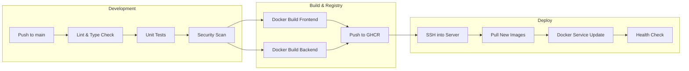

# CI/CD Pipeline — CodeSpectra

> **Last Updated:** 2026-07-08  
> **Current State:** Manual deployment via Dokploy  

---

## Current Deployment Process

The project uses a **manual Docker-based deployment** with Dokploy (Docker Swarm management).

### Steps (from `AGENTS.md`)

```bash
# 1. SSH into the server
# 2. Build inside the running container
docker exec codespectra-frontend-dmeptb sh -c "cd /app && yarn build"

# 3. Commit the container to a new image
docker commit codespectra-frontend-dmeptb codespectra-frontend-dmeptb:patched

# 4. Update the Docker Swarm service
docker service update --image codespectra-frontend-dmeptb:patched --force codespectra-frontend-dmeptb
```

### Problems with Current Approach

| Issue | Impact |
|-------|--------|
| Build happens inside running container | Stateful — depends on existing container state |
| Manual process | Prone to human error; no rollback tracking |
| No automated tests | Breaking changes can go straight to prod |
| No image registry | Images stored only on the server |
| No staging environment | All changes go directly to production |
| No secrets scanning | Hardcoded credentials not caught before deploy |

---

## Recommended: GitHub Actions Pipeline



### Recommended Pipeline Configuration

```yaml
# .github/workflows/deploy.yml
name: Deploy CodeSpectra

on:
  push:
    branches: [main]

env:
  REGISTRY: ghcr.io
  FRONTEND_IMAGE: ghcr.io/${{ github.repository }}/frontend
  BACKEND_IMAGE: ghcr.io/${{ github.repository }}/backend

jobs:
  validate:
    runs-on: ubuntu-latest
    steps:
      - uses: actions/checkout@v4

      - name: TypeScript Check
        run: |
          cd frontend
          yarn install --frozen-lockfile
          yarn typecheck

      - name: Lint
        run: |
          cd frontend
          yarn lint

      - name: Unit Tests
        run: |
          cd frontend
          yarn test --ci

      - name: Security Scan
        uses: aquasecurity/trivy-action@master
        with:
          scan-type: 'fs'
          scan-ref: '.'
          severity: 'CRITICAL,HIGH'

      - name: Dependency Audit
        run: |
          cd frontend
          yarn audit --groups=dependencies

  build-and-push:
    needs: validate
    runs-on: ubuntu-latest
    steps:
      - uses: actions/checkout@v4

      - name: Log in to GHCR
        uses: docker/login-action@v3
        with:
          registry: ${{ env.REGISTRY }}
          username: ${{ github.actor }}
          password: ${{ secrets.GITHUB_TOKEN }}

      - name: Build & Push Frontend
        uses: docker/build-push-action@v5
        with:
          context: ./frontend
          push: true
          tags: ${{ env.FRONTEND_IMAGE }}:${{ github.sha }},${{ env.FRONTEND_IMAGE }}:latest
          build-args: |
            NEXT_PUBLIC_APP_URL=${{ vars.NEXT_PUBLIC_APP_URL }}
            NEXT_PUBLIC_FIREBASE_API_KEY=${{ secrets.NEXT_PUBLIC_FIREBASE_API_KEY }}
            NEXT_PUBLIC_FIREBASE_AUTH_DOMAIN=${{ vars.NEXT_PUBLIC_FIREBASE_AUTH_DOMAIN }}
            NEXT_PUBLIC_FIREBASE_PROJECT_ID=${{ vars.NEXT_PUBLIC_FIREBASE_PROJECT_ID }}
            NEXT_PUBLIC_FIREBASE_STORAGE_BUCKET=${{ vars.NEXT_PUBLIC_FIREBASE_STORAGE_BUCKET }}
            NEXT_PUBLIC_FIREBASE_MESSAGING_SENDER_ID=${{ vars.NEXT_PUBLIC_FIREBASE_MESSAGING_SENDER_ID }}
            NEXT_PUBLIC_FIREBASE_APP_ID=${{ vars.NEXT_PUBLIC_FIREBASE_APP_ID }}

      - name: Build & Push Backend
        uses: docker/build-push-action@v5
        with:
          context: ./backend
          push: true
          tags: ${{ env.BACKEND_IMAGE }}:${{ github.sha }},${{ env.BACKEND_IMAGE }}:latest

  deploy:
    needs: build-and-push
    runs-on: ubuntu-latest
    steps:
      - name: Deploy via SSH
        uses: appleboy/ssh-action@v1.0.3
        with:
          host: ${{ secrets.SERVER_HOST }}
          username: ${{ secrets.SERVER_USER }}
          key: ${{ secrets.SERVER_SSH_KEY }}
          script: |
            docker pull ${{ env.FRONTEND_IMAGE }}:${{ github.sha }}
            docker pull ${{ env.BACKEND_IMAGE }}:${{ github.sha }}

            docker service update \
              --image ${{ env.FRONTEND_IMAGE }}:${{ github.sha }} \
              --force \
              codespectra-frontend-dmeptb

            docker service update \
              --image ${{ env.BACKEND_IMAGE }}:${{ github.sha }} \
              --force \
              codespectra-backend-dmeptb

            echo "Deployment complete. Running health checks..."
            sleep 10
            curl -f http://localhost:3000/api/health || exit 1
```

---

## Security Checks to Add

| Check | Tool | Stage |
|-------|------|-------|
| SAST (Static Analysis) | CodeQL / Semgrep | `validate` job |
| Secrets detection | `trufflehog` / `gitleaks` | `validate` job |
| Dependency scanning | `yarn audit` + Trivy | `validate` job |
| Container scanning | Trivy on images | `build-and-push` job |
| SBOM generation | `syft` | `build-and-push` job |
| DAST (deployed) | ZAP baseline | Post-deploy |

---

## Rollback Strategy

```bash
# Rollback to previous image tag
docker service update \
  --image ghcr.io/<org>/frontend:<previous-sha> \
  --force \
  codespectra-frontend-dmeptb
```

All image tags are SHA-pinned in GHCR, enabling instant rollback to any deployed version.
