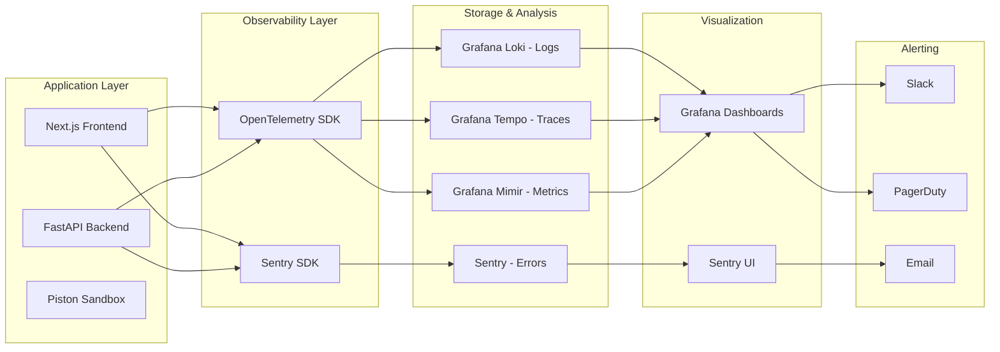

# Monitoring — CodeSpectra

> **Last Updated:** 2026-07-08  
> **Current State:** Minimal (client-side Web Vitals only)  

---

## Current Monitoring

### What Exists

| Component | Method | Location |
|-----------|--------|----------|
| **Client-side Web Vitals** | `WebVitalsReporter` component | Frontend |
| **Web Vitals Storage** | `web_vitals_events` MongoDB collection | `frontend/lib/db/misc.ts:67-68` |
| **Web Vitals Analytics** | `percentile75()` p75 calculation | `frontend/lib/web-vitals-stats.ts` |
| **Error Logging** | `console.error('[CodeSpectra] ...')` | Throughout codebase |
| **Warn Logging** | `console.warn('[CodeSpectra] ...')` | Throughout codebase |
| **Health Endpoint** | `/api/__proxy_health` and `/__proxy_health` | `backend/server.py:97-105` |

### What's Missing

| Gap | Impact | Priority |
|-----|--------|----------|
| No structured logging | Cannot filter by severity, correlation IDs, or module | **HIGH** |
| No centralized log aggregation | Logs are ephemeral in container stdout | **HIGH** |
| No APM (Application Performance Monitoring) | No visibility into slow API routes or DB queries | **HIGH** |
| No error tracking (Sentry) | No alerting on production errors | **HIGH** |
| No uptime monitoring | No automated checks that the app is responding | **MEDIUM** |
| No metric collection | No CPU, memory, or request rate visibility | **MEDIUM** |
| No alerting rules | No pager/PagerDuty/Slack on incidents | **HIGH** |
| No database monitoring | No slow query analysis or connection pool tracking | **MEDIUM** |
| No real user monitoring (RUM) | No insight into actual user experience | **LOW** |

---

## Error Logging Patterns Found

All error handling follows the same pattern throughout the codebase:

```typescript
// frontend/lib/route-auth.ts:86
console.error('[CodeSpectra] Error getting API user:', error)

// frontend/lib/firebase-admin.ts:34
console.error('[Firebase Admin] Init failed:', e)

// frontend/app/api/user/2fa/disable/route.ts:20
console.error('[CodeSpectra] 2FA disable error:', error)
```

Pros:
- Consistently prefixed with `[CodeSpectra]` for grep-ability
- Error objects are passed (not just strings)

Cons:
- No structured format (JSON)
- No severity levels (all are `console.error`)
- No correlation/request IDs
- No stack trace truncation or PII scrubbing
- No log rotation in Docker

---

## Recommended Monitoring Stack



---

## Implementation Roadmap

### Phase 1: Error Tracking (Sentry) — 1-2 days

```typescript
// frontend/lib/sentry.ts
import * as Sentry from '@sentry/nextjs'

Sentry.init({
  dsn: process.env.NEXT_PUBLIC_SENTRY_DSN,
  environment: process.env.NODE_ENV,
  tracesSampleRate: 0.1, // 10% of transactions
  replaysSessionSampleRate: 0.1,
  replaysOnErrorSampleRate: 1.0,
})
```

- Replace all `console.error` with `Sentry.captureException(error)` in API routes
- Add `@sentry/nextjs` for automatic error boundary + route monitoring
- Set up alert rules for `CRITICAL` and `HIGH` errors

### Phase 2: Structured Logging — 3-5 days

Use **pino** (Node.js) or **structlog** (Python) instead of `console.*`:

```typescript
// frontend/lib/logger.ts
import pino from 'pino'

export const logger = pino({
  level: process.env.LOG_LEVEL || 'info',
  formatters: {
    level(label: string) { return { severity: label } },
  },
  base: {
    service: 'codespectra-frontend',
    environment: process.env.NODE_ENV,
  },
  timestamp: pino.stdTimeFunctions.isoTime,
})
```

```python
# backend/logger.py
import structlog
structlog.configure(
    processors=[
        structlog.stdlib.add_log_level,
        structlog.dev.ConsoleRenderer(),
    ],
    context_class=dict,
)
```

### Phase 3: Metrics + APM — 1 week

- **OpenTelemetry** auto-instrumentation for Next.js + FastAPI
- Export to **Grafana Tempo** (traces) + **Grafana Mimir** (metrics)
- Key metrics to track:
  - API route latency (p50, p95, p99)
  - Error rate by route
  - Auth success/failure rate
  - AI endpoint usage (by model, per user)
  - Piston execution time
  - MongoDB query time
  - Active users (DAU/MAU)
  - Rate limit hit count

### Phase 4: Dashboards & Alerting — 3-5 days

**Grafana dashboards to create:**

1. **Application Overview** — Request rate, error rate, p95 latency, active users
2. **Business Metrics** — Signups, subscriptions, scans completed, challenges solved
3. **AI Usage** — Tokens consumed, cost per user, model usage breakdown
4. **Infrastructure** — Container CPU/memory, MongoDB connections, Piston load
5. **Security** — Auth failures, rate limit hits, 2FA events

**Alert rules:**

| Condition | Action | Priority |
|-----------|--------|----------|
| Error rate > 5% for 5 minutes | Slack + PagerDuty | P1 |
| p95 latency > 5s for 5 minutes | Slack | P2 |
| AI cost > $50/day | Email | P2 |
| Login failure rate > 100/min | Slack | P1 |
| Any container restart | Slack | P2 |
| Disk usage > 80% | Email | P3 |

---

## Quick Wins (Do Today)

| Action | Effort | Impact |
|--------|--------|--------|
| Add `@sentry/nextjs` with DSN | 30 min | Catch production errors immediately |
| Enable Web Vitals reporter in production | 15 min | Get RUM data from real users |
| Add `UptimeRobot` or `BetterStack` ping | 5 min | Know when app goes down |
| Set up `Logtail` or `BetterStack` for Docker logs | 1 hour | Centralized log search |
| Add healthcheck endpoint for Docker Compose | Already exists (`/api/__proxy_health`) | Already done |
