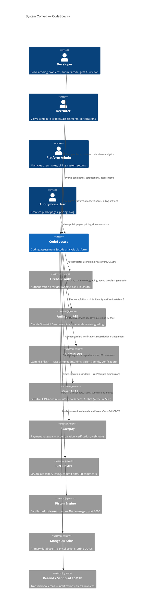

> **Auto-Generated Documentation**
> **Last Updated**: 2026-07-08
> **Auto-Update Rule**: Regenerate when codebase architecture or schema changes.

# C4 Level 1 — System Context Diagram

## External System Details

| System | Purpose | Integration Method | Auth |
|--------|---------|--------------------|------|
| **Firebase Auth** | Authentication (primary provider) | Firebase Admin SDK v13 + Client SDK v11 | Service account + API key |
| **Anthropic API** | AI reasoning, chat, code review | `backend/ai_client.py` — SSE streaming via Anthropic Messages API | `ANTHROPIC_API_KEY` (env) / `x-anthropic-api-key` header |
| **Gemini API** | Fast completions, hints, vision | `backend/ai_client.py` — SSE streaming via Google Generative AI API | `x-goog-api-key` header (`GEMINI_API_KEY` env) |
| **OpenAI API** | Interview service, AI chat | Vercel AI SDK (`@ai-sdk/openai`) | API key via environment |
| **Razorpay** | Payment processing | `razorpay` npm package + webhooks | Key ID + Secret (env or DB) |
| **GitHub API** | OAuth, repos, file content, PRs | `frontend/lib/github-service.ts` — REST API v3 | OAuth token / GitHub App token |
| **Piston Engine** | Code execution | Docker container `ghcr.io/engineer-man/piston@sha256:…` (digest-pinned via PISTON_IMAGE) on port 2000 | None (internal network) |
| **MongoDB Atlas** | Primary database | `mongodb` npm driver v7.3.0 + `motor` Python driver | Connection string (env) |
| **Resend / SendGrid** | Email delivery | `frontend/lib/transactional-mail.ts` — multi-provider abstraction | API keys (env or DB secrets) |
