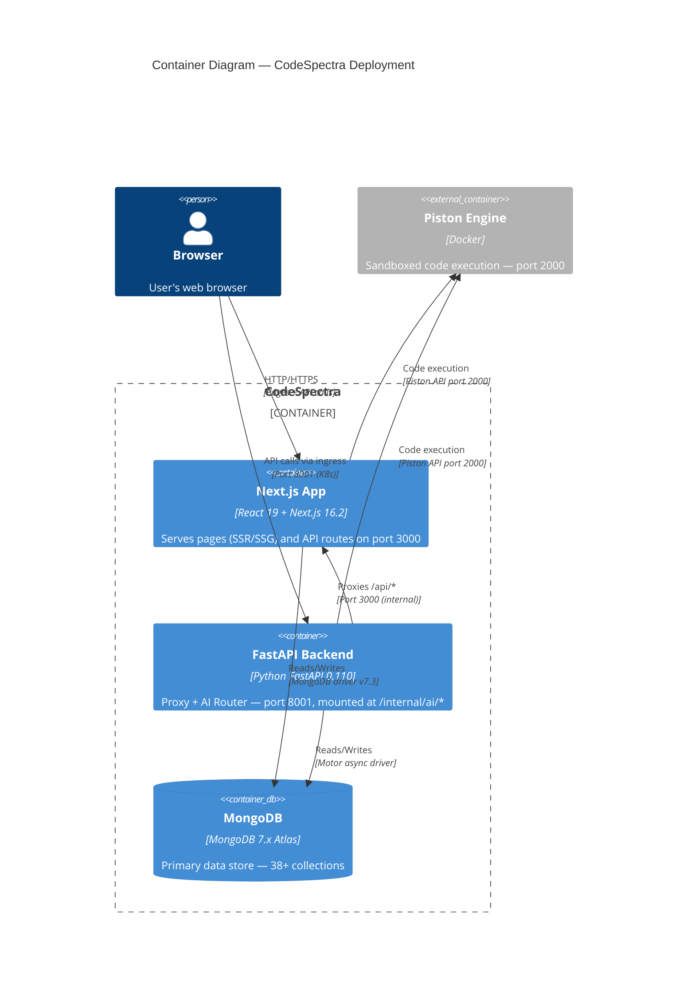

> **Auto-Generated Documentation**
> **Last Updated**: 2026-07-08
> **Auto-Update Rule**: Regenerate when codebase architecture or schema changes.

# C4 Model — Container, Component & Code Level Diagrams

## Level 2 — Container Diagram



## Level 3 — Component Diagram (Next.js Internals)

```mermaid
C4Component
  title Component Diagram — Next.js Application

  Container_Boundary(nextjs, "Next.js App") {
    Component(pages, "Pages", "app/", "96 page.tsx files — SSR/SSG React 19 pages")
    Component(api_routes, "API Routes", "app/api/", "165 route.ts files — 55+ resource groups")
    Component(lib, "Lib Services", "lib/", "77 modules — DB, auth, AI, billing, scanning")
    Component(components, "Components", "components/", "100+ React components — 29 directories")
    Component(middleware, "Middleware", "middleware.ts", "Request-level RBAC enforcement")
    Component(layouts, "Layouts", "app/layout.tsx", "Root + dashboard layouts (685-line god component)")
  }

  Rel(pages, api_routes, "Fetch calls")
  Rel(pages, components, "Renders")
  Rel(api_routes, lib, "Uses services")
  Rel(lib, mongodb, "Database operations")
  Rel(lib, piston, "Code execution")
  Rel(middleware, api_routes, "Auth guard")
```

### Page Groups (64 dashboard pages + 32 public pages)

| Group | Route Prefix | Pages |
|-------|-------------|-------|
| **Admin Console** | `/dashboard/admin/*` | system, users, roles, analytics, audit-logs, integrations, pricing, security, settings, teams, jobs, resumes, codeathons, exams, speed-insights, cdn, workflows, question-generator, hackathons, ai-inventory, permissions, plans, help |
| **Arena & Problems** | `/dashboard/arena/*`, `/dashboard/problems/*` | arena (list + details), problems (list + details) |
| **Scanner** | `/dashboard/scanner/*` | scanner (689-line god component) |
| **Learning** | `/dashboard/learning/*`, `/dashboard/tracks/*` | learning (list + details), tracks |
| **AI & Analytics** | `/dashboard/agent/*`, `/dashboard/analytics/*`, `/dashboard/skill-analytics/*` | agent, analytics, skill-analytics |
| **Assessments** | `/dashboard/certifications/*`, `/dashboard/exams/*`, `/dashboard/interviews/*` | certifications (list + details), exams, interviews (list + setup + dynamic + results + feedback) |
| **Identity** | `/dashboard/identity-verify/*`, `/dashboard/id-card/*` | identity-verify, id-card |
| **Billing** | `/dashboard/billing/*`, `/dashboard/pricing/*` | billing, pricing |
| **User** | `/dashboard/profile/*`, `/dashboard/settings/*`, `/dashboard/notifications/*` | profile, settings, notifications (list + preferences) |
| **Community** | `/dashboard/leaderboard/*`, `/dashboard/achievements/*`, `/dashboard/challenges/*`, `/dashboard/codeathons/*` | leaderboard, achievements, challenges (list + details), codeathons |
| **Hiring** | `/dashboard/jobs/*`, `/dashboard/resumes/*` | jobs, resumes |

## Level 4 — Code Level (Key TypeScript Interfaces)

```mermaid
classDiagram
  class AuthUser {
    +string uid
    +string email
    +string displayName
    +string photoURL
  }

  class SessionPayload {
    +string uid
    +string email
    +string role
  }

  class APIUser {
    +string id
    +string email
    +UserRole role
  }

  class CodeScanDoc {
    +string id
    +string user_id
    +string scan_type
    +string language
    +string scan_status
    +number scan_duration_ms
    +string code_snippet
    +string github_repo_url
    +string created_at
  }

  class CodeMetricsDoc {
    +string id
    +string scan_id
    +number overall_quality_score
    +number bugs
    +number vulnerabilities
    +number code_smells
    +number complexity_score
    +number maintainability_index
  }

  class CodeIssueDoc {
    +string id
    +string scan_id
    +string severity
    +string type
    +string status
    +string message
    +number line_number
    +string created_at
  }

  class ProblemDoc {
    +string id
    +string slug
    +string title
    +Difficulty difficulty
    +string[] topics
    +string statement_md
    +TestCase[] test_cases
    +Record~string,string~ starter_code
    +number time_limit_ms
    +boolean is_published
  }

  class SubmissionDoc {
    +string id
    +string problem_id
    +string user_id
    +string language
    +string source_code
    +SubmissionStatus status
    +number score
    +number total_tests
    +number passed_tests
    +TestRunResult[] results
    +string created_at
  }

  class XpEventDoc {
    +string id
    +string user_id
    +number amount
    +XpReason reason
    +string problem_id
    +string created_at
  }

  class BillingOrderDoc {
    +string id
    +string user_id
    +string razorpay_order_id
    +number amount_paise
    +string status
    +string created_at
  }

  class WorkflowDoc {
    +string id
    +string name
    +string trigger
    +WorkflowNode[] nodes
    +WorkflowEdge[] edges
    +boolean is_active
  }

  AuthUser -- SessionPayload : "session cookie"
  SessionPayload -- APIUser : "role normalized"
  CodeScanDoc -- CodeMetricsDoc : "1:1 lookup"
  CodeScanDoc -- CodeIssueDoc : "1:N"
  ProblemDoc -- SubmissionDoc : "1:N"
  SubmissionDoc -- XpEventDoc : "optional"
```
