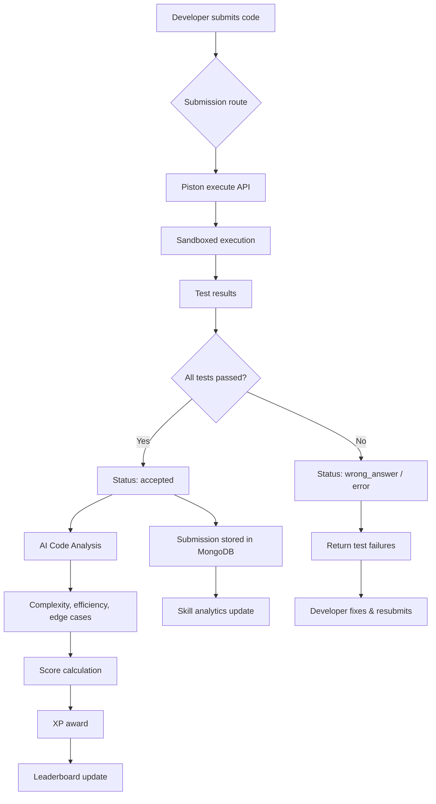
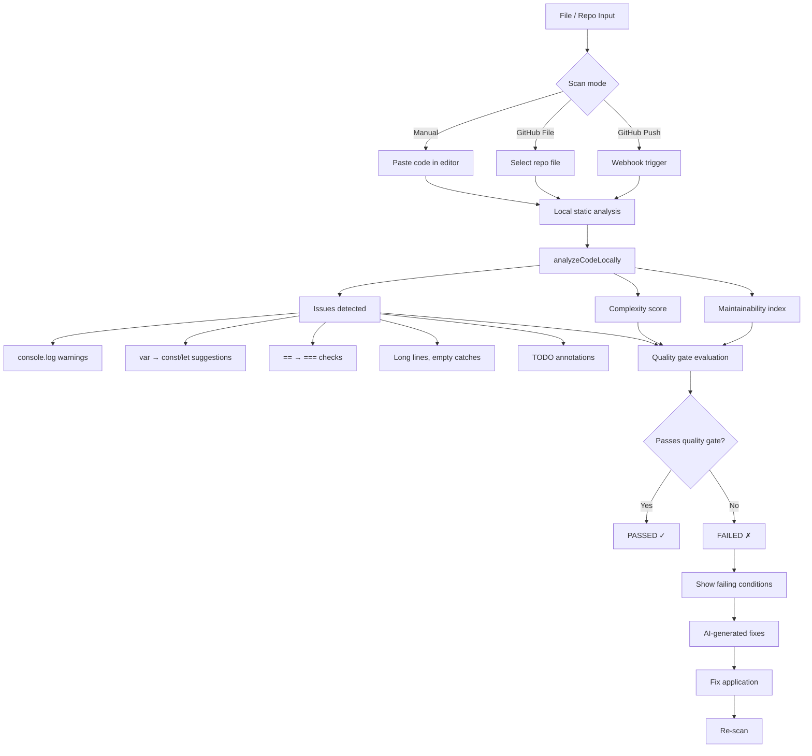

> **Auto-Generated Documentation**
> **Last Updated**: 2026-07-08
> **Auto-Update Rule**: Regenerate when codebase architecture or schema changes.

# Data Flow Diagrams

## 1. Code Submission & Evaluation Flow



**Key modules**:
- `frontend/app/api/submissions/route.ts` — Submission endpoint
- `frontend/lib/piston.ts` — Piston execution client (slot-based concurrency, 5000ms timeout)
- `frontend/lib/local-executor.ts` — Local fallback (Python, JS, TS, Bash)
- `backend/ai_router.py:267` — `/code-analysis` endpoint (complexity, efficiency, readability)
- `frontend/lib/db/leaderboard.ts` — `awardXp()` idempotent XP grants

**XP Economy**: easy=10, medium=25, hard=50, first_blood_bonus=25

---

## 2. Code Scanner & Quality Gate Flow



**Key modules**:
- `frontend/lib/local-code-analyzer.ts` — 127 lines, regex-based static analysis (7 rules)
- `frontend/lib/quality-gate-calculator.ts` — 5 conditions: security, reliability, maintainability, coverage, duplication
- `frontend/lib/scanner-analysis-mapper.ts` — Issue severity mapping
- `frontend/lib/quality-rater.ts` — A–E SonarQube-compatible rating
- `frontend/components/scanner/` — 23 sub-components

**Quality Gate Conditions**:
| Condition | Default Threshold |
|-----------|-------------------|
| Security issues | ≤ configured max |
| Reliability issues | ≤ configured max |
| Maintainability issues | ≤ configured max |
| Test coverage | ≥ configured % |
| Duplications | ≤ configured % |

---

## 3. GitHub Webhook → Scan → PR Comment Flow

```mermaid
graph TD
    A[GitHub Push / PR event] --> B[/api/github/webhook]
    B --> C[Create GithubWebhookEventDoc]
    C --> D[Enqueue GithubScanQueueDoc]
    D --> E[Status: pending]
    E --> F[POST /api/github/queue/run]
    F --> G[fetchCommitFiles]
    G --> H[Diffs from GitHub API]
    H --> I[Assemble code for review]
    I --> J[backendComplete AI call]
    J --> K[AI Code Review result]
    K --> L[Persist to ai_code_reviews]
    L --> M{Event is pull_request?}
    M -->|Yes| N[GitHub App token available?]
    N -->|Yes| O[Post PR comment]
    N -->|No| P[Skip comment]
    M -->|No| Q[Mark queue item completed]
    O --> Q
    P --> Q
    Q --> R[Update scan_id on queue item]
```

**Key modules**:
- `frontend/app/api/github/webhook/route.ts` — Webhook receiver
- `frontend/lib/github-queue-worker.ts` — 267 lines, atomic `findOneAndUpdate` claim
- `backend/ai_router.py:231` — `/code-review` endpoint
- `frontend/lib/github-service.ts` — Browser-side integration

**Queue Worker Details**:
- Atomic claim via `findOneAndUpdate({ status: 'pending' }, { status: 'running' })`
- Max patch bytes: 12,000 per file
- Per-item `locked_at` prevents double-processing
- Failed items marked with `last_error` for observability

---

## 4. Razorpay Payment → Webhook → Subscription Flow

```mermaid
graph TD
    A[User selects plan] --> B[/api/billing/create-order]
    B --> C[Create Razorpay order]
    C --> D[Persist BillingOrderDoc]
    D --> E[Return order ID to client]
    E --> F[Client opens Razorpay checkout]
    F --> G[User completes payment]
    G --> H[Client calls /api/billing/verify]
    H --> I[HMAC-SHA256 verification]
    I --> J{Signature valid?}
    J -->|No| K[Return error]
    J -->|Yes| L[Persist BillingPaymentDoc]
    L --> M{Plan is subscription?}
    M -->|Yes| N[Create BillingSubscriptionDoc]
    M -->|No| O[Mark order paid]
    N --> P[Razorpay webhook fires]
    P --> Q[Webhook signature verification]
    Q --> R[Update subscription status]
    R --> S[Update user plan in DB]
    S --> T[Send confirmation email]
```

**Key modules**:
- `frontend/app/api/billing/create-order/route.ts` — Order creation
- `frontend/app/api/billing/verify/route.ts` — Payment verification
- `frontend/app/api/billing/webhook/route.ts` — Webhook handler
- `frontend/lib/razorpay-server.ts` — 99 lines, HMAC-SHA256 with `timingSafeEqual`
- `frontend/lib/db/billing.ts` — 3 collections: `billing_orders`, `billing_payments`, `billing_subscriptions`

**Plan Catalog** (prices in INR paise):
| Plan | Amount | Duration |
|------|--------|----------|
| Pro Monthly | ₹499 (49,900 paise) | 30 days |
| Pro Yearly | ₹4,990 (499,000 paise) | 365 days |
| 50 Problem Pack | ₹199 (19,900 paise) | One-time |
