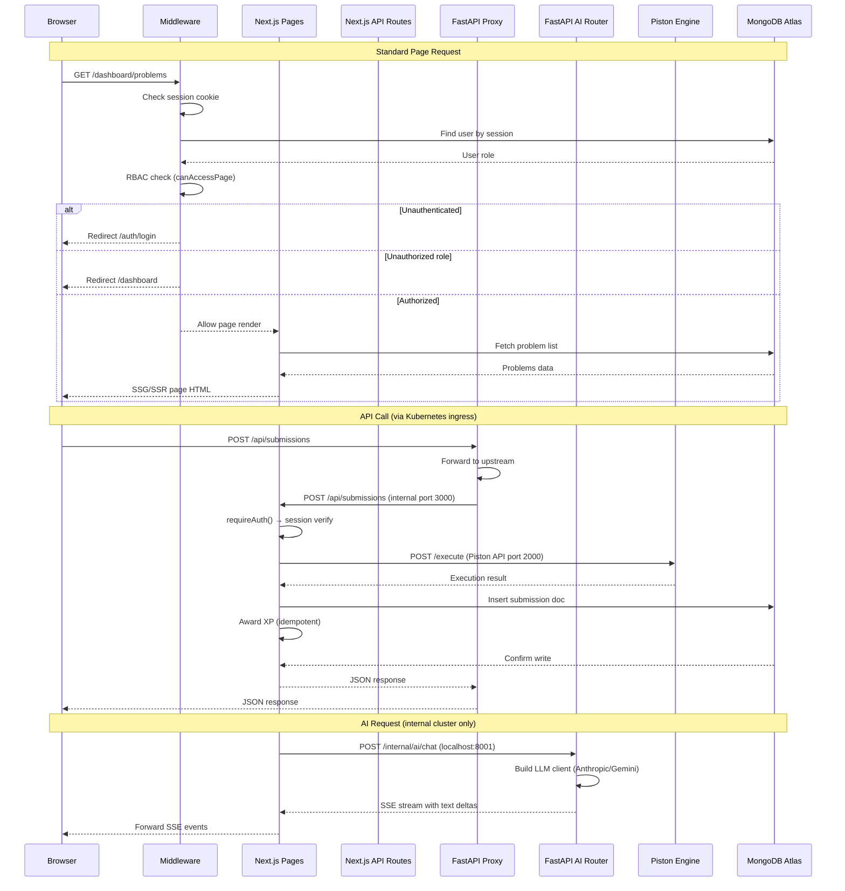
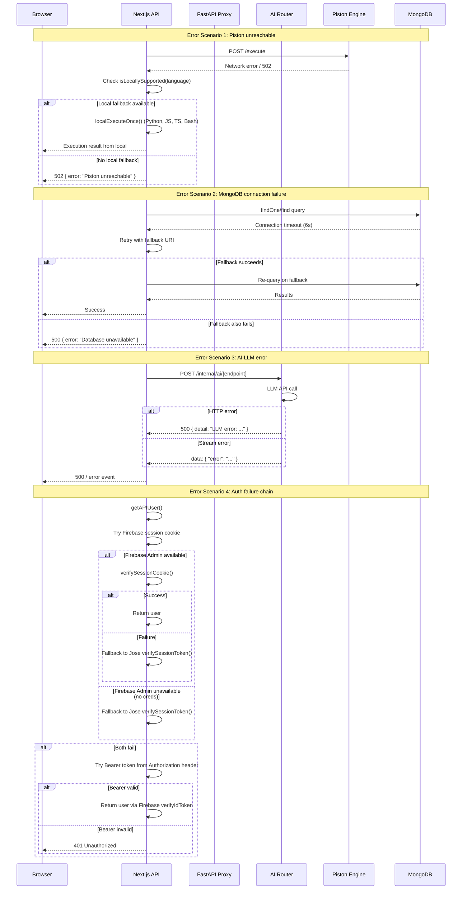

> **Auto-Generated Documentation**
> **Last Updated**: 2026-07-08
> **Auto-Update Rule**: Regenerate when codebase architecture or schema changes.

# Sequence Diagrams — Request Lifecycle & Error Handling

## 1. Request Lifecycle (Browser → Backend → Database)

## 2. Error Handling Across Layers

### Error Handling Strategy Summary

| Layer | Error Type | Handling | Fallback |
|-------|-----------|----------|----------|
| **Piston** | Network failure | `isLocallySupported()` check | Local executor (Python, JS, TS, Bash) |
| **Piston** | HTTP 401/403/429 | Rate-limit / quota error | Local executor if available |
| **Piston** | Unknown language | `resolveLanguageVersion()` returns null | Local executor or error |
| **MongoDB** | Primary URI timeout | `connect()` catches Error | `MONGODB_URI_FALLBACK` |
| **MongoDB** | Query failure | Per-function try/catch | Retry or 500 response |
| **AI** | LLM API error | `chat.stream_message()` exception | SSE `data: { "error": "..." }` |
| **AI** | JSON parse failure | `_parse_json_response()` | Best-effort extraction + fallback defaults |
| **Auth** | Firebase Admin unavailable | Silent null return | Jose session token verification |
| **Auth** | Bearer token invalid | Try/catch in `verifyIdToken` | Return 401 |
| **Proxy** | Upstream unreachable | `httpx.RequestError` catch | 502 `{"error":"upstream unreachable"}` |
