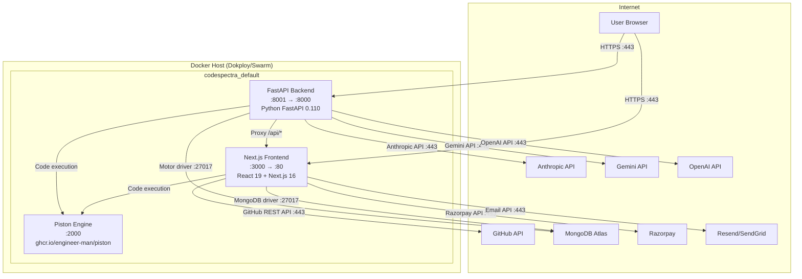

> **Auto-Generated Documentation**
> **Last Updated**: 2026-07-08
> **Auto-Update Rule**: Regenerate when codebase architecture or schema changes.

# Network Architecture Diagram

## Port Mapping

| Container | Internal Port | External Port | Protocol | Purpose |
|-----------|--------------|---------------|----------|---------|
| **Piston** | 2000 | 2000 | HTTP | Code execution sandbox API |
| **Frontend** | 80 (internal) | 3000 | HTTP | Next.js SSR + API routes |
| **Backend** | 8000 (internal) | 8001 | HTTP | FastAPI proxy + AI router |

## External Connection Details

| Target | Protocol | Port | Auth Method | Purpose |
|--------|----------|------|-------------|---------|
| **MongoDB Atlas** | MongoDB wire | 27017 | Connection string (SRV) | Primary database |
| **Firebase Auth** | HTTPS | 443 | Service account + API key | Authentication |
| **Anthropic API** | HTTPS | 443 | `x-api-key` header | AI chat, code review, grading |
| **Gemini API** | HTTPS | 443 | API key in URL query | Fast completions, hints, vision |
| **OpenAI API** | HTTPS | 443 | Bearer token | Interview service, AI chat |
| **Razorpay** | HTTPS | 443 | Key ID + Secret | Payment processing |
| **GitHub REST API** | HTTPS | 443 | OAuth token / App token | Repo access, PR comments |
| **Resend/SendGrid** | HTTPS | 443 | API key | Transactional email |

## Network Security Notes

| Issue | Severity | Description |
|-------|----------|-------------|
| No internal TLS between containers | MEDIUM | Docker internal network is trusted but no mTLS |
| Gemini API key in URL query parameter | CRITICAL | `backend/ai_client.py:55` — key exposed in logs/proxies |
| Piston `privileged: true` | MEDIUM | Container runs privileged; sandbox escape risk |
| MongoDB credentials in committed `.env` | CRITICAL | `backend/.env` tracked in git with plaintext credentials |
| No network policy enforcement | MEDIUM | All containers can reach all external services |
| Firebase Admin credentials in env | LOW | Service account JSON loaded from env, not mounted secrets |
