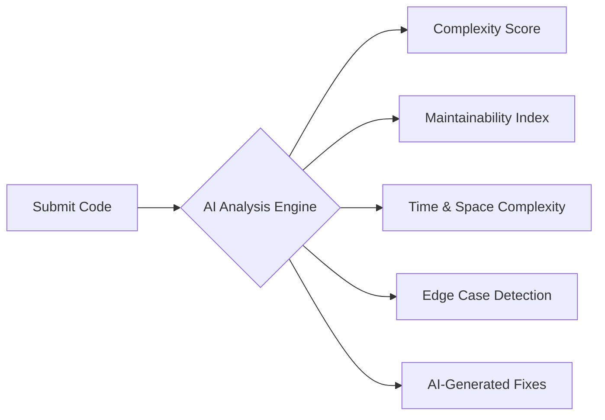
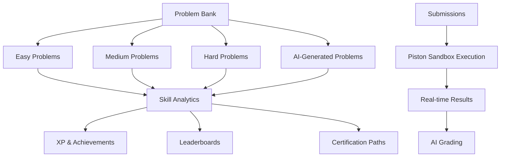
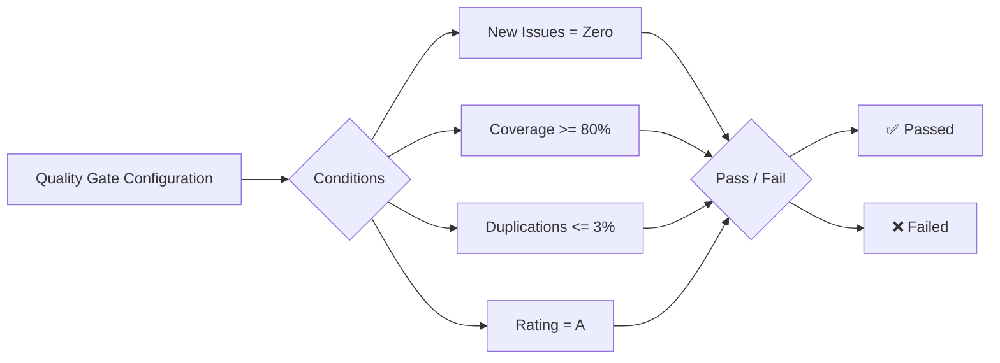

> **Public Documentation**
> **Last Updated**: 2026-07-08
> **Audience**: Everyone (no login required)

# CodeSpectra Features

CodeSpectra combines AI-powered code analysis, smart reviews, coding challenges, learning paths, team management, security scanning, quality gates, and integrations into a single unified platform.

---

## AI-Powered Code Analysis

Understand your code's quality, complexity, and maintainability in seconds.

- **Multi-dimensional scoring**: Security, Reliability, Maintainability, and Technical Debt ratings (A–E scale)
- **Complexity analysis**: Cyclomatic complexity, cognitive complexity, and Halstead metrics
- **AI-generated fixes**: One-click fix suggestions for every detected issue
- **Fix workflow**: Apply, review, and unapply fixes with full history tracking

---

## Smart Code Reviews

Automated AI code reviews that catch issues before they reach production.

- **PR Integration**: Automatic review comments on GitHub pull requests
- **Multi-model AI**: Claude Sonnet 4.5 for deep reasoning, Gemini Flash for fast analysis
- **Structured feedback**: Each review includes severity ratings, line-level annotations, and actionable suggestions
- **Codebase Q&A**: Ask natural language questions about any scanned codebase
- **Branch analytics**: Compare quality metrics across branches and track trends over time

---

## Coding Challenges & Assessments

A comprehensive problem-solving platform for skill development and technical screening.

- **100+ curated problems** across algorithms, data structures, databases, and system design
- **AI-generated problems**: Admins can generate new problems with test cases using AI
- **40+ languages**: Write solutions in any supported language
- **Live coding tests**: Real-time collaborative coding for technical interviews
- **Proctoring**: AI identity verification and event monitoring for exam integrity
- **Automated grading**: Rubric-based AI grading with per-criterion scoring

---

## Learning Paths & Certifications

Structured skill development with verifiable credentials.

- **Curated tracks**: Learning paths organized by topic and skill level
- **Skill analytics**: AI-powered insights showing strengths, gaps, and personalized growth plans
- **Certification exams**: Proctored assessments with AI grading
- **Skill certifications available**:
  - JavaScript
  - Python
  - SQL
  - React
  - Algorithms & Data Structures
  - Frontend Development
- **Identity verification**: AI-based selfie vs. ID comparison for certification integrity

---

## Team Management

Manage developers, track progress, and maintain code quality across your organization.

- **Role-based access**: Owner, Admin, Member roles with granular permissions
- **Team analytics**: Aggregated metrics across team members and projects
- **Quality gates**: Define organization-wide quality thresholds
- **Activity feeds**: Real-time visibility into team scanning and review activity
- **Organization settings**: Configure shared integrations and security policies

---

## Security Scanning

Identify vulnerabilities and security hotspots before they become incidents.

- **OWASP Top 10 detection**: Auto-identify common web application vulnerabilities
- **Security hotspots**: Flagged areas ranked by risk level
- **Compliance templates**: Pre-built gate configurations for OWASP, NIST, and PR review standards
- **Secret detection**: Identify hardcoded credentials and API keys
- **Dependency analysis**: Track known vulnerabilities in project dependencies

---

## Quality Gates

Define and enforce code quality standards across your projects.

- **Custom thresholds**: Set pass/fail conditions for any metric
- **Automatic evaluation**: Every scan is evaluated against configured gates
- **Preset templates**: OWASP, NIST, and standard PR review profiles
- **CI/CD integration**: Block PRs that fail quality gates
- **Trend tracking**: Monitor quality metrics over time

---

## Integration Ecosystem

Connect CodeSpectra with your existing development workflow.

### GitHub Integration

- **OAuth authentication**: Connect your GitHub account with secure token encryption (AES-256-GCM)
- **Repository scanning**: Scan any public or private repository
- **PR automation**: Automatic AI code review on every pull request
- **Webhook processing**: Real-time scan triggers on push and PR events

### CI/CD Pipeline

- **GitHub Actions**: Plug into existing CI/CD workflows (coming soon)
- **Webhook API**: Trigger scans programmatically from any CI system
- **Quality gate API**: Check quality status from your pipeline

### Developer Tools

- **REST API**: Full programmatic access to all platform features
- **MCP Server**: Model Context Protocol server for AI tool integration
- **Code editor support**: Monaco-based editor in the platform
- **VS Code extension**: Inline scanning and AI review (coming soon)

### Payment Processing

- **Razorpay**: Full subscription management for Indian customers (INR)
- **Stripe**: Global payment processing (coming soon)

---

## Feature Availability

| Feature | Free | Pro | Enterprise |
|---------|------|-----|------------|
| Code Scans (per day) | 10 | 100 | Unlimited |
| Coding Challenges (per month) | 5 | 50 | Unlimited |
| AI Code Review | — | Unlimited | Unlimited |
| AI Hints | — | Unlimited | Unlimited |
| Smart Hints (progressive) | — | ✓ | ✓ |
| Advanced Skill Analytics | — | ✓ | ✓ |
| Certifications | — | ✓ | ✓ |
| Team Management | — | — | ✓ |
| Priority Support | — | — | ✓ |
| Concurrent Executions | 2 | 10 | 30 |

---

> **Ready to get started?** Visit the [Getting Started guide](01-getting-started.md) or see [Pricing](03-pricing.md) for plan details.
