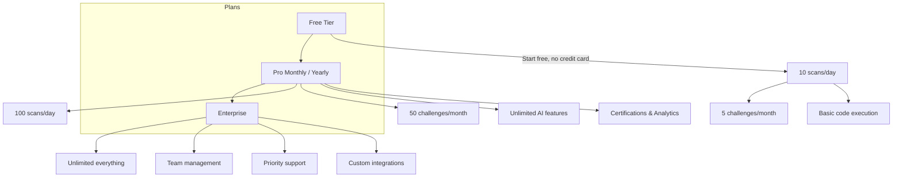

> **Public Documentation**
> **Last Updated**: 2026-07-08
> **Audience**: Everyone (no login required)

# Pricing

CodeSpectra offers flexible pricing for individual developers, professional engineers, and enterprise teams. Start free and upgrade as your needs grow.

---

## Plans Overview

---

## Feature Comparison

| Feature | Free | Pro | Enterprise |
|---------|:----:|:---:|:----------:|
| **Code Scans per day** | 10 | 100 | Unlimited |
| **Challenges per month** | 5 | 50 | Unlimited |
| **Concurrent executions** | 2 | 10 | 30 |
| **AI Code Review** | — | Unlimited | Unlimited |
| **AI Smart Hints** | — | Unlimited | Unlimited |
| **AI Chat** | — | ✓ | ✓ |
| **Code Analysis** | — | Unlimited | Unlimited |
| **AI-Generated Fixes** | — | ✓ | ✓ |
| **Skill Analytics** | — | ✓ | ✓ |
| **Certifications** | — | ✓ | ✓ |
| **Identity Verification** | — | ✓ | ✓ |
| **Arena & Leaderboards** | ✓ | ✓ | ✓ |
| **Team Management** | — | — | ✓ |
| **Priority Support 24/7** | — | — | ✓ |
| **Custom Quality Gates** | — | ✓ | Unlimited |
| **API Access** | — | ✓ | ✓ |
| **GitHub Integration** | — | ✓ | ✓ |
| **MCP Server** | — | ✓ | ✓ |

---

## Pricing Plans

Live prices below come straight from the pricing API — the same numbers on the [pricing page](/pricing), set in **Admin → Pricing**. They update automatically when plans change.

{{live-pricing}}

### Free

**$0** — forever

Everything you need to try CodeSpectra and solve coding challenges.

- 10 code scans per day
- 5 coding challenges per month
- 2 concurrent code executions
- Public problem catalog access
- Arena and leaderboards
- Dashboard and profile

### Pro

Monthly and yearly billing — see live prices above.

For professional developers who want AI-powered code quality and skill development.

- 100 code scans per day
- 50 coding challenges per month
- 10 concurrent code executions
- Unlimited AI code review
- Unlimited smart hints
- AI chat with code context
- Advanced skill analytics
- Skill certifications
- Identity verification
- GitHub integration
- API access and MCP server
- Custom quality gates

### Enterprise

**Custom pricing** — contact sales for teams (see live plans above for current Pro pricing).

For organizations that need team management, compliance, and dedicated support.

- Everything in Pro, plus:
- Unlimited code scans
- Team management and RBAC
- Organization-wide quality gates
- Priority 24/7 support
- Dedicated onboarding
- Custom integrations
- Audit logs
- Bulk assessment scheduling
- Single sign-on (coming soon)

---

## Add-Ons

| Item | Price | Details |
|------|-------|---------|
| 50 Premium Problem Pack | ₹199 (one-time) | 50 expert-curated premium problems, lifetime access |

---

## Frequently Asked Questions

### How does the free trial work?

The Free tier has no time limit. You can use it indefinitely at no cost. When you're ready for more capabilities, upgrade to Pro or Enterprise at any time.

### Can I switch between plans?

Yes. You can upgrade or downgrade at any time. When upgrading, Pro features are available immediately. When downgrading, your plan changes at the end of the current billing period.

### What payment methods do you accept?

We currently process payments through Razorpay, supporting all major Indian payment methods including UPI, credit/debit cards, net banking, and wallets. Global payments are processed via Stripe.

### Is there a discount for annual billing?

Yes. The Pro Yearly plan costs roughly 10 months of monthly billing for 12 months of access, saving approximately 17% compared to paying monthly.

### Do you offer educational or open-source discounts?

We offer special pricing for educational institutions and qualifying open-source projects. Contact our sales team for details.

### What happens if I exceed my plan limits?

Free and Pro plans have hard limits on scans per day and challenges per month. You can wait for the limit to reset (daily/monthly), upgrade your plan, or purchase add-on packs.

### Is my data secure on the Free plan?

Yes. All plans — including Free — use the same encryption and security standards. Your code is encrypted in transit (TLS 1.3) and at rest. See our [Security & Privacy](04-product-overview.md#security--privacy) section for details.

### Can I cancel my subscription?

Yes. You can cancel anytime from your billing settings. Your Pro features remain active until the end of the current billing period.

### How do I upgrade to Enterprise?

Contact our sales team through the platform or reach out to sales@codespectra.ai. We'll set up a personalized onboarding call and configure your organization.

---

> **Ready to get started?** [Create your free account](01-getting-started.md) — no credit card required.
