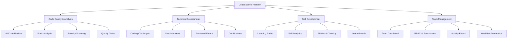

> **Public Documentation**
> **Last Updated**: 2026-07-08
> **Audience**: Everyone (no login required)

# CodeSpectra Product Overview

---

## What is CodeSpectra?

CodeSpectra is an AI-powered engineering intelligence platform that unifies code quality analysis, technical assessments, skill development, and team management into a single, integrated experience.

Unlike fragmented toolchains that require separate products for code review (SonarQube), technical screening (HackerRank), learning (LeetCode), and AI assistance (GitHub Copilot), CodeSpectra provides all four pillars in one platform — with AI woven into every surface.

---

## Key Capabilities

### AI-Powered Code Quality

- **AI Code Review**: Automated pull request reviews using Claude Sonnet 4.5 with line-level annotations, severity ratings, and actionable fix suggestions
- **Static Analysis**: Multi-dimensional quality scoring (Security, Reliability, Maintainability, Technical Debt) with an A–E rating system
- **Security Scanning**: OWASP Top 10 detection, security hotspot identification, and compliance template enforcement
- **Quality Gates**: Configurable pass/fail thresholds that integrate with your CI/CD pipeline

### Technical Assessments

- **Problem Catalog**: 100+ coding challenges across algorithms, data structures, databases, and system design
- **AI Problem Generator**: Generate new problems with test cases on demand
- **Sandboxed Execution**: 40+ languages running in secure, isolated Piston containers
- **Proctoring**: AI-based identity verification and exam integrity monitoring
- **AI Grading**: Rubric-based automated grading with per-criterion scoring

### Skill Development

- **Learning Paths**: Curated tracks organized by topic and difficulty
- **Skill Analytics**: AI-powered insights into strengths, gaps, and growth trajectory
- **Certifications**: Proctored, verifiable skill certifications across 6 domains
- **Arena**: Real-time competitive coding challenges with leaderboards

### Team & Enterprise

- **Team Management**: Role-based access with Owner, Admin, and Member roles
- **Workflow Automation**: DAG-based workflow engine for custom automations
- **GitHub Integration**: OAuth, repository scanning, and automated PR reviews
- **Analytics Dashboard**: Team-wide quality metrics and trends

---

## Who It's For

### Individual Developers

Practice coding, improve code quality, and earn certifications. Use AI hints when you're stuck, get your code reviewed by AI, and track your skill growth over time.

### Engineering Teams

Enforce code quality standards across your repos, automate PR reviews, and get visibility into team-wide code health. Set quality gates that block regressions before they merge.

### Enterprise Organizations

Scale code quality and technical assessment across the entire org. Manage teams, enforce compliance standards (OWASP, NIST), and create custom workflows — all with dedicated support.

### Recruiters & HR

Screen candidates with proctored assessments, AI-graded coding challenges, and verifiable skill certifications. Reduce false positives in technical hiring with data-driven insights.

---

## Platform Highlights

| Feature | Description |
|---------|-------------|
| **Multi-Model AI** | Uses Claude Sonnet 4.5 (reasoning), Gemini Flash (speed), and GPT-4o-mini — routing to the right model for each task |
| **40+ Languages** | Full support with sandboxed execution via Piston |
| **MCP Server** | Model Context Protocol server for AI tool integration |
| **Self-Hosted Option** | Full Docker Compose deployment — your data stays on your infrastructure |
| **Role-Based Access** | Granular permissions across 22 resource types |
| **Workflow Engine** | Custom automation pipelines with cron scheduling |
| **Git-Backed** | Deep GitHub integration with encrypted token storage |

---

## Security & Privacy

### Data Protection

- **Encryption in transit**: All traffic encrypted with TLS 1.3
- **Encryption at rest**: Data encrypted at the storage layer
- **GitHub token encryption**: AES-256-GCM encryption for stored credentials
- **Session security**: httpOnly, secure, sameSite=lax session cookies

### Code Handling

- Your code is processed in isolated sandbox environments
- Scanned code is stored securely and used only for analysis
- AI models do not train on your code or data
- Self-hosting option available for air-gapped environments

### Compliance

- **OWASP Top 10**: Built-in detection rules
- **NIST compliance templates**: Available quality gate presets
- **Audit logging**: Full admin action audit trail
- **RBAC**: Role-based access control with 22 permission categories
- **SOC 2**: Preparation in progress (target: 2027)

### Authentication

- Email/password with bcrypt hashing
- Google OAuth
- GitHub OAuth
- Two-factor authentication (TOTP)
- Session management with JWT

---

## Technology Stack

CodeSpectra is built on modern, battle-tested technologies:

| Layer | Technology |
|-------|-----------|
| Frontend | Next.js, React, TypeScript, Tailwind CSS |
| AI Gateway | FastAPI (Python) |
| Database | MongoDB |
| Code Execution | Piston (Docker sandbox) |
| Authentication | Better Auth, Firebase Auth |
| Payments | Razorpay (Stripe coming soon) |
| Deployment | Docker Compose, Docker Swarm |

---

> **Ready to try CodeSpectra?** [Get started free](01-getting-started.md) — no credit card required.
