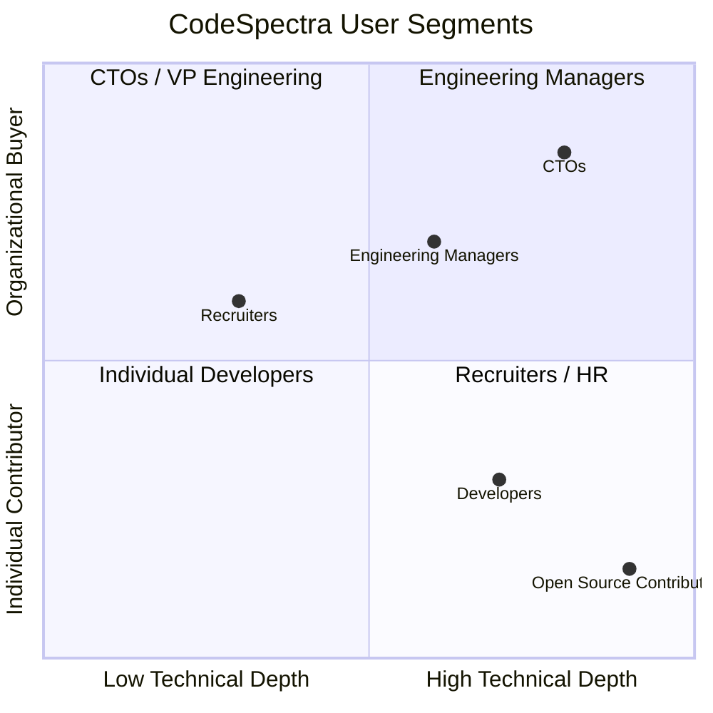

# Product Vision — CodeSpectra

> **Auto-Generated**: Internal Engineering documentation.

> **Document**: Product Vision
> **Date**: 2026-07-08
> **Status**: Living document

---

## 1. Mission Statement

> **"Make every developer better through AI-powered code intelligence."**

CodeSpectra is an integrated platform that combines technical assessment, code quality analysis, AI-powered development assistance, and engineering management into a single unified experience. We eliminate the fragmentation between tools developers use to learn, prove themselves, build quality software, and grow their careers.

---

## 2. The Four Pillars

```mermaid
graph TD
    CS[CodeSpectra Platform] --> P1[Hiring & Assessment]
    CS --> P2[Development & Code Quality]
    CS --> P3[DevOps & Engineering Management]
    CS --> P4[AI Integration]

    P1 --> P1a[Coding Problems]
    P1 --> P1b[AI Interviews]
    P1 --> P1c[Proctoring & Identity Verify]
    P1 --> P1d[Certifications]

    P2 --> P2a[Code Scanner]
    P2 --> P2b[Quality Gates]
    P2 --> P2c[AI Code Review]
    P2 --> P2d[Compliance (OWASP/NIST)]

    P3 --> P3a[GitHub Integration]
    P3 --> P3b[Workflow Automation]
    P3 --> P3c[Team Management]
    P3 --> P3d[Analytics & Metrics]

    P4 --> P4a[AI Chat & Hints]
    P4 --> P4b[Smart Grading]
    P4 --> P4c[Agentic Fixes]
    P4 --> P4d[MCP Server]
```

---

### Pillar 1: Hiring & Assessment

**Vision**: Replace fragmented technical screening (HackerRank, LeetCode, Codility) with an intelligent, anti-cheating-enabled assessment platform that provides genuine signal about candidate ability.

**Current State (Verified)**:
- 90+ API routes for problems, submissions, challenges, exams, interviews
- Piston-powered sandboxed code execution for 15+ languages
- AI interview system with adaptive follow-up questions (GPT-4-turbo)
- Identity verification via Gemini Vision (selfie vs ID photo)
- Proctor events collection for exam integrity monitoring
- 6 skill certifications (JavaScript, Python, SQL, React, Algorithms, Frontend Developer)
- XP economy with first-blood bonuses and leaderboards

**Gaps**:
- Non-adaptive problem difficulty (no IRT-style calibration)
- Limited proctoring (no screen recording, eye tracking, or browser lockdown)
- No bulk assessment scheduling for enterprises
- Certifications are multiple-choice only (no coding submission integration yet)

---

### Pillar 2: Development & Code Quality

**Vision**: Provide SonarQube-equivalent code quality analysis with AI-generated fixes, directly in the developer's workflow — without the operational overhead of self-hosting a quality platform.

**Current State (Verified)**:
- A–E quality rating system (Security, Reliability, Maintainability, Technical Debt)
- Configurable quality gates with OWASP/NIST/PR presets
- Local heuristic-based code analyzer (console.log, var, ==, long lines, empty catches, TODOs)
- AI-powered code review (Claude Sonnet 4.5) with severity ratings
- AI code analysis (time/space complexity, efficiency, edge cases)
- Suggested fixes with apply/unapply workflow

**Gaps**:
- Heuristic analyzer is simplistic — no AST parsing or deep semantic analysis
- No real-time analysis in IDE (no VS Code extension or LSP integration)
- No CI/CD plugin (GitHub Action, GitLab CI, Jenkins plugin)
- No baseline comparison (diff new issues from existing)

---

### Pillar 3: DevOps & Engineering Management

**Vision**: Connect code quality to engineering management with automated workflows, team analytics, and actionable metrics — bridging the gap between what developers commit and what managers measure.

**Current State (Verified)**:
- GitHub OAuth + webhook integration with automated PR review comments
- Workflow engine (DAG-based automations: HTTP, AI, MongoDB, delay, log)
- Scheduler with cron expression support
- Team management with role-based access (owner → admin → member)
- Admin dashboard with system stats, cache management, audit logs
- Web Vitals performance tracking

**Gaps**:
- No DORA metrics (deployment frequency, lead time, MTTR, change failure rate)
- No SLA/SLO tracking
- No Jira/Linear integration
- No custom dashboard builder
- No CI/CD pipeline integration

---

### Pillar 4: AI Integration

**Vision**: Embed AI throughout every surface — from hints that teach, to reviews that improve code, to agents that fix issues, to an MCP server that lets external AI tools interact with the platform.

**Current State (Verified)**:
- Multi-model LLM gateway (Claude Sonnet 4.5, Gemini 3 Flash, GPT-4o-mini)
- 11 AI endpoints: chat, hints, code-review, code-analysis, grade, generate-problem, skill-insights, identity-verify, agent, complete, chat-stream
- Vercel AI SDK integration for structured output generation (interview service)
- Agentic fix loop (analyze → fix → re-analyze, up to 5 steps)
- MCP server exposing 5 tools (list_problems, get_problem, run_code, get_user_xp, get_leaderboard)
- AI Inventory system tracking 13 categories of AI assets

**Gaps**:
- No proper RAG/vector search (hints are prompt-only, not retrieval-augmented)
- No fine-tuned models
- No AI usage analytics / cost tracking
- No A/B testing for AI prompt variations
- AI inventory is partially static (recommendations hardcoded, not dynamic)

---

## 3. Target Users



### Primary Audiences

| Segment | Primary Need | Key Features | Monetization |
|---|---|---|---|
| **Individual Developers** | Skill improvement, interview prep, code quality feedback | Problems, AI hints, code review, scanner | Free tier → Pro ($29/mo) |
| **Engineering Managers** | Team code quality visibility, PR workflow automation | Quality gates, GitHub integration, team dashboard | Pro → Enterprise ($99/mo) |
| **Recruiters / HR** | Technical screening at scale | Assessments, identity verify, certifications | Enterprise custom pricing |
| **Organizations** | Unified dev tools, compliance, hiring pipeline | Everything + SSO, audit logs, dedicated support | Enterprise custom pricing |

---

## 4. Current State vs Vision

| Dimension | Current State | Future Vision |
|---|---|---|
| **Code Analyzer** | Heuristic, rule-based, 10-15 rules | AST-based, rule + ML hybrid, 200+ rules |
| **AI Integration** | Prompt-based, stateless | RAG-augmented, context-aware, fine-tuned models |
| **Scalability** | Single-node, in-memory caches | Distributed, horizontally scalable, global CDN |
| **Enterprise** | Basic RBAC, no SSO | SAML/OIDC SSO, SCIM provisioning, SOC 2 |
| **Mobile** | Empty shell (android/ios dirs with README) | Full React Native app for on-the-go assessments |
| **Testing** | Minimal (2 test files found) | >80% coverage, E2E tests, visual regression |
| **CI/CD Integration** | GitHub only (webhook + OAuth) | GitHub Actions, GitLab CI, Jenkins, CircleCI |
| **Billing** | Razorpay active, Stripe stubbed ("DEAD" pattern) | Dual-processor with full subscription lifecycle |
| **Developer Experience** | No VS Code extension | IDE extension, LSP server, CLI tool |

---

## 5. Strategic North Stars

1. **Zero-config onboarding**: A developer should be able to scan their first repo and get actionable feedback in under 60 seconds.
2. **AI-first, everywhere**: Every surface area should have an AI augmentation — from problem hints to code review to certification generation.
3. **Unified data model**: Problems, submissions, scans, reviews, and scores should form a connected graph so skill analytics is accurate across all dimensions.
4. **Enterprise-ready by default**: Security, compliance, audit, and SSO are not add-ons; they are built into the architecture from day one.
5. **Open ecosystem**: MCP server, public API, webhook system, and plugin architecture ensure CodeSpectra is a platform, not a silo.

---

## 6. Success Criteria (12 Months)

| Metric | Current | Target |
|---|---|---|
| Active users (monthly) | Not measured | 10,000 MAU |
| Code scans per day | Not measured | 50,000 scans/day |
| Problems in catalog | < 100 | 1,000+ problems |
| Certification exams passed | Not measured | 5,000 certifications |
| Enterprise customers | Unknown | 50 paid organizations |
| Test coverage | Minimal | >80% |
| API uptime | Unknown | 99.9% |
