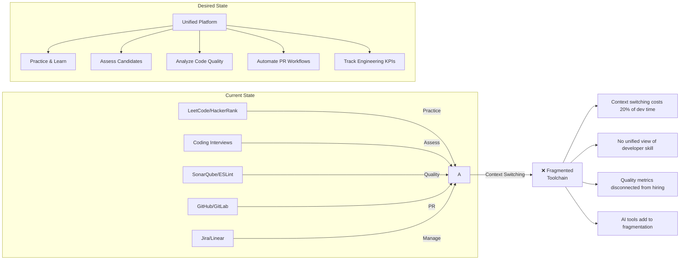

# Problem Statement — CodeSpectra

> **Auto-Generated**: Internal Engineering documentation.

> **Document**: Problem Statement & Market Analysis
> **Date**: 2026-07-08
> **Classification**: Internal — Strategic

---

## 1. The Core Problem

### The Fragmented Developer Toolchain

A developer's lifecycle involves five distinct activities that currently require 5–10 different tools:



### Key Pain Points

#### 1. Hiring is Broken
- **False positives**: 40% of hires who pass technical screens underperform within 6 months (source: Glassdoor)
- **Cheating epidemic**: 30-50% of remote candidates use AI tools to cheat (source: multiple proctoring vendors)
- **No standardized quality signal**: Resumes and GitHub stars are poor predictors of code quality
- **Fragmented assessment stack**: Screening (HackerRank) → Interview (CoderPad) → Offer → Onboarding — no data continuity

#### 2. Code Quality is Siloed
- **SonarQube complexity**: Self-hosting requires JVM, PostgreSQL, Elasticsearch — operational overhead that many teams avoid
- **Late feedback**: Most quality analysis runs in CI/CD, not during development or PR review
- **Security blind spots**: OWASP Top 10 knowledge is not systematically tested in engineering organizations
- **No unified rating**: No single "code health score" that management can track over time

#### 3. AI Tools are Adding Chaos
- **Tool sprawl**: GitHub Copilot, Cursor, Claude, ChatGPT, CodeRabbit — each solves one slice
- **No governance**: Organizations cannot enforce code quality standards on AI-generated code
- **No measurement**: Teams cannot measure whether AI is actually improving code quality or just increasing velocity of bad code
- **Vendor lock-in**: Each AI tool has its own model, pricing, and data policies

#### 4. Engineering Management is Opaque
- **DORA metrics**: Few teams reliably track deployment frequency, lead time, MTTR, change failure rate
- **No developer growth analytics**: "Which skills is my team building?" is answered anecdotally, not data-driven
- **Certification fragmentation**: AWS certs, Coursera, internal training — no standardized skill verification employers trust
- **No compliance automation**: SOC 2, PCI-DSS, HIPAA code-level compliance is manual and error-prone

---

## 2. Market Landscape

```mermaid
quadrantChart
    title Competitive Landscape
    x-axis Narrow (Single Feature) --> Broad (Platform)
    y-axis Developer Tool --> HR / Talent Tool
    quadrant-1 Full Platform Play
    quadrant-2 Talent Assessment
    quadrant-3 Point Solutions
    quadrant-4 Enterprise HR Platforms
    CodeSpectra: [0.75, 0.55]
    HackerRank: [0.4, 0.75]
    SonarQube: [0.25, 0.2]
    GitHub: [0.65, 0.3]
    CoderPad: [0.25, 0.7]
    Codility: [0.35, 0.8]
    CodeRabbit: [0.3, 0.15]
    LinearB: [0.5, 0.35]
    Plato: [0.45, 0.4]
```

### Competitor Analysis

| Competitor | Category | Strength | Weakness | Threat Level |
|---|---|---|---|---|
| **HackerRank** | Technical screening | Brand, enterprise sales, large problem library | No code quality, no AI reviews, expensive | High |
| **SonarQube** | Code quality | Deep analysis, industry standard rating (A–E) | Ops-heavy, no hiring, no AI | Medium |
| **CodeRabbit** | AI PR review | Fast AI reviews, GitHub native | Narrow scope, no assessment | Medium |
| **GitHub Copilot** | AI coding assistant | Massive user base, IDE-native | No quality analysis, no assessment | Low (partner) |
| **LinearB** | Engineering management | DORA metrics, Git analytics | No code quality, no hiring | Low |
| **Codility** | Technical screening | Fair coding assessments | No quality, no AI, no certifications | Medium |
| **CoderPad** | Live interviews | Real-time collaboration | No async assessment, no quality | Low |

### Market Gap

**No existing product spans all four pillars** (hiring, quality, management, AI). A developer must use 3–5 tools to get what CodeSpectra aims to provide in one platform. This creates:

- **Cost**: 3–5x vendor management overhead
- **Data loss**: No connection between "how someone codes in an interview" and "how they code on the job"
- **Context switching**: Tool boundaries mean insights are lost
- **AI fragmentation**: No single policy for AI tool usage across the SDLC

---

## 3. Why CodeSpectra Exists

### Origin

CodeSpectra was built from the observation that the developer tooling market is undergoing a once-in-a-decade shift driven by two forces:

1. **AI is changing how code is written** — but quality assurance for AI-generated code is an unsolved problem
2. **Remote work is permanent** — trust-based hiring and code quality assessment need to be rebuilt for distributed teams

### Core Thesis

> **The same platform that assesses candidates should also assess the code they write on day one, and continue assessing it throughout their tenure.**

CodeSpectra breaks down the artificial wall between hiring assessment and ongoing code quality management:

- A candidate's assessment submission → feeds into skill analytics
- A developer's PR → gets the same quality gate as a hiring screen
- A certification earned → is backed by the same engine that grades submissions
- An AI review of production code → uses the same model as interview feedback

### Differentiation

| Dimension | Traditional Approach | CodeSpectra |
|---|---|---|
| Assessment ↔ Code Quality | Separate vendors, no data sharing | Unified data model, shared analysis engine |
| AI Code Review | Per-tool model (e.g., CodeRabbit only) | Multi-model (Claude, Gemini, GPT) with routing |
| Proctoring | Video-only, expensive | AI vision-based identity verification |
| Certifications | Vendor-specific, expensive | Open-source question banks, transparent |
| Workflow Automation | Custom scripts, CI config | Built-in DAG workflow engine |
| Extensibility | Closed APIs, no standard | MCP server, open protocol |

---

## 4. Success Metrics

### Product Metrics

| Metric | Definition | Current Baseline | Target (12 Mo) |
|---|---|---|---|
| **Adoption** | Monthly active users (MAU) | Not instrumented | 10,000 |
| **Code Scans** | Total scans per day | Not instrumented | 50,000 |
| **Submissions** | Problem submissions per day | Not instrumented | 5,000 |
| **AI Reviews** | AI code reviews per day | Not instrumented | 1,000 |
| **Certifications** | Exams passed per month | Not instrumented | 500 |

### Quality Metrics

| Metric | Definition | Target |
|---|---|---|
| **Issue Detection Rate** | % of real issues caught by scanner vs manual review | >80% |
| **AI Review Accuracy** | Human-evaluated relevance of AI review comments | >85% |
| **False Positive Rate** | Issues flagged that are not real problems | <10% |
| **Quality Gate Accuracy** | Gates correctly passing/failing based on human review | >95% |

### Business Metrics

| Metric | Definition | Target (12 Mo) |
|---|---|---|
| **Free → Pro Conversion** | % of free users who upgrade | 5% |
| **Enterprise Customers** | Active paid organizations | 50 |
| **Monthly Recurring Revenue** | MRR from subscriptions | $50,000 |
| **Net Promoter Score** | User satisfaction survey | >40 |

### Engineering Metrics

| Metric | Current | Target |
|---|---|---|
| **Test Coverage** | <10% (estimated) | >80% |
| **TypeScript Errors** | Unknown (silently ignored) | Zero |
| **API p50 Latency** | Not measured | <200ms |
| **API p99 Latency** | Not measured | <1s |
| **Uptime** | Not instrumented | 99.9% |
| **Security Scan** | None | Monthly penetration tests + SAST |

---

## 5. Risks & Mitigations

| Risk | Likelihood | Impact | Mitigation |
|---|---|---|---|
| Market position unclear (too broad) | Medium | High | Focus marketing on strongest pillar first (AI code quality) |
| LLM costs unpredictable | High | High | Multi-model routing to optimize cost/quality, caching, usage tiers |
| MongoDB migration debt | Medium | Medium | Complete Supabase removal, add schema validation |
| No enterprise sales motion | High | High | Build self-serve → sales-assisted funnel |
| AI cheating arms race | Medium | Medium | Continuous improvement of proctoring + identity verification |
