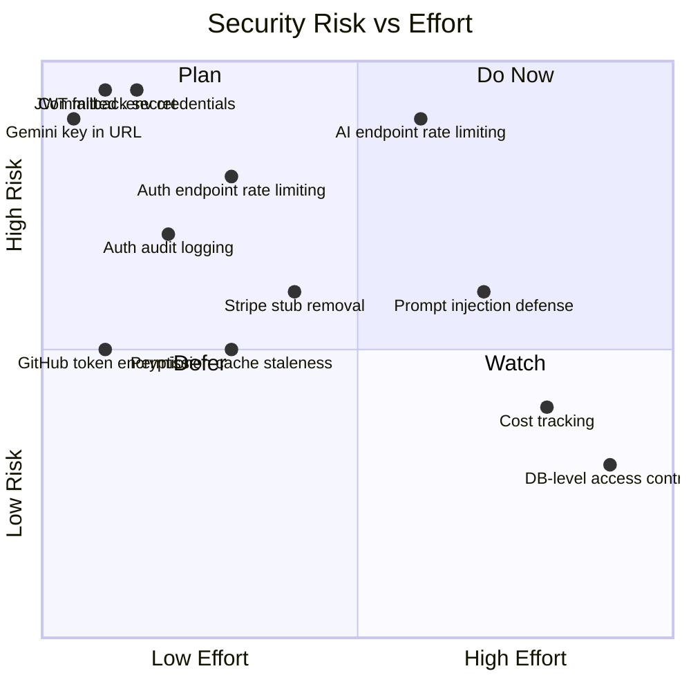

> **Auto-Generated Documentation**
> **Last Updated**: 2026-07-08
> **Auto-Update Rule**: Regenerate when codebase architecture or schema changes.

# CodeSpectra — Security Remediation Summary

## Top 10 Remediation Items

| # | Finding | Severity | File:Line | Risk | Effort | Recommendation |
|---|---------|----------|-----------|------|--------|----------------|
| 1 | **JWT fallback secret hardcoded** | CRITICAL | `frontend/lib/session.ts:6` | Attacker can forge session tokens for any user/role | **1 hour** | Fail hard at startup if `SESSION_SECRET` is unset in production; add `process.exit(1)` guard in `signSessionToken()` |
| 2 | **MongoDB credentials committed in `.env`** | CRITICAL | `backend/.env:1` | Full database access for anyone with repo access | **2 hours** | Rotate credentials immediately; remove file from git history with BFG Repo-Cleaner; use `.env` template with `.env.example` |
| 3 | **Gemini API key in URL query parameter** | CRITICAL | `backend/ai_client.py:55` | Key leaked via proxy logs, referrer headers, browser history | **30 minutes** | Move API key to `x-goog-api-key` header (Gemini supports this); remove query-string key |
| 4 | **No rate limiting on AI endpoints** | CRITICAL | `backend/ai_router.py` (all endpoints) | Attacker can exhaust LLM quota, cause runaway costs | **3 days** | Add per-user + per-IP rate limiting in FastAPI middleware; implement token bucket for LLM API calls |
| 5 | **No rate limiting on auth endpoints** | HIGH | `frontend/app/api/auth/login/route.ts`, `signup/route.ts` | Brute-force password attacks, account enumeration | **1 day** | Add exponential backoff per IP + per email on login failures; rate-limit signup per IP |
| 6 | **Firebase session cookie + dual auth chain confused** | HIGH | `frontend/lib/route-auth.ts:56-89` | Complex fallback chain can mask credential failures | **1 day** | Consolidate to single auth path; enforce at least one provider is configured at startup |
| 7 | **No auth event audit logging** | HIGH | `frontend/lib/db/misc.ts:70` (`admin_audit_logs` exists but unused) | Cannot investigate unauthorized access | **1 day** | Add middleware that logs `{ user_id, action, ip, user_agent, timestamp }` for all auth mutations |
| 8 | **Permission cache 60-second staleness** | MEDIUM | `frontend/lib/route-auth.ts:22-27` | Role changes take up to 60s to propagate; per-process cache not shared across replicas | **2 days** | Reduce TTL to 10s or use MongoDB change streams; add `invalidatePermissionCache()` call on role writes |
| 9 | **GitHub OAuth tokens optionally encrypted** | MEDIUM | `frontend/lib/github-api-auth.ts:16`, `github-token-crypto.ts` | Leaked GitHub tokens in DB if DB is breached | **1 day** | Make AES-256-GCM encryption mandatory in production; warn at startup if `GITHUB_TOKEN_ENCRYPTION_KEY` is missing |
| 10 | **Stripe webhook stubbed as throwing errors** | HIGH | `frontend/lib/stripe-webhook-sync.ts` | Any Stripe webhook call returns 500; no Stripe signature verification exists | **2 days** | Implement webhook handler with `stripe.webhooks.constructEvent()`; or remove Stripe stubs entirely |

---

## Remediation Priority Matrix

---

## Vulnerability Breakdown by Category

| OWASP Category | Count | Top Finding |
|----------------|-------|-------------|
| A01: Broken Access Control | 4 | RBAC not enforced at DB level |
| A02: Cryptographic Failures | 3 | JWT fallback secret (HS256 symmetric) |
| A03: Injection | 0 | ✓ MongoDB queries parameterized |
| A04: Insecure Design | 5 | No rate limiting, no cost tracking |
| A05: Security Misconfiguration | 2 | Piston privileged mode, no internal TLS |
| A06: Vulnerable Components | 0 | (Not assessed — dependency scan needed) |
| A07: Auth Failures | 3 | Dual auth chain, no session revocation |
| A08: Integrity Failures | 2 | Stripe stub, optional token encryption |
| A09: Logging Failures | 2 | No auth audit, console.error only |
| A10: SSRF | 0 | (Not assessed) |

---

## Recommended Security Roadmap

| Phase | Items | Timeline |
|-------|-------|----------|
| **Immediate (CRITICAL)** | Fix JWT fallback, rotate DB creds, move Gemini key to header | Day 1 |
| **Week 1** | Rate limiting (AI + Auth endpoints), auth audit logging | Days 2–5 |
| **Week 2** | Consolidate auth chain, GitHub token encryption enforcement, reduce permission cache TTL | Days 6–10 |
| **Month 1** | Prompt injection defense, cost tracking, Stripe cleanup | Days 11–30 |
| **Quarter 2** | DB-level access control, mTLS between containers, session revocation, 2FA full implementation | Days 31–90 |
