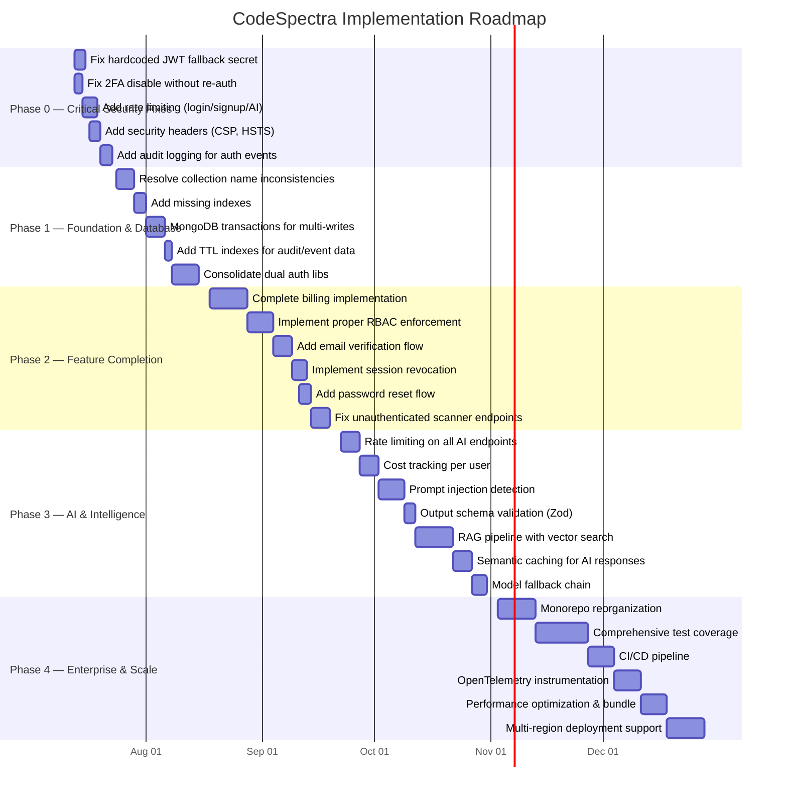

# CodeSpectra Implementation Roadmap

> **Auto-Generated**: Internal Engineering documentation.

> **Auto-generated:** This document is derived from the codebase audit. Last updated: 2026-07-08.
> **Status:** Living document — update as phases are completed.

---

## Overview

This roadmap covers 5 phases over ~24 weeks to bring CodeSpectra from its current MVP state to a production-ready enterprise platform. Each phase addresses specific findings from the comprehensive codebase audit.

---

## Mermaid Gantt Chart



---

## Phase 0 — Critical Security Fixes (Week 1–2)

**Goal:** Eliminate immediate security vulnerabilities that could lead to account takeover, data breach, or DoS.

| # | Task | Files Affected | Effort | Priority |
|---|------|---------------|--------|----------|
| 0.1 | **Fix hardcoded JWT fallback secret** — Replace `'fallback-dev-secret-do-not-use-in-production-32chars'` with runtime error if `SESSION_SECRET` is unset | `frontend/lib/session.ts:6` | 1h | CRITICAL |
| 0.2 | **Fix 2FA disable without re-auth** — Require password re-entry or TOTP code before disabling 2FA | `frontend/lib/auth-context.tsx`, API routes | 3h | CRITICAL |
| 0.3 | **Add rate limiting to login/signup** — Apply sliding-window limiter to auth endpoints | `frontend/app/api/auth/login/route.ts`, `frontend/app/api/auth/signup/route.ts` | 4h | CRITICAL |
| 0.4 | **Add rate limiting to all AI endpoints** — Extend Upstash/in-memory limiter to `/api/ai/*` | `frontend/app/api/ai/*/route.ts`, `backend/ai_router.py` | 6h | HIGH |
| 0.5 | **Add security headers** — Configure CSP, HSTS, X-Frame-Options, X-Content-Type-Options | `frontend/next.config.mjs`, `backend/server.py` | 4h | HIGH |
| 0.6 | **Add audit logging for auth events** — Log login, signup, logout, 2FA, password changes | `frontend/lib/route-auth.ts`, session routes | 6h | HIGH |

### Security Issues Found During Audit

| Issue | Severity | Evidence |
|-------|----------|----------|
| Hardcoded JWT secret | CRITICAL | `session.ts:6` — secret falls back to known string |
| API key in URL (Gemini) | HIGH | `backend/ai_client.py:55` — `?key={key}` in URL |
| No rate limiting on auth | HIGH | Login/signup routes have no rate limit |
| No CSP/HSTS headers | MEDIUM | `next.config.mjs` has no security headers config |
| Stripe/Supabase stubs leak info | LOW | Dead code returns 503 with stack traces |
| Gemini TLS config implicit | LOW | No custom CA bundle for enterprise MITM environments |

---

## Phase 1 — Foundation & Database (Week 3–6)

**Goal:** Resolve data integrity risks, improve query performance, and establish a consistent data access layer.

| # | Task | Files Affected | Effort |
|---|------|---------------|--------|
| 1.1 | **Resolve collection name inconsistencies** — `jobs()` returns `job_postings` collection; `users()` returns `user` (singular). Audit all `db.collection()` calls for consistency | `frontend/lib/db/content.ts:130`, `frontend/lib/db/admin.ts:96`, all `db/*.ts` | 2d |
| 1.2 | **Add missing indexes** — email (unique), slug (unique), user_id+created_at (compound), status+created_at | `frontend/lib/db-init.ts`, `frontend/lib/mongodb.ts` | 1d |
| 1.3 | **Implement MongoDB transactions** — Wrap multi-collection writes (billing + subscription, user creation + profile) in sessions | `frontend/app/api/billing/*/route.ts`, `frontend/app/api/auth/signup/route.ts` | 3d |
| 1.4 | **Add TTL indexes** — Auto-expire audit logs, webhook events, session tokens after retention period | `frontend/lib/db/admin.ts` | 1d |
| 1.5 | **Consolidate dual auth libs** — Merge `route-auth.ts` into `api-auth.ts` (or eliminate indirect re-export pattern that confuses Turbopack) | `frontend/lib/route-auth.ts`, `frontend/lib/api-auth.ts` | 4d |
| 1.6 | **Define Zod schemas for all DB entities** — Move from manual `as any` casts to validated schemas | All `frontend/lib/db/*.ts` | 3d |

### Collection Name Audit Findings

| Function | Collection Used | Expected | Issue |
|----------|---------------|----------|-------|
| `users()` in `admin.ts` | `user` | `users` | Singular vs plural |
| `jobs()` in `content.ts` | `job_postings` | `jobs` | Mismatched name |
| `allUsers()` in `admin.ts` | `user` | `users` | Singular vs plural |
| `getUserById()` in `admin.ts` | `user` | `users` | Singular vs plural |

---

## Phase 2 — Feature Completion (Week 7–10)

**Goal:** Close functional gaps where placeholders and stubs currently block user workflows.

| # | Task | Files Affected | Effort |
|---|------|---------------|--------|
| 2.1 | **Complete billing implementation** — Replace 503 stubs in checkout, subscription, cancel routes. Full Razorpay + Stripe flows | `frontend/app/api/billing/checkout/route.ts`, `subscription/route.ts`, `cancel/route.ts`, `payment-methods/route.ts`, `invoices/route.ts` | 8d |
| 2.2 | **Implement proper RBAC with server-side enforcement** — Add middleware-level auth checks, not just client-side page guards | `frontend/middleware.ts` (create), `frontend/lib/route-auth.ts` | 5d |
| 2.3 | **Add email verification flow** — Send verification email on signup, verify on click, block unverified access | `frontend/app/api/auth/signup/route.ts`, `frontend/lib/transactional-mail.ts` | 4d |
| 2.4 | **Implement session revocation** — Add token blacklist in MongoDB, invalidate sessions on password change | `frontend/lib/session.ts`, `frontend/app/api/auth/session/route.ts` | 3d |
| 2.5 | **Add proper password reset flow** — Replace Firebase-only flow with self-contained email-based reset | `frontend/app/api/auth/forgot-password/route.ts`, `frontend/app/api/auth/reset-password/route.ts` | 3d |
| 2.6 | **Fix unauthenticated scanner endpoints** — Audit scanner API routes for missing auth checks | All `frontend/app/api/scanner/*/route.ts` | 3d |

### Billing Placeholder Inventory

| Route | Method | Status | Issue |
|-------|--------|--------|-------|
| `/api/billing/checkout` | POST | 503 | `"Billing is not configured"` |
| `/api/billing/checkout` | GET | Redirect | Redirects to billing with error |
| `/api/billing/subscription` | GET | 503 | `"Billing is not configured"` |
| `/api/billing/subscription` | PUT | 503 | `"Billing is not configured"` |
| `/api/billing/cancel` | POST | ? | Needs audit |
| `/api/billing/invoices` | GET | ? | Needs audit |
| `/api/billing/payment-methods` | POST | ? | Needs audit |

---

## Phase 3 — AI & Intelligence (Week 11–16)

**Goal:** Secure AI endpoints, add observability, build proper RAG infrastructure, and implement cost controls.

| # | Task | Files Affected | Effort |
|---|------|---------------|--------|
| 3.1 | **Rate limiting on all AI endpoints** — Apply per-user+per-IP limits to chat, hints, code review, grading, agent | `frontend/app/api/ai/*/route.ts`, `backend/ai_router.py` | 3d |
| 3.2 | **Cost tracking per user** — Log token usage per request, attribute to user, cap monthly spend | `backend/ai_router.py`, new `db/cost-tracking.ts` | 4d |
| 3.3 | **Prompt injection detection** — Scan user prompts for injection patterns before sending to LLM | `backend/ai_client.py`, `frontend/lib/ai/` | 5d |
| 3.4 | **Output schema validation** — Validate LLM JSON responses against Zod/Pydantic schemas before returning | `backend/ai_router.py`, all `/api/ai/*/route.ts` | 2d |
| 3.5 | **RAG pipeline with vector search** — Index problem statements, submissions, docs in MongoDB Atlas Vector Search | `frontend/lib/ai/`, `frontend/lib/db/` | 7d |
| 3.6 | **Semantic caching** — Cache semantically similar queries to reduce LLM calls and latency | New cache layer, `frontend/lib/ai/backend.ts` | 4d |
| 3.7 | **Model fallback chain** — On provider failure, fall through: Claude → Gemini → GPT-4o-mini | `backend/ai_router.py:37-41` | 3d |

### AI Endpoint Inventory

| Endpoint | Model | Rate Limited? | Validation? | Cost Tracked? |
|----------|-------|---------------|-------------|---------------|
| `/chat` | Claude Sonnet 4.5 | ❌ | ❌ | ❌ |
| `/complete` | Gemini 3 Flash | ❌ | ❌ | ❌ |
| `/hints` | Gemini 3 Flash | ❌ | ❌ | ❌ |
| `/code-review` | Claude Sonnet 4.5 | ❌ | ❌ | ❌ |
| `/code-analysis` | Gemini 3 Flash | ❌ | ❌ | ❌ |
| `/grade` | Claude Sonnet 4.5 | ❌ | ❌ | ❌ |
| `/agent` | Claude Sonnet 4.5 | ❌ | ❌ | ❌ |
| `/generate-problem` | Claude Sonnet 4.5 | ❌ | ❌ | ❌ |
| `/skill-insights` | Gemini 3 Flash | ❌ | ❌ | ❌ |
| `/identity-verify` | Gemini 3 Flash | ❌ | ❌ | ❌ |

---

## Phase 4 — Enterprise & Scale (Week 17–24)

**Goal:** Prepare codebase for team scaling, production reliability, and multi-region deployment.

| # | Task | Files Affected | Effort |
|---|------|---------------|--------|
| 4.1 | **Monorepo reorganization** — Structure as `apps/frontend`, `apps/backend`, `packages/*` with shared configs | Root level | 7d |
| 4.2 | **Comprehensive test coverage** — Unit tests for auth, RBAC, billing; integration tests for API routes; E2E for critical flows | All | 10d |
| 4.3 | **CI/CD pipeline** — GitHub Actions for lint, typecheck, test, build, deploy | `.github/workflows/` | 5d |
| 4.4 | **OpenTelemetry instrumentation** — Traces for API routes, AI calls, DB queries; metrics for rate limits, error rates | `frontend/instrumentation.ts`, `backend/server.py` | 5d |
| 4.5 | **Performance optimization** — Bundle analysis, code splitting Next.js pages, lazy load scanner components | `frontend/next.config.mjs`, `frontend/app/dashboard/layout.tsx` | 5d |
| 4.6 | **Multi-region deployment** — Atlas global clusters, region-agnostic session store, CDN for static assets | `frontend/next.config.mjs`, `backend/server.py` | 7d |

### Monorepo Proposed Structure

```
codespectra/
├── apps/
│   ├── frontend/          # Next.js 16 application
│   ├── backend/           # FastAPI proxy + AI router
│   └── mobile/            # React Native (future)
├── packages/
│   ├── shared-types/      # Zod schemas, TypeScript interfaces
│   ├── ai-client/         # Shared AI SDK (used by frontend + backend)
│   ├── db-core/           # MongoDB client, models, indexes
│   ├── auth-core/         # Session, RBAC, permissions logic
│   └── config-eslint/     # Shared ESLint config
├── docker-compose.yml
└── package.json           # Workspace root
```

---

## Risk Register

| Risk | Likelihood | Impact | Mitigation |
|------|-----------|--------|------------|
| MongoDB schema drift | High | High | Add Zod schemas + validation in Phase 1 |
| AI cost overrun | Medium | High | Phase 3 cost tracking + caps |
| Session hijacking | Low | Critical | Phase 0 JWT fix + Phase 2 revocation |
| Rate limit bypass | Medium | Medium | Phase 0 + Phase 3 comprehensive limiting |
| Billing data inconsistency | High | High | Phase 1 transactions + Phase 2 completion |
| Auth library divergence | High | Medium | Phase 1 consolidation |
