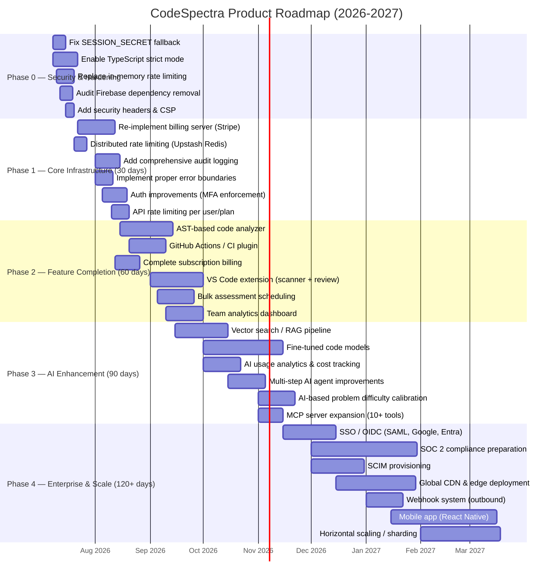
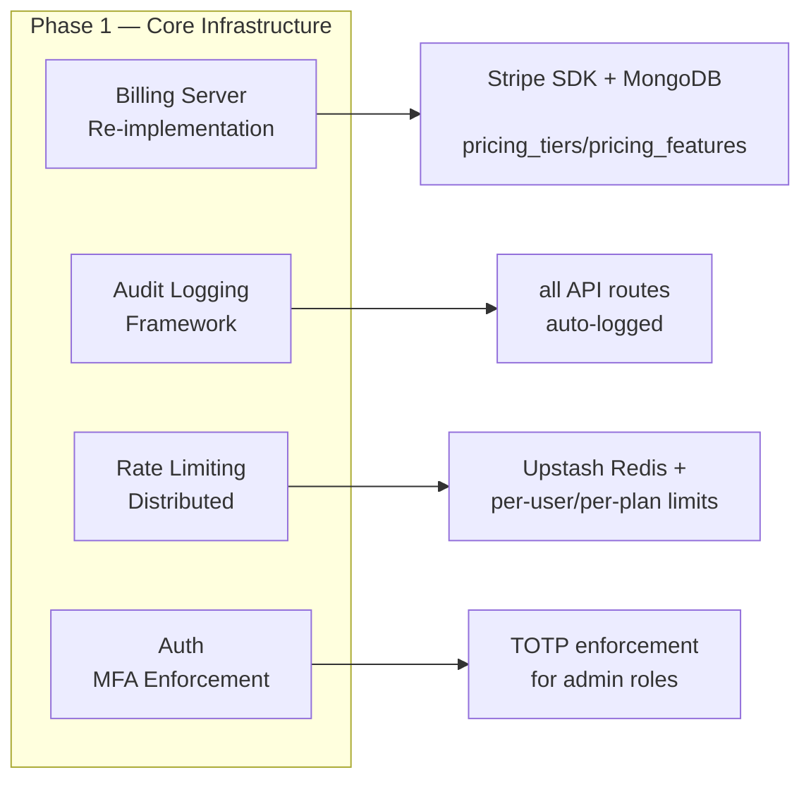
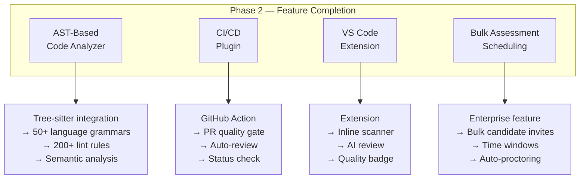
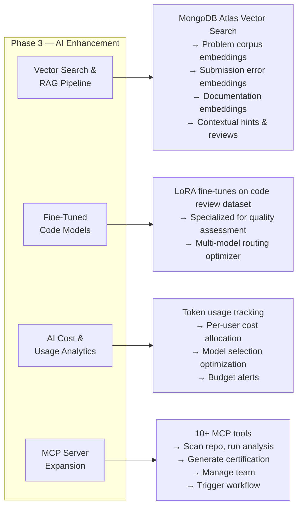
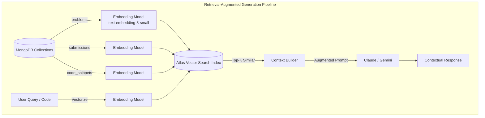
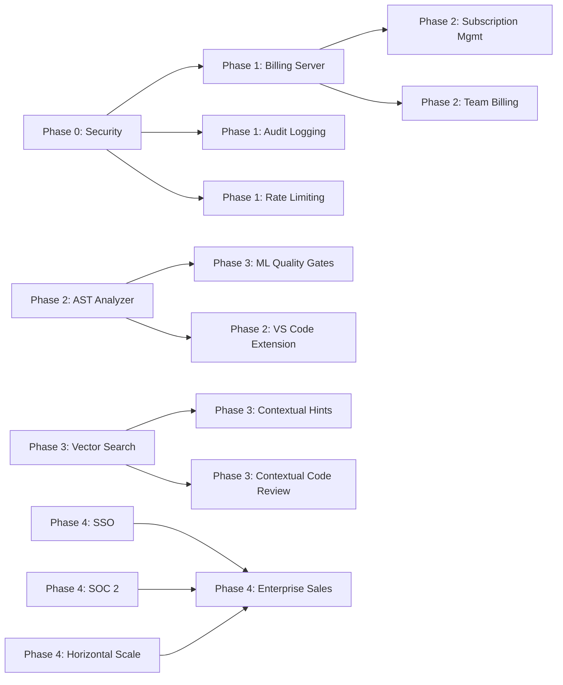

# Product Roadmap — CodeSpectra

> **Auto-Generated**: Internal Engineering documentation.

> **Document**: Product Roadmap  
> **Date**: 2026-07-08  
> **Classification**: Internal — Strategic Planning  

---

## 1. Roadmap Overview



---

## 2. Phase 0 — Security & Hardening (Immediate)

**Timeline**: Days 1–14  
**Theme**: Security first — fix critical vulnerabilities before any feature work  

### Objectives

| Objective | Priority | Verification |
|---|---|---|
| Remove hardcoded `SESSION_SECRET` fallback | Critical | CI fails if env var absent |
| Enable TypeScript strict mode & fix all errors | Critical | `yarn build` must pass with strict rules |
| Replace in-memory rate limiting with distributed | High | Rate limit persists across restarts |
| Audit and remove Firebase dependency | High | No Firebase imports in production build |
| Add security headers (CSP, HSTS, X-Frame-Options) | Medium | Security scan passes |

### Rationale

The codebase has `ignoreBuildErrors: true` in `next.config.mjs` (`frontend/next.config.mjs:18`), a hardcoded fallback dev secret (`frontend/lib/session.ts:6:` `'fallback-dev-secret-do-not-use-in-production-32chars'`), and in-memory-only rate limiting that resets on every server restart (`frontend/lib/in-memory-rate-limit.ts`). These represent critical security and reliability risks that must be addressed before any feature development.

### Deliverables

- [ ] `SESSION_SECRET` validation on startup
- [ ] TypeScript strict mode enabled, all errors resolved
- [ ] Upstash Redis rate limiting with MongoDB fallback
- [ ] Firebase dependency removed or gated behind feature flag
- [ ] Security headers middleware
- [ ] Penetration test (basic)

---

## 3. Phase 1 — Core Infrastructure (30 Days)

**Timeline**: Days 15–44  
**Theme**: Fill critical infrastructure gaps left by Supabase→MongoDB migration  



### Key Deliverables

| Area | Current State | Target State | Owner |
|---|---|---|---|
| **Billing Server** | Stubs throw "DEAD" errors (`frontend/lib/billing-server.ts`) | Full Stripe integration with MongoDB persistence | Backend |
| **Audit Logging** | Admin audit logs exist at API level only | All user + admin actions logged to `admin_audit_logs` | Full-stack |
| **Rate Limiting** | In-memory only, resets on restart | Upstash Redis + per-plan tiers | Backend |
| **Auth** | Firebase fallback, no MFA | Better Auth primary, TOTP enforcement for admins | Full-stack |
| **Error Handling** | Basic try/catch in routes | Global error boundary with structured JSON errors | Full-stack |

### Billing Server Re-implementation Details

The current `billing-server.ts` has 5 exported functions that all throw errors:

```
ensureDefaultPaymentMethod → throws "Billing helpers were temporarily removed"
getSubscriptionRow → throws "Billing helpers were temporarily removed"
composeSubscriptionResponse → throws "Billing helpers were temporarily removed"
completeCheckout → throws "Billing helpers were temporarily removed"
cancelUserSubscription → throws "Billing helpers were temporarily removed"
```

The re-implementation will:
1. Wire Stripe SDK calls to `billing_orders`, `billing_payments`, `billing_subscriptions` MongoDB collections
2. Support dual payment processors: Stripe (global) + Razorpay (India)
3. Implement subscription lifecycle management (create, update, cancel, expire)
4. Add webhook handlers for both Stripe and Razorpay
5. Create a billing admin dashboard for manual interventions

---

## 4. Phase 2 — Feature Completion (60 Days)

**Timeline**: Days 45–104  
**Theme**: Complete core product features that are currently MVP-quality or missing  



### Key Deliverables

| Feature | Current | Target | Effort |
|---|---|---|---|
| **Code Analyzer** | Heuristic (10 rules, no AST) | Tree-sitter AST parsing, 200+ rules | 4 weeks |
| **GitHub CI** | Webhook queue worker only | GitHub Action marketplace listing | 3 weeks |
| **Billing Complete** | Razorpay working, Stripe stubbed | Both processors fully functional | 2 weeks |
| **VS Code Extension** | Not existing | Scanner + AI review inline | 4 weeks |
| **Bulk Assessments** | Per-user invite only | Bulk CSV upload, scheduling engine | 3 weeks |
| **Team Analytics** | Basic team page | DORA metrics, trend charts | 3 weeks |

### Analyzer Upgrade Path

```
Heuristic (current)     → Regex-based, 10 rules, per-line only
    ↓
Tree-sitter (Phase 2)  → AST-based, 200+ rules, multi-file analysis
    ↓
ML Hybrid (Phase 3)    → AST + learned patterns, cross-project insights
    ↓
Continuous (Phase 4)   → Real-time analysis in IDE + CI/CD
```

---

## 5. Phase 3 — AI Enhancement (90 Days)

**Timeline**: Days 105–194  
**Theme**: Move from prompt-based AI to intelligent, retrieval-augmented, fine-tuned AI  



### Key Deliverables

| Feature | Current | Target | Effort |
|---|---|---|---|
| **RAG/Vector Search** | Prompt-only, no embeddings | MongoDB Atlas Vector Search, hybrid search | 4 weeks |
| **Fine-tuned Models** | Off-the-shelf only | LoRA fine-tunes for code review + grading | 6 weeks |
| **AI Usage Analytics** | Not tracked | Per-user cost, model performance dashboards | 3 weeks |
| **MCP Server** | 5 tools | 10+ tools, tool composition | 2 weeks |
| **Difficulty Calibration** | Static (easy/medium/hard) | IRT-based adaptive difficulty | 3 weeks |
| **Agent System** | 5-step linear loop | Stateful agents with tool access | 3 weeks |

### RAG Architecture



---

## 6. Phase 4 — Enterprise & Scale (120+ Days)

**Timeline**: Days 195–365  
**Theme**: Enterprise readiness, compliance, and horizontal scale  

```mermaid
graph TD
    subgraph Phase4[Phase 4 — Enterprise & Scale]
        E1[SSO / OIDC]
        E2[SOC 2
        Compliance]
        E3[Global CDN
        & Edge]
        E4[Mobile App]
        E5[Horizontal
        Scaling]
    end

    E1 --> F1[SAML 2.0, Google Workspace,
    Microsoft Entra ID, Okta
    → Just-in-time provisioning]
    E2 --> F2[Controls: Access, Change, Ops
    → Evidence collection automation
    → Penetration testing]
    E3 --> F3[Edge functions for scanner
    → Multi-region MongoDB Atlas
    → CDN for static assets]
    E4 --> F4[React Native
    → On-the-go assessments
    → Push notifications
    → QR verification]
    E5 --> F5[MongoDB sharding
    → Read replicas
    → Connection pooling tuning
    → Cache layer (Redis)]
```

### Key Deliverables

| Feature | Current | Target | Effort |
|---|---|---|---|
| **SSO / OIDC** | Not supported | SAML 2.0, Google, Entra, Okta | 6 weeks |
| **SOC 2** | Not prepared | Type II ready (controls in place) | 12 weeks |
| **SCIM** | Not supported | User provisioning/deprovisioning | 4 weeks |
| **CDN** | Not deployed | Edge functions, multi-region | 6 weeks |
| **Webhook System** | Inbound only (GitHub) | Outbound event system, retry logic | 3 weeks |
| **Mobile Apps** | Empty shells | React Native: assessment + scanner | 8 weeks |
| **Horizontal Scale** | Single node | Read replicas, sharding, caching | 6 weeks |

---

## 7. Dependency Map



---

## 8. Resource Estimates

| Phase | Duration | Engineering | Design | Ops |
|---|---|---|---|---|
| Phase 0: Security | 2 weeks | 2 engineers | — | 0.25 Ops |
| Phase 1: Core Infrastructure | 4 weeks | 2-3 engineers | 0.25 designer | 0.5 Ops |
| Phase 2: Feature Completion | 8 weeks | 3-4 engineers | 1 designer | 1 Ops |
| Phase 3: AI Enhancement | 12 weeks | 3-4 engineers (1 ML) | 0.5 designer | 1 Ops |
| Phase 4: Enterprise & Scale | 24 weeks | 4-5 engineers | 1 designer | 2 Ops |

---

## 9. Risks & Dependencies

| Risk | Phase | Impact | Mitigation |
|---|---|---|---|
| Stripe SDK integration delays billing | Phase 1 | Blocks subscription revenue | Launch with Razorpay-only initially |
| Fine-tuning ROI unclear | Phase 3 | Potential wasted ML effort | Start with prompt optimization, measure before fine-tuning |
| SOC 2 scope creep | Phase 4 | Delays enterprise readiness | Scope to minimum controls first, expand iteratively |
| Mobile app engineering cost | Phase 4 | High effort for uncertain ROI | Validate with PWA first before native investment |
| MongoDB Atlas vector search costs | Phase 3 | Operating cost increase | Implement tiered embedding strategies (cheap models for indexing) |
