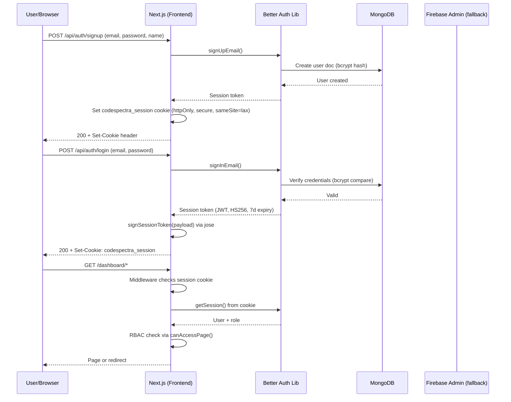
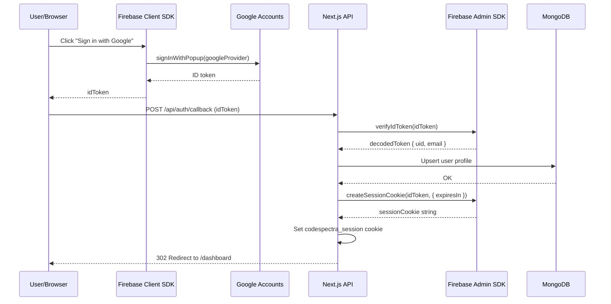
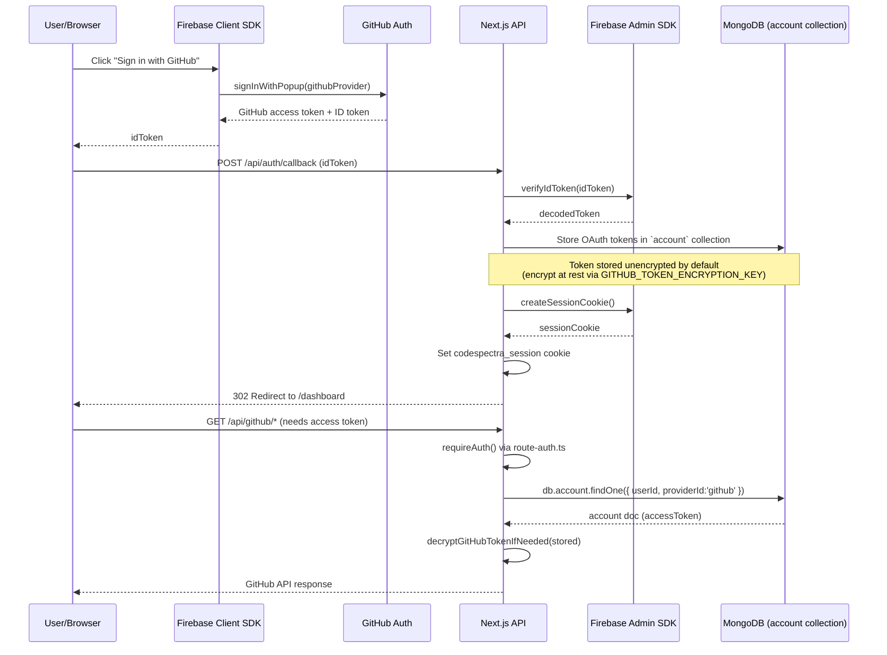

# Authentication Flow — CodeSpectra

> **Last Updated:** 2026-07-08  
> **Auth Libraries:** Better Auth (primary), Firebase (legacy), Jose (session tokens)

---

## 1. Email/Password Authentication

Uses Better Auth on the backend with bcrypt password hashing + JWT session cookie.

**Cookie properties** (`frontend/lib/session.ts:35-41`):
- `httpOnly: true`
- `secure: true` (production only)
- `sameSite: 'lax'`
- `path: '/'`
- `maxAge: 7 days`

---

## 2. Google OAuth

Uses Firebase `signInWithPopup` (client-side) then syncs session cookie (server-side).

---

## 3. GitHub OAuth

Firebase `signInWithPopup` for auth + custom GitHub API integration for repository access.

---

## Auth Inconsistencies Found in Audit

| # | Issue | Location | Details |
|---|-------|----------|---------|
| A1 | **Session token fallback secret** | `frontend/lib/session.ts:6` | Hardcoded dev secret `'fallback-dev-secret-do-not-use-in-production-32chars'` used when `SESSION_SECRET` env var is unset. |
| A2 | **Three independent auth providers** | `lib/route-auth.ts`, `lib/firebase-admin.ts`, `lib/session.ts` | Auth chain: Firebase Admin SDK → Jose session verification → cookie. If Firebase Admin is unconfigured, it silently falls through to Jose-only verification. |
| A3 | **Stub auth-service.ts still importable** | `frontend/lib/auth-service.ts` | All functions return `{ success: false, error: "Supabase auth-service was removed..." }`. Orphaned imports in dashboard pages continue to compile. |
| A4 | **Firebase client config from API** | `frontend/lib/firebase.ts:44` | `/api/firebase-config` returns client-side Firebase config. If this endpoint is unauthenticated, it leaks project metadata. |
| A5 | **Missing OAuth state parameter** | No `state` parameter found in OAuth callback handling | OAuth flows lack CSRF protection via `state` parameter. | 
| A6 | **Bearer token auth without CSRF** | `frontend/lib/route-auth.ts:74-83` | Authorization: Bearer <token> is accepted for API routes alongside session cookies. This widens the attack surface for token exfiltration. |
