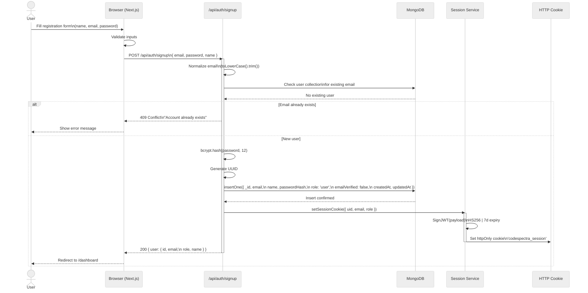
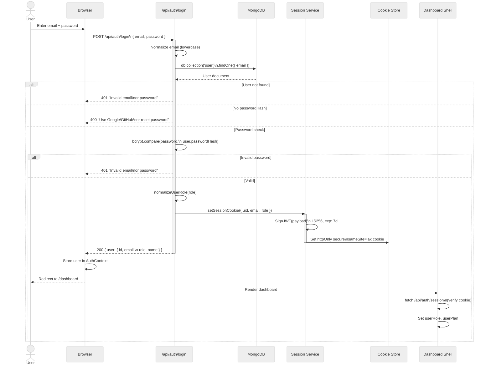
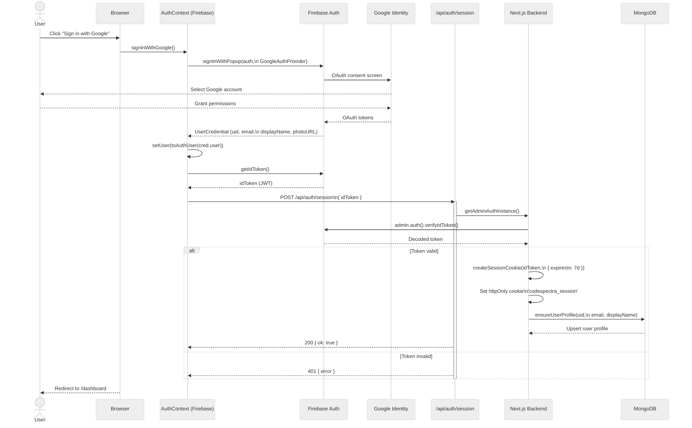
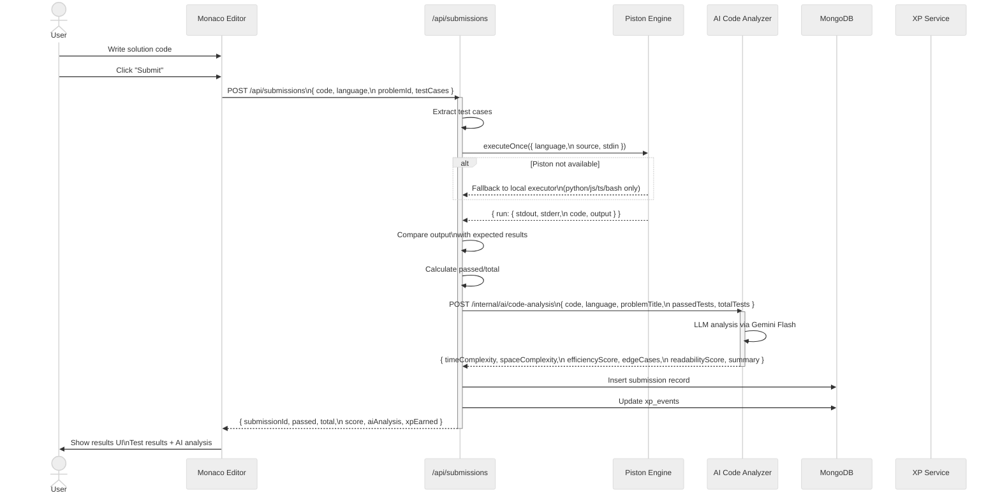
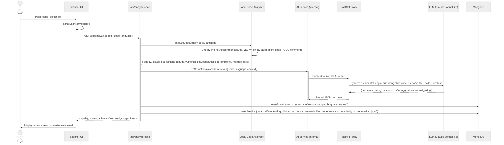
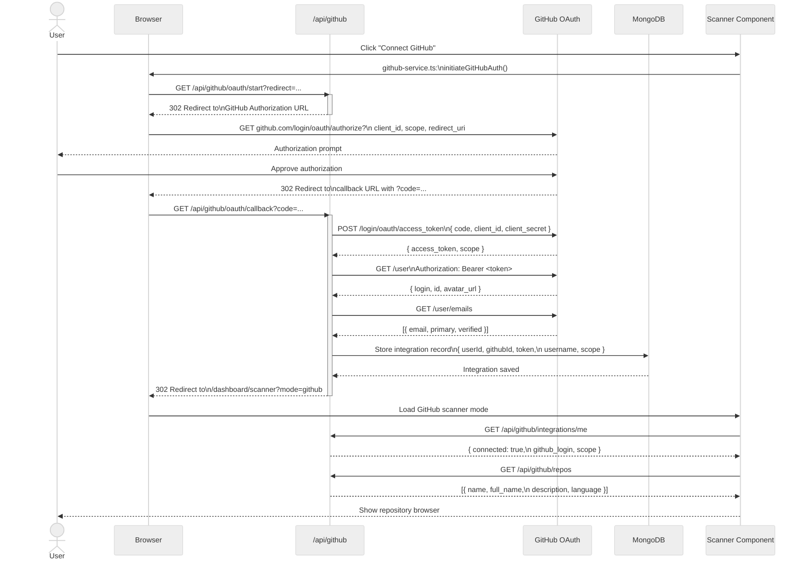
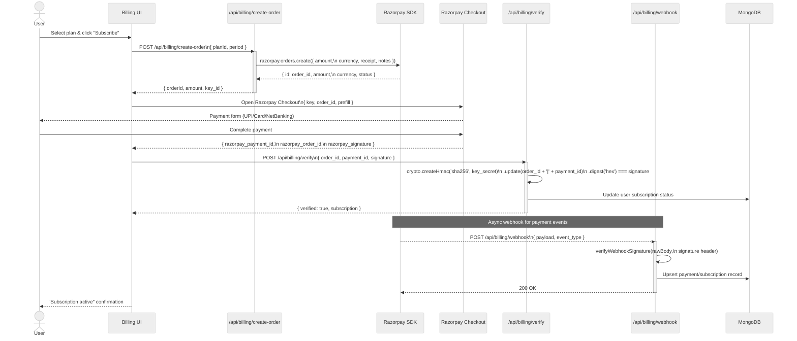

# CodeSpectra Sequence Diagrams

> **Auto-generated from codebase audit** — Last updated: 2026-07-08

---

## 1. User Registration (Email/Password)



---

## 2. User Login (with JWT Session)



---

## 3. Google OAuth Login



---

## 4. Code Submission & Auto-Grading



---

## 5. AI Code Review Pipeline



---

## 6. GitHub Integration OAuth Flow



---

## 7. Razorpay Billing Flow



---

## 8. Certificate Generation & Verification

```mermaid
%%{init: {'theme': 'neutral', 'themeVariables': { 'primaryColor': '#f59e0b' }}}%%
sequenceDiagram
    actor User
    participant CertPage as Certifications Page
    participant CertAPI as /api/certifications
    participant SVGGen as SVG Generator
    participant QR as QR Service
    participant MongoDB as MongoDB
    participant Verifier as Certificate Verifier

    User->>CertPage: View /dashboard/certifications
    CertPage->>CertAPI: GET /api/certifications/me
    CertAPI->>MongoDB: Find user certificates
    MongoDB-->>CertAPI: [{ id, title, issueDate,\n  expiryDate, badgeUrl }]
    CertAPI-->>CertPage: Certificates list

    User->>CertPage: Click "Generate Certificate"
    CertPage->>CertAPI: POST /api/certifications\n{ examId, userId }
    activate CertAPI
    CertAPI->>MongoDB: Verify exam completion
    MongoDB-->>CertAPI: Exam passed with score
    CertAPI->>CertAPI: Generate unique verification code
    CertAPI->>SVGGen: Generate certificate SVG\n(name, exam, date, badge)
    CertAPI->>QR: qrcode.toDataURL(\n  `/cert/verify?code=...`)
    CertAPI->>MongoDB: Save certificate record
    CertAPI-->>CertPage: { certificateUrl, verifyCode, svg }
    deactivate CertAPI

    User->>User: Share certificate URL

    Note over Verifier: Public Verification Flow
    actor Visitor as Anonymous Visitor
    Visitor->>Verifier: Navigate to /cert/verify?code=XXX
    Verifier->>CertAPI: GET /api/certifications/verify?code=...
    CertAPI->>MongoDB: Lookup by verification code
    MongoDB-->>CertAPI: { holder, exam, date,\n  score, valid }
    CertAPI-->>Verifier: Verification result
    Verifier-->>Visitor: Show valid/invalid badge
