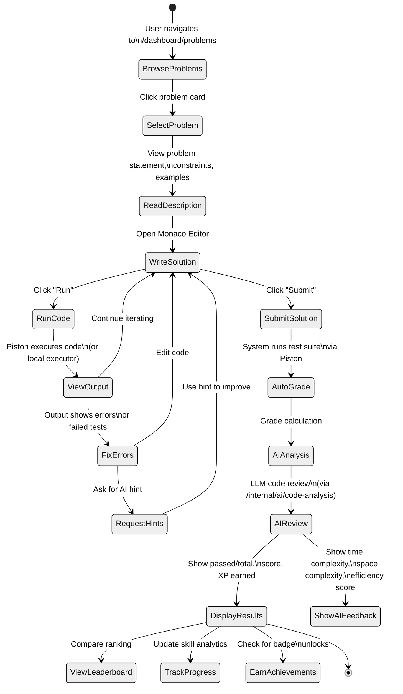
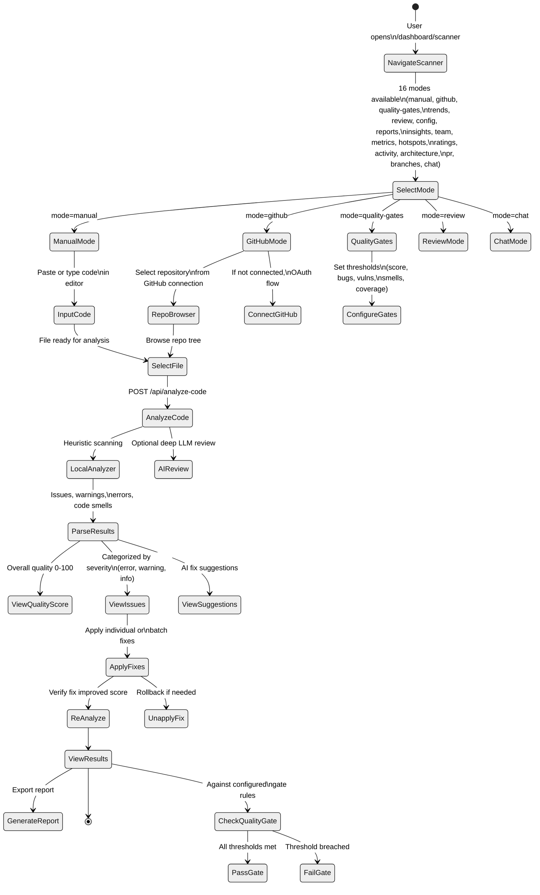
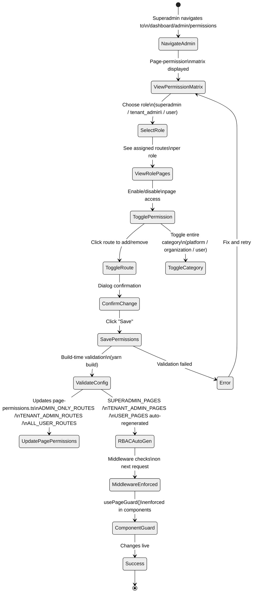

# CodeSpectra Activity Diagrams

> **Auto-generated from codebase audit** — Last updated: 2026-07-08

---

## 1. Problem Solving Workflow



---

## 2. Code Scanner Workflow



---

## 3. Admin Permission Management



---

## 4. Password Reset Flow

```mermaid
%%{init: {'theme': 'neutral', 'themeVariables': { 'primaryColor': '#0ea5e9' }}}%%
stateDiagram-v2
    [*] --> ClickForgotPassword: User clicks\n"Forgot Password?"

    ClickForgotPassword --> EnterEmail: /auth/forgot-password
    EnterEmail --> ValidateEmail: Client-side validation

    state ValidateEmail <<choice>>
    ValidateEmail --> SendResetRequest: POST /api/auth/forgot-password\n{ email }
    ValidateEmail --> EnterEmail: Invalid email format

    SendResetRequest --> CheckAccount: Server looks up\nuser in MongoDB

    state CheckAccount <<choice>>
    CheckAccount --> SendEmail: Account exists -\nsend reset email
    CheckAccount --> ShowSuccess: Account doesn't exist -\nshow generic success\n(security: don't reveal)

    SendEmail --> EmailDelivered: Nodemailer sends\nemail with reset link
    EmailDelivered --> ShowConfirmation: "Check your email"

    ShowConfirmation --> OpenEmail: User checks inbox
    OpenEmail --> ClickResetLink: Click link in email\n(contains ?code=token)

    ClickResetLink --> EnterNewPassword: /auth/reset-password\nform page
    EnterNewPassword --> ValidatePassword: Min 6 chars check

    ValidatePassword --> SubmitReset: POST /api/auth/reset-password\n{ code, newPassword }
    SubmitReset --> UpdateDatabase: bcrypt.hash(newPassword)\n→ MongoDB update
    UpdateDatabase --> RedirectLogin: Redirect to\n/auth/login

    RedirectLogin --> [*]: User logs in with\nnew password
