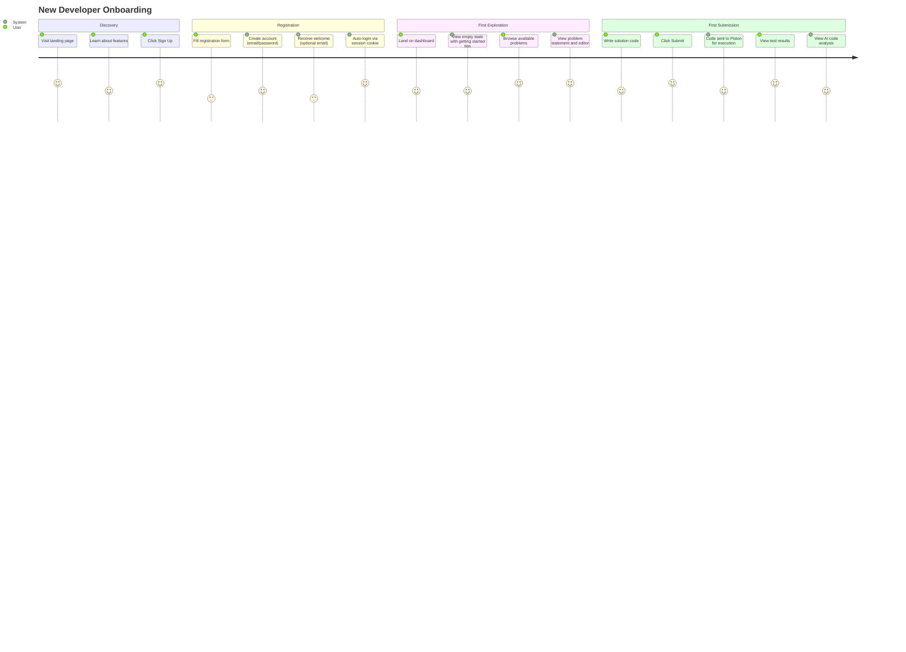
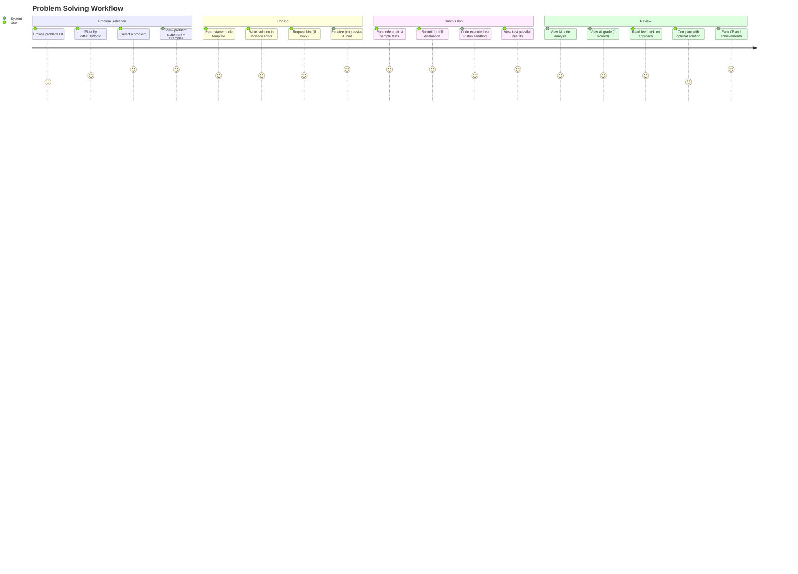
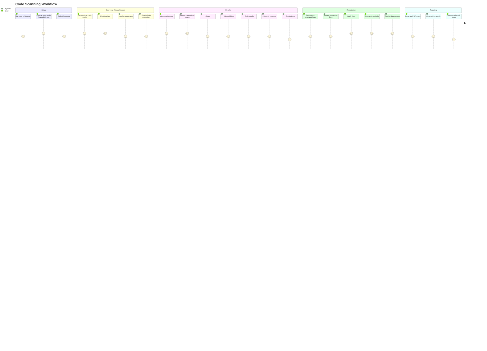
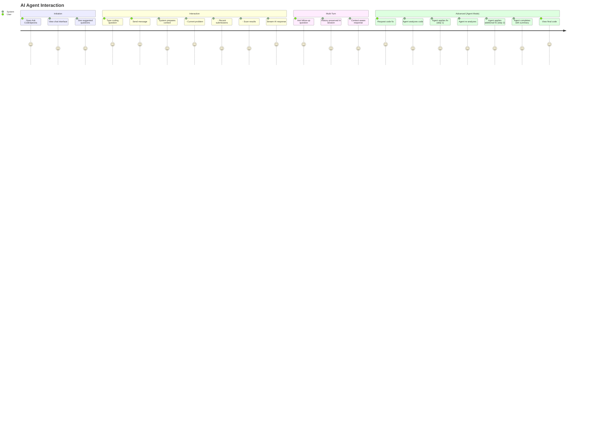
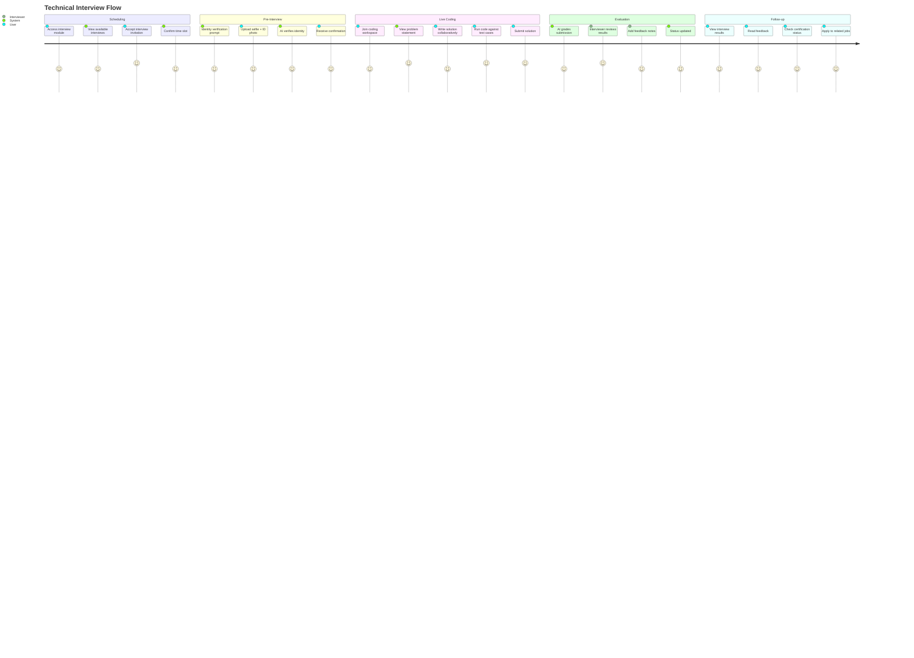
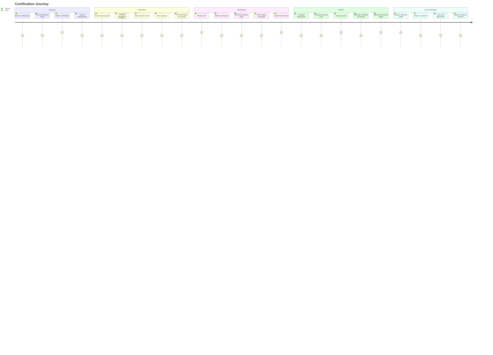

# CodeSpectra User Journeys

> **Auto-generated:** Based on codebase audit. Last updated: 2026-07-08.

---

## 1. New Developer Onboarding



### Key Screens
- Landing page → `/` with feature highlights
- Sign up → `/signup` with email/password form
- Dashboard → `/dashboard` with overview + quick actions
- First problem → `/dashboard/problems?slug=hello-world`
- Results → Submission view with test results + AI feedback

### Success Metrics
- Time to first submission: <5 minutes
- Account verification rate (if email verification enabled): >80%
- Day-1 retention: >40%

---

## 2. Problem Solving Workflow



### Key Screens
- Problem list → `/dashboard/problems` with search/filter
- Problem detail → `/dashboard/problems/[slug]` with statement + editor
- Editor → Monaco code editor with syntax highlighting
- Hints → Progressive 4-level hints panel
- Results → `SubmissionResult` with test output + AI analysis

### Sub-Flows
- **Hint flow:** Nudge (level 1) → Approach (level 2) → Pseudocode (level 3) → Solution (level 4)
- **Code analysis flow:** Time complexity → Space complexity → Efficiency score → Edge cases → Readability
- **Grading flow:** Per-criterion score (correctness, efficiency, style, etc.) → Total → Letter grade → Feedback

---

## 3. Code Scanning Workflow



### Key Screens
- Scanner mode selector → `/dashboard/scanner?mode=manual|github|quality-gates|...`
- Code editor → Monaco editor with scan trigger
- Results dashboard → Quality score + categorized issues
- AI fixes panel → AI-suggested code changes with apply button
- Quality gates → Pass/fail status with failing conditions
- Reports → `ReportGenerator` component with PDF export
- Trends → `MetricsTrendChart` with historical data

### Scanner Modes (19 total)
| Mode | Purpose |
|------|---------|
| `manual` | Paste/type code and scan |
| `github` | Scan GitHub repositories |
| `quality-gates` | Quality Gate configuration & status |
| `trends` | Historical metrics trends |
| `review` | AI code review |
| `config` | Scanner configuration |
| `reports` | Report generation |
| `insights` | Insights dashboard |
| `team` | Team leaderboard |
| `metrics` | File browser with metrics |
| `hotspots` | Security hotspots |
| `ratings` | Quality ratings |
| `activity` | Activity timeline |
| `architecture` | Architecture visualization |
| `pr` | PR integration |
| `branches` | Branch analytics |
| `chat` | Codebase chat Q&A |

---

## 4. AI Agent Interaction



### Key Screens
- Floating chat → `AskCodeSpectra` component (available dashboard-wide)
- Agent view → `/dashboard/agent` with multi-step agent interface
- Code review → `/api/ai/code-review` returns structured JSON
- Chat history → `ai_chat_sessions` collection persists conversations

### AI Endpoints Available
| Endpoint | Function | Model |
|----------|----------|-------|
| `/chat` | Conversational AI assistant | Claude Sonnet 4.5 |
| `/complete` | Non-streaming text completion | Gemini 3 Flash |
| `/hints` | Progressive coding hints | Gemini 3 Flash |
| `/code-review` | Structured code review | Claude Sonnet 4.5 |
| `/code-analysis` | Complexity + quality analysis | Gemini 3 Flash |
| `/grade` | Rubric-based grading | Claude Sonnet 4.5 |
| `/agent` | Multi-step code fixing agent | Claude Sonnet 4.5 |
| `/generate-problem` | AI problem generation | Claude Sonnet 4.5 |
| `/skill-insights` | Developer skill analysis | Gemini 3 Flash |
| `/identity-verify` | Selfie vs ID comparison | Gemini 3 Flash (vision) |

---

## 5. Interview Flow



### Key Screens
- Interview list → `/dashboard/interviews`
- Interview workspace → Coding environment + video/proctoring
- Feedback → `/dashboard/interviews/feedback`
- Results → `/dashboard/interviews/results`

---

## 6. Certification Journey



### Key Screens
- Certifications → `/dashboard/certifications`
- Exam → `/dashboard/exams/[id]` with timer + proctoring
- Certificate → Profile with shareable verification link
- Learning → `/dashboard/learning` with track progress

---

## UI/UX Principles

| Principle | Implementation |
|-----------|---------------|
| **Dark mode first** | `theme-context.tsx` with system preference detection + manual toggle |
| **Responsive layout** | Mobile sidebar overlay, collapsible desktop rail |
| **Progressive disclosure** | 4-level hints, drill-down scanner modes |
| **Real-time feedback** | Streaming AI responses via SSE, live scanner mode switching |
| **Empty states** | Onboarding tips on first visit |
| **Keyboard shortcuts** | Command menu via `CommandMenu` component |
| **Toast notifications** | `Sonner` for success/error/info |
| **Breadcrumbs** | `Breadcrumbs` component in dashboard layout |
| **Skeleton loading** | `animate-pulse` fallback for sidebar sub-navs |
| **Collapsible sidebar** | Persistent preference via `localStorage` |

---

## Navigation Structure

```
Dashboard
├── Overview          /dashboard
├── Arena             /dashboard/arena
├── Problems          /dashboard/problems
├── Tracks            /dashboard/tracks
├── Scanner           /dashboard/scanner?mode=...
├── Agent             /dashboard/agent
├── Learning          /dashboard/learning
├── Skill Analytics   /dashboard/skill-analytics
├── Leaderboard       /dashboard/leaderboard
├── Achievements      /dashboard/achievements
├── Certifications    /dashboard/certifications
├── Pricing           /dashboard/pricing
├── Interviews        /dashboard/interviews
├── Jobs              /dashboard/jobs
├── Exams             /dashboard/exams
├── Resumes           /dashboard/resumes
├── Billing           /dashboard/billing
├── Settings          /dashboard/settings
├── Profile           /dashboard/profile
└── Admin (superadmin only)
    ├── System        /dashboard/admin/system
    ├── Users         /dashboard/admin/users
    ├── Roles         /dashboard/admin/roles
    ├── Permissions   /dashboard/admin/permissions
    ├── Plans         /dashboard/admin/plans
    ├── Settings      /dashboard/admin/settings
    └── ...           /dashboard/admin/*
```
